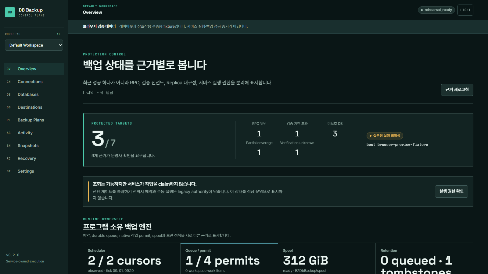
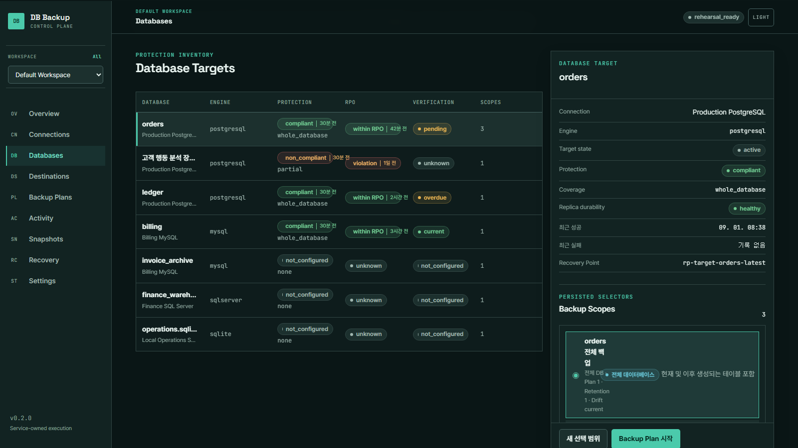
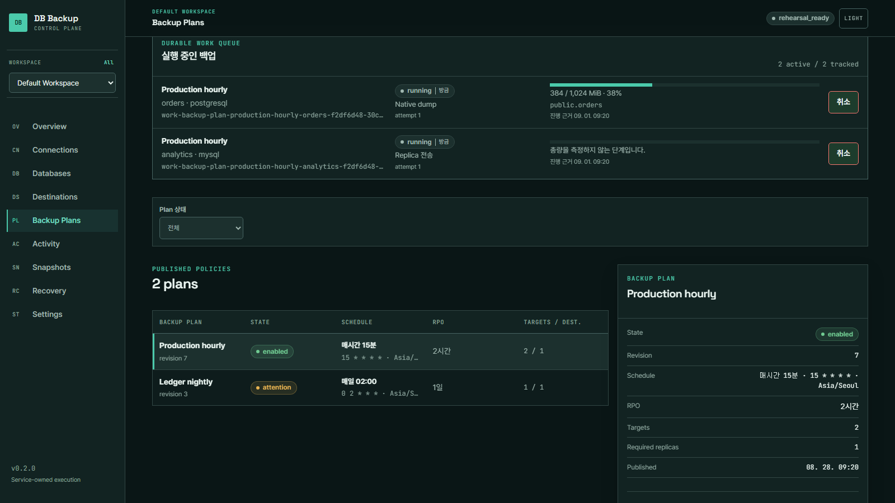

[한국어](README.md) | **English** | [日本語](README.ja.md)

# DbBackup

**A Rust-based desktop tool for operating backup, verification, recovery, and retention for multiple databases in one place on Windows.**

DbBackup schedules logical backups for PostgreSQL, MySQL, MariaDB, and SQLite, then compresses, encrypts, signs, and stores either an entire database or an explicitly selected set of tables. It prioritizes evidence that a backup can actually be decrypted and restored over merely confirming that a backup file exists.

> **Current status: Windows release candidate (`v0.1.0-rc.1`)**
>
> The core features and repository-level automated verification are in place, but no publicly available, production-signed installer exists yet. macOS and Linux are not supported. Production promotion remains `parked` until Authenticode signing, exact-artifact qualification on a clean Windows environment, and approval of operational stop metrics are complete.

## Console preview

> These screens are rendered from deterministic Playwright demo fixtures. They demonstrate layout and interaction, not evidence of a successful service execution or backup.



| Selected-table Backup Scope | Durable backup progress |
|---|---|
|  |  |

## Why DbBackup

DbBackup is not a general-purpose file backup utility. It is a control plane for operating database recoverability.

- **Exact Backup Scope** — Preserves immutable evidence of either an entire database or an explicitly selected table set.
- **Execution engine independent of the UI** — The Windows service continues to manage schedules, the durable queue, retries, and cancellation after the Console is closed.
- **Manifest-last commit** — Publishes payloads first, then records a signed Set Manifest as the final commit marker.
- **Recovery-oriented verification** — Verifies signatures, decryption, hashes, native restore, and content oracles in stages.
- **Fail-closed status reporting** — Never widens partial, stale, or unknown evidence into success or whole-database protection.
- **Bounded native execution** — Runs only audited vendor tools and dependencies under a Job Object, with deadlines and spool/resource permits.

## Support scope

### Platforms

| Platform | Status | Notes |
|---|---|---|
| Windows | Release candidate | Service, Tauri Console, CLI, and MSI/NSIS release workflow implemented |
| macOS | Not supported | No `launchd`, Keychain, Unix socket, or notarized package yet |
| Linux | Not supported | No `systemd`, Secret Service, Unix socket, or DEB/RPM/AppImage package yet |

### Databases and Scope

| Engine | Whole database | Selected tables | Current evidence |
|---|---:|---:|---|
| PostgreSQL | Supported | Supported | Native dump → encryption → signed Manifest → clean restore oracle passed |
| MySQL | Supported | Supported | Native dump → encryption → signed Manifest → clean restore oracle passed |
| MariaDB | Supported | Supported | Native dump → encryption → signed Manifest → clean restore oracle passed |
| SQLite | Supported | Not applicable | Online backup and create-new/atomic-overwrite recovery passed |
| SQL Server | Experimental | Not supported | Only a BACPAC contract exists; Plan publication is blocked before certification |

L1 verification and create-new recovery are supported for MySQL and MariaDB. L2 verification that depends on a public native parser is currently `limited`; unsupported policies are never silently downgraded to a lower verification level.

### Storage destinations

| Destination | Status | Notes |
|---|---|---|
| Local filesystem | Supported | Writer/reader and encrypted Replica round trip verified |
| S3-compatible storage | Experimental | Implementation and automated tests exist, but there is no approved operational testbed evidence |
| SSH/SFTP | Experimental | Host-key pinning and reader/writer separation implemented; not yet promoted for operations |

The source of truth for public claims and evidence levels is [`release/gates/g0-claims.json`](release/gates/g0-claims.json). `not_run` does not mean success.

## Getting started

### User installation

There is currently no production-signed installer available for direct download from GitHub. Do not install unverified raw binaries with administrator privileges or populate `InstallRoot/tools` with arbitrary files.

Operators evaluating an approved release candidate must follow the out-of-band signer, package manifest, and native-tool audit procedures in these documents:

- [Windows install, repair, and uninstall](docs/runbooks/install.md)
- [Safe update](docs/runbooks/update.md)
- [Staged rollout](docs/rollout-plan-program-owned-backup-engine.md)

### Development build from source

Requirements:

- Windows and MSVC build tools
- Rust 1.97.0 recommended; MSRV 1.91.0
- Node.js 24 and npm
- Docker Desktop when running live database fixtures

```powershell
# Service and CLI
cargo build --release --locked -p dbbackup-service -p dbbackup-cli

# Console
npm ci --prefix apps/console
npm --prefix apps/console run build

# Inspect available commands
.\target\release\dbbackup.exe --help
```

This build is for development and review. If a `DbBackupService` entry already exists, the CLI blocks its legacy direct-backup path to prevent concurrent execution.

## Typical workflow

In an environment with an approved signed installer, use DbBackup in this order:

1. Install the Windows service and Console.
2. Register and probe a PostgreSQL, MySQL, MariaDB, or SQLite connection.
3. Discover databases and save either a whole-database Scope or an exact table Scope.
4. Connect a Local destination and verify reader/writer eligibility.
5. Publish the Scope, destination, schedule, verification policy, and retention policy as a Backup Plan.
6. The in-service scheduler creates durable work for due occurrences even when the Console is closed.
7. Review signed Manifest, Replica, and verification state on the Snapshots screen.
8. Restore into a new database by default and review the content-oracle result.

Backup Scope automation through the CLI requires an idempotency key. Reuse a UUID only when retrying the same request after its response was lost.

> `[unverified]` The example below requires an installed signed candidate and a real Database Target, so it was not executed during this README review.

```powershell
$cli = "$env:ProgramFiles\DbBackup\dbbackup.exe"
$targetId = '<database-target-uuid>'

& $cli service scope discover `
    --database-target-id $targetId `
    --idempotency-key ([guid]::NewGuid())

& $cli service scope objects `
    --database-target-id $targetId `
    --limit 100
```

For the complete CLI contract, see `dbbackup.exe --help` and [`docs/plan/connected-backup-platform-v2/ipc-spec.md`](docs/plan/connected-backup-platform-v2/ipc-spec.md).

## How it works

```mermaid
flowchart LR
    UI["Tauri Console / CLI"] -->|"authenticated local IPC"| SVC["DbBackupService"]
    SVC --> SCH["Scheduler + durable queue"]
    SCH --> SRC["DB-native backup provider"]
    SRC --> PIPE["zstd + ChaCha20-Poly1305 STREAM"]
    PIPE --> DST["Replica payloads"]
    DST --> MAN["Signed Set Manifest"]
    MAN --> CAT["Recovery Point catalog"]
    CAT --> VER["Verify / restore / retention workers"]
```



- Windows Service Control Manager owns only the lifecycle of the singleton process.
- Plans and schedules live in the Operational Store and are evaluated by the scheduler inside the service.
- Work Items are protected by leases and fencing tokens, and a periodic reconciler recovers them after a crash.
- Each backup part is compressed, encrypted, and measured with plaintext and ciphertext BLAKE3 in a single stream.
- A Recovery Point is not promoted to complete without evidence for both a required Replica and a signed Manifest.

See [Program-owned backup engine](docs/plan/program-owned-backup-engine.md) for the detailed design.

## Security model

DbBackup does not assume that encryption alone makes a backup safe.

- Credential protection and ransomware resilience are treated as separate concerns.
- Each backup uses a DEK, zstd, ChaCha20-Poly1305 STREAM, and an Ed25519-signed Manifest.
- The installed service executes only package-certified native tool bundles, never tools discovered through ambient `PATH`.
- Signature, Scope, Replica, tool identity, and target database identity are revalidated before recovery.
- S3/SSH writer credentials are not reused as reader credentials.
- Secrets, recovery codes, the Operational Store, spool data, and personal settings must not be committed to the repository.

This tool alone does not provide complete ransomware protection. Use an immutable offsite Replica under a separate account and run regular restore drills. See [SECURITY.md](SECURITY.md) for vulnerability reporting and threat boundaries.

## Current limitations

- Windows only; there are no macOS or Linux installers.
- No public production-signed installer or clean-machine qualification evidence yet.
- Focused on logical backups; PostgreSQL PITR/WAL archiving is not provided.
- A pre-commit retry restarts the native dump and upload from the beginning.
- S3/SSH, SQL Server, and the Tauri updater have not completed separate promotion.
- Public HTTP API, organization RBAC, remote agents, and a backup content browser are out of scope.
- A general logical-digest comparison between the signed backup-time source and restored target is not yet provided.

If these limitations do not meet your requirements, do not use the current version as the sole backup mechanism for production.

## Verification status

2026-08-30 implementation gate; README commands rechecked 2026-09-01:

- Rust workspace all-target tests, strict Clippy, and rustfmt passed
- Console Vitest 94 tests, production build, and Chromium Playwright 36/36 passed
- Windows installer/package PowerShell contracts 17/17 passed
- PostgreSQL, MySQL, and MariaDB explicit-table dump/decrypt/restore evidence 3/3 passed
- A 256 MiB generated-stream fixture passed within a 96 MiB peak working-set growth limit
- Independent review of installer and native dependency boundaries found 0 HIGH/MEDIUM findings

The reproducible script is [`scripts/test-selective-scopes.ps1`](scripts/test-selective-scopes.ps1). It writes results locally to `artifacts/g2/selective-scopes.json`; `artifacts/` is excluded from Git because it stores build evidence. Automated test results do not replace production deployment approval.

## Development

```powershell
cargo fmt --all -- --check
cargo clippy --workspace --all-targets --locked -- -D warnings
cargo test --workspace --all-targets --locked

npm ci --prefix apps/console
npm test --prefix apps/console
npm --prefix apps/console run build
npm --prefix apps/console run test:e2e
```

Live Docker fixtures create external state and clean it up afterward.

```powershell
# PostgreSQL/MySQL/MariaDB selected-Scope round trip
powershell -NoProfile -File .\scripts\test-selective-scopes.ps1 -Engine all

# MinIO/OpenSSH remote-recovery fixture
# [unverified] Not executed during this README review
powershell -NoProfile -File .\scripts\test-remote-recovery.ps1
```

Do not run `cargo test --workspace -- --ignored` indiscriminately. The ignored inventory includes tests that use the real Task Scheduler, the installed service pipe, Docker, live databases, and remote storage.

<details>
<summary>Workspace layout</summary>

| Area | Main crates or app |
|---|---|
| Domain and application | `dbbackup-core`, `dbbackup-domain`, `dbbackup-application` |
| Operational Store | `dbbackup-catalog` |
| Queue and workers | `dbbackup-runtime`, `dbbackup-service`, `dbbackup-scheduler` |
| Backup pipeline | `dbbackup-pipeline`, `dbbackup-secrets`, `dbbackup-verify` |
| Database providers | `dbbackup-source-pg`, `dbbackup-source-mysql`, `dbbackup-source-sqlite`, `dbbackup-source-sqlserver` |
| Destinations | `dbbackup-dest-s3`, `dbbackup-dest-ssh` |
| User interfaces | `dbbackup-cli`, `dbbackup-ipc-client`, `apps/console` |

</details>

## Documentation

| Purpose | Document |
|---|---|
| Understand the structure | [Workspace manifest](Cargo.toml), [Program-owned engine](docs/plan/program-owned-backup-engine.md) |
| Current support claims | [G0 claims matrix](release/gates/g0-claims.json) |
| Service execution design | [Program-owned engine](docs/plan/program-owned-backup-engine.md) |
| Install and update | [Install](docs/runbooks/install.md), [Update](docs/runbooks/update.md) |
| Operational rollout | [Rollout plan](docs/rollout-plan-program-owned-backup-engine.md) |
| Incident response | [Incident runbook](docs/runbooks/incident.md) |
| Example configuration | [`config/dbbackup.example.toml`](config/dbbackup.example.toml) |
| Security reports | [SECURITY.md](SECURITY.md) |

## Contributing

Observe these boundaries before contributing:

1. Do not commit secrets, personal settings, recovery codes, catalogs, or backup payloads.
2. When support status changes, update the claims matrix and evidence contracts as well as the code.
3. At minimum, pass rustfmt, strict Clippy, workspace tests, and Console tests/build.
4. State the execution scope for tests that modify a real service, Task Scheduler, Docker, or remote storage.

There is no separate `CONTRIBUTING.md` or Code of Conduct yet.

## License

DbBackup is distributed under the [MIT License](LICENSE). Copyright (c) 2026 dannykkh.

---

Last reviewed: 2026-09-01
