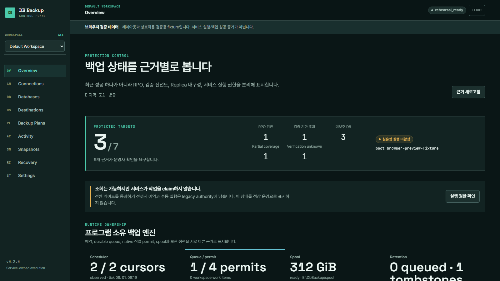
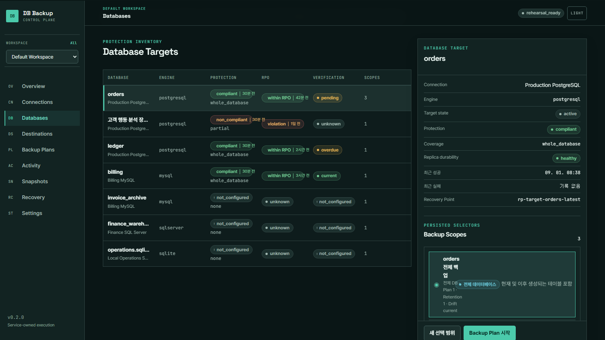
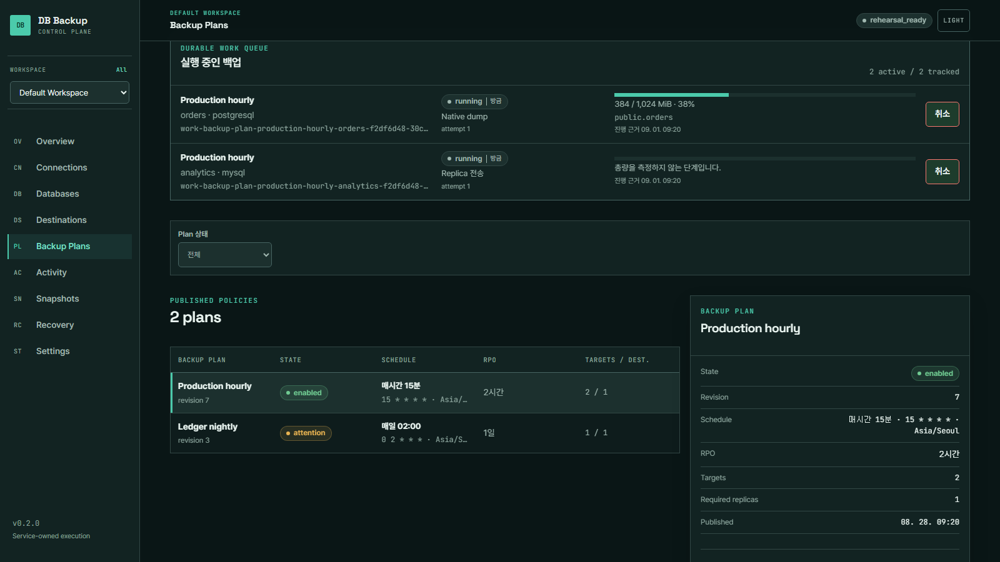

[한국어](README.md) | [English](README.en.md) | **日本語**

# RestorePlane

[](https://github.com/Dannykkh/restoreplane/actions/workflows/ci.yml)
[](https://github.com/Dannykkh/restoreplane/releases)
[](LICENSE)
[](#プラットフォーム)

**Windows上で複数データベースのバックアップ、検証、復元、保持を一元管理するRust製デスクトップツールです。**

RestorePlaneはPostgreSQL、MySQL、MariaDB、SQLiteの論理バックアップをスケジュールし、データベース全体または明示的に選択したテーブルだけを圧縮・暗号化・署名して保存します。バックアップファイルが作成されたという事実だけでなく、実際に復号して復元できるという証拠を重視します。

> **現在のステータス: Windows release candidate (`v0.1.0-rc.1`)**
>
> 主要機能の実装とリポジトリ内の自動検証は整っていますが、一般公開されたproduction署名済みインストーラーはまだありません。macOSとLinuxはサポートしていません。実運用への昇格は、Authenticode署名、クリーンなWindows環境でのexact-artifact検証、運用停止メトリクスの承認が完了するまで`parked`です。

## Consoleプレビュー

> 次の画面は、決定的なPlaywright demo fixtureからレンダリングしたものです。レイアウトと操作を示すものであり、実際のservice実行やバックアップ成功の証拠ではありません。



| 選択テーブルBackup Scope | Durable backupの進行状況 |
|---|---|
|  |  |

## RestorePlaneを選ぶ理由

RestorePlaneは一般的なファイルバックアップツールではなく、データベースの復元可能性を運用するcontrol planeです。

- **正確なBackup Scope** — データベース全体または明示的に選択したテーブル集合を不変の証拠として残します。
- **UIから独立した実行エンジン** — Consoleを閉じても、Windows serviceがスケジュール、durable queue、retry、cancellationを継続して管理します。
- **Manifest-last commit** — payloadを公開した後、署名済みSet Manifestを最後のcommit markerとして記録します。
- **復元中心の検証** — 署名、復号、ハッシュ、native restore、content oracleを段階的に確認します。
- **Fail-closedな状態表示** — partial、stale、unknownな証拠を成功やwhole-database保護として扱いません。
- **制限されたnative実行** — 監査済みvendor toolとdependencyだけをJob Object配下で実行し、deadlineとspool/resource permitを適用します。

## サポート範囲

### プラットフォーム

| プラットフォーム | ステータス | 備考 |
|---|---|---|
| Windows | Release candidate | Service、Tauri Console、CLI、MSI/NSIS release workflowを実装済み |
| macOS | 未対応 | `launchd`、Keychain、Unix socket、notarized packageは未実装 |
| Linux | 未対応 | `systemd`、Secret Service、Unix socket、DEB/RPM/AppImageは未実装 |

### データベースとScope

| エンジン | データベース全体 | 選択テーブル | 現在の証拠 |
|---|---:|---:|---|
| PostgreSQL | 対応 | 対応 | native dump → 暗号化 → signed Manifest → clean restore oracleに合格 |
| MySQL | 対応 | 対応 | native dump → 暗号化 → signed Manifest → clean restore oracleに合格 |
| MariaDB | 対応 | 対応 | native dump → 暗号化 → signed Manifest → clean restore oracleに合格 |
| SQLite | 対応 | 該当なし | online backupとcreate-new/atomic overwrite復元に合格 |
| SQL Server | 実験的 | 未対応 | BACPAC契約のみ存在し、認証前はPlanの公開をブロック |

MySQLとMariaDBではL1検証とcreate-new restoreに対応しています。公開native parserに依存するL2検証は現在`limited`であり、未対応のポリシーを暗黙に下位の検証レベルへ変更することはありません。

### 保存先

| 保存先 | ステータス | 備考 |
|---|---|---|
| Local filesystem | 対応 | writer/readerと暗号化Replicaの往復検証が完了 |
| S3-compatible storage | 実験的 | 実装と自動テストはあるが、承認済みの運用testbed証拠はなし |
| SSH/SFTP | 実験的 | host-key pinningとreader/writer分離を実装済み、運用昇格前 |

公開claimと証拠レベルの正本は[`release/gates/g0-claims.json`](release/gates/g0-claims.json)です。`not_run`は成功を意味しません。

## はじめに

### ユーザー向けインストール

現在、GitHubから直接ダウンロードできるproduction署名済みインストーラーはありません。未検証のraw binaryを管理者権限でインストールしたり、`InstallRoot/tools`を任意のファイルで埋めたりしないでください。

承認済みrelease candidateを評価する運用担当者は、次の文書に記載されたout-of-band signer、package manifest、native-tool auditの手順に従ってください。

- [Windowsのインストール・修復・アンインストール](docs/runbooks/install.md)
- [安全なアップデート](docs/runbooks/update.md)
- [段階的rollout](docs/rollout-plan-program-owned-backup-engine.md)

### ソースからの開発ビルド

要件:

- WindowsとMSVC build tools
- Rust 1.97.0推奨、MSRV 1.91.0
- Node.js 24とnpm
- live database fixtureを実行する場合はDocker Desktop

```powershell
git clone https://github.com/Dannykkh/restoreplane.git
cd restoreplane

# ServiceとCLI
cargo build --release --locked -p restoreplane-service -p restoreplane-cli

# Console
npm ci --prefix apps/console
npm --prefix apps/console run build

# 利用可能なコマンドを確認
.\target\release\restoreplane.exe --help
```

このビルドは開発・レビュー用です。すでに`RestorePlaneService`エントリが存在する場合、二重実行を防ぐためCLIのlegacy direct backup経路はブロックされます。

## 一般的な利用フロー

承認済みの署名済みインストーラーが用意された環境では、次の順序で使用します。

1. Windows serviceとConsoleをインストールします。
2. PostgreSQL、MySQL、MariaDB、またはSQLiteの接続を登録してprobeします。
3. データベースを検出し、データベース全体または正確なテーブルScopeを保存します。
4. Local destinationを接続し、reader/writerの適格性を確認します。
5. Scope、destination、スケジュール、検証・保持ポリシーをBackup Planとして公開します。
6. Consoleを閉じてもservice schedulerがdue occurrenceをdurable workとして作成します。
7. Snapshots画面でsigned Manifest、Replica、verification状態を確認します。
8. 原則として新しいデータベースへ復元し、content oracleの結果を確認します。

CLIによるBackup Scopeの自動化にはidempotency keyが必要です。応答を失った同一リクエストを再試行するときだけ同じUUIDを再利用してください。

> `[unverified]` 次の例には、インストール済みのsigned candidateと実際のDatabase Targetが必要なため、今回のREADMEレビューでは実行していません。

```powershell
$cli = "$env:ProgramFiles\RestorePlane\restoreplane.exe"
$targetId = '<database-target-uuid>'

& $cli service scope discover `
    --database-target-id $targetId `
    --idempotency-key ([guid]::NewGuid())

& $cli service scope objects `
    --database-target-id $targetId `
    --limit 100
```

CLIの完全な契約については、`restoreplane.exe --help`と[`docs/plan/connected-backup-platform-v2/ipc-spec.md`](docs/plan/connected-backup-platform-v2/ipc-spec.md)を参照してください。

## 動作の仕組み

```mermaid
flowchart LR
    UI["Tauri Console / CLI"] -->|"authenticated local IPC"| SVC["RestorePlaneService"]
    SVC --> SCH["Scheduler + durable queue"]
    SCH --> SRC["DB-native backup provider"]
    SRC --> PIPE["zstd + ChaCha20-Poly1305 STREAM"]
    PIPE --> DST["Replica payloads"]
    DST --> MAN["Signed Set Manifest"]
    MAN --> CAT["Recovery Point catalog"]
    CAT --> VER["Verify / restore / retention workers"]
```



- Windows Service Control Managerはsingleton processのlifecycleだけを所有します。
- PlanとscheduleはOperational Storeに保存され、service内のschedulerが評価します。
- Work Itemはleaseとfencing tokenで保護され、crash後はperiodic reconcilerが復旧します。
- 各backup partは1本のストリームで圧縮、暗号化、平文・暗号文のBLAKE3測定を行います。
- required Replicaとsigned Manifestの証拠がなければ、Recovery Pointをcompleteへ昇格しません。

詳細設計は[Program-owned backup engine](docs/plan/program-owned-backup-engine.md)を参照してください。

## セキュリティモデル

RestorePlaneは「暗号化済みだから安全」とは仮定しません。

- 認証情報の保護とランサムウェア耐性を別の問題として扱います。
- バックアップごとのDEK、zstd、ChaCha20-Poly1305 STREAM、Ed25519 signed Manifestを使用します。
- インストール済みserviceはambient `PATH`ではなく、package-certified native tool bundleだけを実行します。
- 復元前にsignature、Scope、Replica、tool identity、対象DB identityを再検証します。
- S3/SSH writerの認証情報をreaderとして再利用しません。
- secret、recovery code、Operational Store、spool、個人設定をリポジトリへcommitしません。

このツールだけでランサムウェア対策が完成するわけではありません。別アカウントのimmutable offsite Replicaと定期的なrestore drillが必要です。脆弱性の報告方法と脅威境界は[SECURITY.md](SECURITY.md)を参照してください。

## 現在の制限事項

- Windows専用で、macOS/Linux向けインストーラーはありません。
- 公開production署名済みinstallerとclean-machine qualification evidenceはまだありません。
- 論理バックアップが中心で、PostgreSQL PITR/WAL archiveは提供しません。
- pre-commit retryではnative dumpとuploadを最初からやり直します。
- S3/SSH、SQL Server、Tauri updaterは個別の昇格前です。
- public HTTP API、organization RBAC、remote agent、backup content browserは現在の対象外です。
- signed backup-time sourceとrestored targetの汎用logical digest比較はまだ提供していません。

これらの制限が要件に合わない場合、現在のバージョンを本番バックアップの唯一の手段として使用しないでください。

## 検証状況

2026-08-30 implementation gate、READMEコマンドは2026-09-01に再確認:

- Rust workspace all-target tests、strict Clippy、rustfmtに合格
- Console Vitest 94 tests、production build、Chromium Playwright 36/36に合格
- Windows installer/package PowerShell contracts 17/17に合格
- PostgreSQL、MySQL、MariaDB explicit-table dump/decrypt/restore evidence 3/3に合格
- 256 MiB generated-stream fixtureが96 MiB peak working-set増加上限内で合格
- installerとnative dependency境界の独立レビューでHIGH/MEDIUM 0件

再現スクリプトは[`scripts/test-selective-scopes.ps1`](scripts/test-selective-scopes.ps1)です。実行結果はローカルの`artifacts/g2/selective-scopes.json`に生成されます。`artifacts/`はbuild evidenceの保存先であるためGitには含めません。自動テストの合格はproduction deployment approvalの代わりにはなりません。

## 開発

```powershell
cargo fmt --all -- --check
cargo clippy --workspace --all-targets --locked -- -D warnings
cargo test --workspace --all-targets --locked

npm ci --prefix apps/console
npm test --prefix apps/console
npm --prefix apps/console run build
npm --prefix apps/console run test:e2e
```

実際のDocker fixtureは外部状態を作成し、終了時に削除します。

```powershell
# PostgreSQL/MySQL/MariaDB 選択Scopeの往復
powershell -NoProfile -File .\scripts\test-selective-scopes.ps1 -Engine all

# MinIO/OpenSSH リモートrecovery fixture
# [unverified] 今回のREADMEレビューでは未実行
powershell -NoProfile -File .\scripts\test-remote-recovery.ps1
```

`cargo test --workspace -- --ignored`を一括実行しないでください。ignored inventoryには、実際のTask Scheduler、インストール済みservice pipe、Docker、live DB、remote storageを使用するテストが含まれます。

<details>
<summary>Workspace構成</summary>

| 領域 | 主要crateまたはアプリ |
|---|---|
| Domainとapplication | `restoreplane-core`、`restoreplane-domain`、`restoreplane-application` |
| Operational Store | `restoreplane-catalog` |
| Queueとworkers | `restoreplane-runtime`、`restoreplane-service`、`restoreplane-scheduler` |
| Backup pipeline | `restoreplane-pipeline`、`restoreplane-secrets`、`restoreplane-verify` |
| Database providers | `restoreplane-source-pg`、`restoreplane-source-mysql`、`restoreplane-source-sqlite`、`restoreplane-source-sqlserver` |
| Destinations | `restoreplane-dest-s3`、`restoreplane-dest-ssh` |
| User interfaces | `restoreplane-cli`、`restoreplane-ipc-client`、`apps/console` |

</details>

## ドキュメント

| 目的 | ドキュメント |
|---|---|
| 構成を把握する | [Workspace manifest](Cargo.toml)、[Program-owned engine](docs/plan/program-owned-backup-engine.md) |
| 現在のサポートclaim | [G0 claims matrix](release/gates/g0-claims.json) |
| Service実行設計 | [Program-owned engine](docs/plan/program-owned-backup-engine.md) |
| インストールとupdate | [Install](docs/runbooks/install.md)、[Update](docs/runbooks/update.md) |
| 運用rollout | [Rollout plan](docs/rollout-plan-program-owned-backup-engine.md) |
| 障害対応 | [Incident runbook](docs/runbooks/incident.md) |
| 設定例 | [`config/restoreplane.example.toml`](config/restoreplane.example.toml) |
| セキュリティ報告 | [SECURITY.md](SECURITY.md) |

## コントリビューション

コントリビューションの前に、次の境界を守ってください。

1. secret、個人設定、recovery code、catalog、backup payloadをcommitしないでください。
2. サポート状況が変わる場合は、コードだけでなくclaims matrixとevidence contractも更新してください。
3. 最低限、rustfmt、strict Clippy、workspace tests、Console tests/buildに合格してください。
4. 実際のservice、Task Scheduler、Docker、remote storageを変更するテストは実行範囲を明記してください。

独立した`CONTRIBUTING.md`とCode of Conductはまだありません。

## ライセンス

RestorePlaneは[MIT License](LICENSE)で配布されます。Copyright (c) 2026 dannykkh.

---

Last reviewed: 2026-09-01
