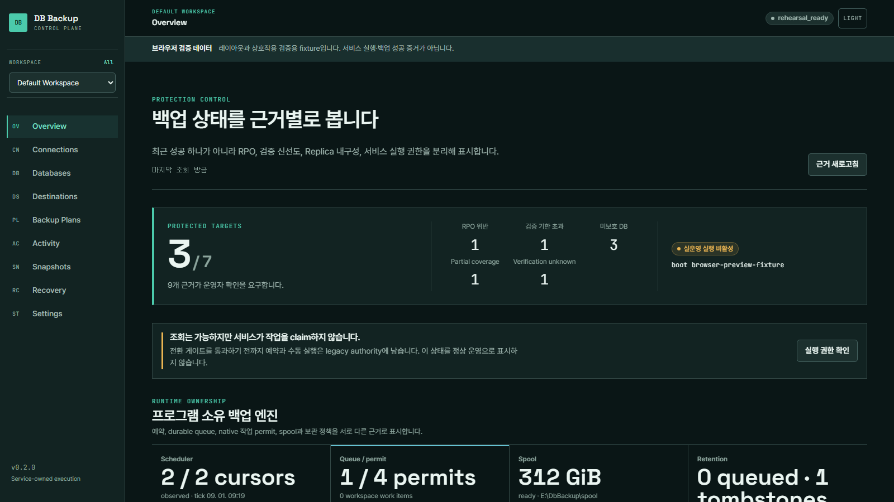
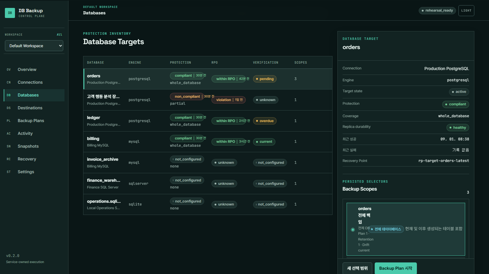
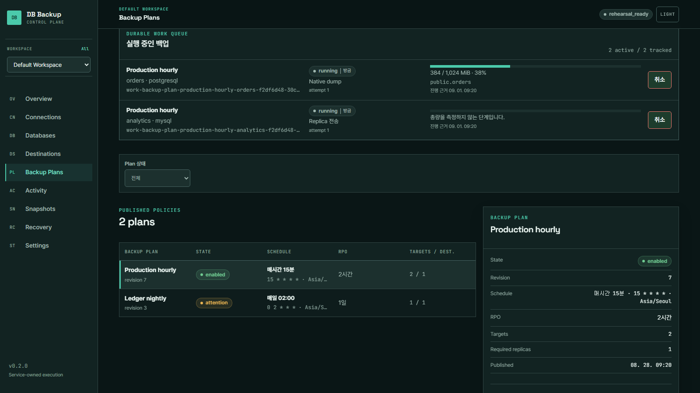

**한국어** | [English](README.en.md) | [日本語](README.ja.md)

# RestorePlane

[](https://github.com/Dannykkh/restoreplane/actions/workflows/ci.yml)
[](https://github.com/Dannykkh/restoreplane/releases)
[](LICENSE)
[](#플랫폼)

**Windows에서 여러 데이터베이스의 백업, 검증, 복원, 보존을 한곳에서 운영하는 Rust 기반 데스크톱 도구입니다.**

RestorePlane은 PostgreSQL, MySQL, MariaDB, SQLite의 논리 백업을 예약하고, 전체 데이터베이스 또는 선택한 테이블만 압축·암호화·서명해 보관합니다. 백업 파일이 만들어졌다는 사실보다 실제로 복호화하고 복원할 수 있는 증거를 중요하게 다룹니다.

> **현재 상태: Windows release candidate (`v0.1.0-rc.1`)**
>
> 핵심 기능 구현과 저장소 내 자동 검증은 갖춰졌지만 공개 production 서명 설치 패키지는 아직 없습니다. macOS와 Linux는 지원하지 않습니다. 실제 배포 승격은 Authenticode 서명, 깨끗한 Windows 환경의 exact-artifact 검증, 운영 중단 지표 승인이 끝날 때까지 `parked`입니다.

## 데이터베이스 작업 확장

현재 개발 소스에는 기존 Tauri/Rust 백업 Console 옆에 사용자 소유 Workbench를 추가하고 있습니다. 탐색·SQL/수동 트랜잭션·검토 편집·파일 이동·백업/복원 연계는 [사용 안내](docs/runbooks/workbench.md), 실제 검증과 미완료 항목은 [구현 장부](docs/plan/database-management-workspace/checklist-status.md)를 참고하세요. 새 기능이 기존 공개 `v0.1.0-rc.1`에 포함됐다는 의미는 아닙니다.

## Console 미리보기

> 아래 이미지는 결정적 Playwright demo fixture로 렌더링한 화면입니다. 레이아웃과 상호작용을 보여주며 실제 service 실행이나 백업 성공 증거를 의미하지 않습니다.



| 선택 테이블 Backup Scope | Durable backup 진행 상태 |
|---|---|
|  |  |

## 왜 RestorePlane인가

일반 파일 백업 도구가 아니라 데이터베이스 복구 가능성을 운영하는 control plane입니다.

- **정확한 Backup Scope** — 데이터베이스 전체 또는 명시적으로 선택한 테이블 집합을 불변 증거로 남깁니다.
- **UI와 분리된 실행 엔진** — Console을 닫아도 Windows service가 일정, durable queue, retry, cancellation을 계속 관리합니다.
- **Manifest-last commit** — payload를 게시한 뒤 서명된 Set Manifest를 마지막 commit marker로 기록합니다.
- **복원 중심 검증** — 서명, 복호화, 해시, native restore, content oracle을 단계별로 확인합니다.
- **Fail-closed 상태 표시** — partial, stale, unknown evidence를 성공이나 whole-database 보호로 확대하지 않습니다.
- **제한된 native 실행** — 감사된 vendor 도구와 dependency만 Job Object 아래에서 실행하고, deadline과 spool/resource permit을 적용합니다.

## 지원 범위

### 플랫폼

| 플랫폼 | 상태 | 비고 |
|---|---|---|
| Windows | Release candidate | Service, Tauri Console, CLI, MSI/NSIS release workflow 구현 |
| macOS | 지원하지 않음 | `launchd`, Keychain, Unix socket, notarized package가 아직 없음 |
| Linux | 지원하지 않음 | `systemd`, Secret Service, Unix socket, DEB/RPM/AppImage가 아직 없음 |

### 데이터베이스와 Scope

| 엔진 | 전체 DB | 선택 테이블 | 현재 증거 |
|---|---:|---:|---|
| PostgreSQL | 지원 | 지원 | native dump → 암호화 → signed Manifest → clean restore oracle 통과 |
| MySQL | 지원 | 지원 | native dump → 암호화 → signed Manifest → clean restore oracle 통과 |
| MariaDB | 지원 | 지원 | native dump → 암호화 → signed Manifest → clean restore oracle 통과 |
| SQLite | 지원 | 해당 없음 | online backup과 create-new/atomic overwrite 복원 통과 |
| SQL Server | 실험적 | 미지원 | BACPAC 계약만 존재하며 인증 전에는 Plan 게시 차단 |

MySQL과 MariaDB의 L1 검증과 create-new restore는 지원합니다. 공개 native parser에 의존하는 L2 검증은 현재 `limited`이며, 지원되지 않는 정책을 더 낮은 검증 단계로 조용히 바꾸지 않습니다.

### 저장 목적지

| 목적지 | 상태 | 비고 |
|---|---|---|
| Local filesystem | 지원 | writer/reader와 암호화 Replica 왕복 검증 완료 |
| S3-compatible storage | 실험적 | 구현과 자동 테스트는 있으나 승인된 운영 testbed 증거 없음 |
| SSH/SFTP | 실험적 | host-key pin과 reader/writer 분리 구현, 운영 승격 전 |

정확한 공개 claim과 증거 수준의 정본은 [`release/gates/g0-claims.json`](release/gates/g0-claims.json)입니다. `not_run`은 성공을 의미하지 않습니다.

## 시작하기

### 사용자 설치

현재 GitHub에서 바로 내려받을 수 있는 production 서명 설치 프로그램은 없습니다. 검증되지 않은 raw binary를 관리자 권한으로 설치하거나 `InstallRoot/tools`를 임의 파일로 채우지 마세요.

승인된 release candidate를 평가하는 운영자는 다음 문서의 out-of-band signer, package manifest, native-tool audit 절차를 따라야 합니다.

- [Windows 설치·수리·제거](docs/runbooks/install.md)
- [안전한 업데이트](docs/runbooks/update.md)
- [단계적 rollout](docs/rollout-plan-program-owned-backup-engine.md)

### 소스에서 개발 빌드

요구사항:

- Windows와 MSVC build tools
- Rust 1.97.0 권장, MSRV 1.91.0
- Node.js 24와 npm
- live database fixture를 실행할 경우 Docker Desktop

```powershell
git clone https://github.com/Dannykkh/restoreplane.git
cd restoreplane

# Service와 CLI
cargo build --release --locked -p restoreplane-service -p restoreplane-cli

# Console
npm ci --prefix apps/console
npm --prefix apps/console run build

# 사용 가능한 명령 확인
.\target\release\restoreplane.exe --help
```

이 빌드는 개발·검토용입니다. 이미 `RestorePlaneService` 항목이 존재하면 CLI의 legacy direct backup 경로는 이중 실행을 막기 위해 차단됩니다.

## 일반적인 사용 흐름

서명 설치 패키지가 준비된 환경에서는 다음 순서로 사용합니다.

1. Windows service와 Console을 설치합니다.
2. PostgreSQL, MySQL, MariaDB 또는 SQLite 연결을 등록하고 probe합니다.
3. 데이터베이스를 검색한 뒤 전체 DB 또는 정확한 테이블 Scope를 저장합니다.
4. Local destination을 연결하고 reader/writer 적격성을 확인합니다.
5. Scope, destination, 일정, 검증·보존 정책을 Backup Plan으로 게시합니다.
6. Console을 닫아도 service scheduler가 due occurrence를 durable work로 생성합니다.
7. Snapshot 화면에서 signed Manifest, Replica, verification 상태를 확인합니다.
8. 복원은 기본적으로 새 데이터베이스에 수행하고 content oracle 결과를 확인합니다.

CLI의 Backup Scope 자동화에는 idempotency key가 필요합니다. 응답을 잃은 동일 요청에만 같은 UUID를 재사용합니다.

> `[unverified]` 아래 예시는 설치된 signed candidate와 실제 Database Target이 필요하므로 이번 README 검토에서는 실행하지 않았습니다.

```powershell
$cli = "$env:ProgramFiles\RestorePlane\restoreplane.exe"
$targetId = '<database-target-uuid>'

& $cli service scope discover `
    --database-target-id $targetId `
    --idempotency-key ([guid]::NewGuid())

& $cli service scope objects `
    --database-target-id $targetId `
    --limit 100
```

전체 CLI 계약은 `restoreplane.exe --help`와 [`docs/plan/connected-backup-platform-v2/ipc-spec.md`](docs/plan/connected-backup-platform-v2/ipc-spec.md)를 참고하세요.

## 동작 방식

```mermaid
flowchart LR
    UI["Tauri Console / CLI"] -->|"authenticated local IPC"| SVC["RestorePlaneService"]
    SVC --> SCH["Scheduler + durable queue"]
    SCH --> SRC["DB-native backup provider"]
    SRC --> PIPE["zstd + ChaCha20-Poly1305 STREAM"]
    PIPE --> DST["Replica payloads"]
    DST --> MAN["Signed Set Manifest"]
    MAN --> CAT["Recovery Point catalog"]
    CAT --> VER["Verify / restore / retention workers"]
```



- Windows Service Control Manager는 singleton process의 lifecycle만 소유합니다.
- Plan과 schedule은 Operational Store에 있고 service 내부 scheduler가 평가합니다.
- Work Item은 lease와 fencing token으로 보호되며 crash 뒤 periodic reconciler가 복구합니다.
- 각 backup part는 한 번의 스트림에서 압축, 암호화, 평문·암호문 BLAKE3 측정을 수행합니다.
- required Replica와 signed Manifest 증거가 없으면 Recovery Point를 complete로 승격하지 않습니다.

자세한 설계는 [Program-owned backup engine](docs/plan/program-owned-backup-engine.md)에 있습니다.

## 보안 모델

RestorePlane은 “암호화했으니 안전하다”는 가정을 하지 않습니다.

- 자격증명 보호와 랜섬웨어 내성을 별도 문제로 취급합니다.
- 백업별 DEK, zstd, ChaCha20-Poly1305 STREAM, Ed25519 signed Manifest를 사용합니다.
- 설치된 service는 ambient `PATH`가 아니라 package-certified native tool bundle만 실행합니다.
- 복원 전에 signature, Scope, Replica, tool identity와 대상 DB identity를 재검증합니다.
- S3/SSH writer 자격증명을 reader로 재사용하지 않습니다.
- secret, recovery code, Operational Store, spool, 개인 설정은 저장소에 커밋하지 않습니다.

이 도구만으로 랜섬웨어 방어가 완성되지는 않습니다. 별도 계정의 immutable offsite Replica와 정기적인 restore drill이 필요합니다. 취약점 제보와 위협 경계는 [SECURITY.md](SECURITY.md)를 확인하세요.

## 현재 제한사항

- Windows 전용이며 macOS/Linux 설치 프로그램은 없습니다.
- 공개 production 서명 installer와 clean-machine qualification evidence가 아직 없습니다.
- 논리 백업 중심이며 PostgreSQL PITR/WAL archive를 제공하지 않습니다.
- pre-commit retry는 native dump와 upload를 처음부터 다시 시작합니다.
- S3/SSH, SQL Server, Tauri updater는 별도 승격 전입니다.
- public HTTP API, organization RBAC, remote agent, backup content browser는 현재 범위가 아닙니다.
- signed backup-time source와 restored target의 범용 logical digest 비교는 아직 제공하지 않습니다.

이 제한이 요구사항과 맞지 않으면 현재 버전을 운영 백업의 유일한 수단으로 사용하지 마세요.

## 검증 상태

2026-08-30 implementation gate, README commands rechecked 2026-09-01:

- Rust workspace all-target tests, strict Clippy, rustfmt 통과
- Console Vitest 94 tests, production build, Chromium Playwright 36/36 통과
- Windows installer/package PowerShell contracts 17/17 통과
- PostgreSQL, MySQL, MariaDB explicit-table dump/decrypt/restore evidence 3/3 통과
- 256 MiB generated-stream fixture가 96 MiB peak working-set 증가 상한 안에서 통과
- installer와 native dependency 경계 독립 검토에서 HIGH/MEDIUM 0

재현 스크립트는 [`scripts/test-selective-scopes.ps1`](scripts/test-selective-scopes.ps1)이며, 실행 결과는 로컬 `artifacts/g2/selective-scopes.json`에 생성됩니다. `artifacts/`는 빌드 증거 보관 경로라 Git에 포함하지 않습니다. 자동 테스트 통과는 production deployment approval을 대신하지 않습니다.

## 개발

```powershell
cargo fmt --all -- --check
cargo clippy --workspace --all-targets --locked -- -D warnings
cargo test --workspace --all-targets --locked

npm ci --prefix apps/console
npm test --prefix apps/console
npm --prefix apps/console run build
npm --prefix apps/console run test:e2e
```

실제 Docker fixture는 외부 상태를 만들었다가 정리합니다.

```powershell
# PostgreSQL/MySQL/MariaDB 선택 Scope 왕복
powershell -NoProfile -File .\scripts\test-selective-scopes.ps1 -Engine all

# MinIO/OpenSSH 원격 recovery fixture
# [unverified] 이번 README 검토에서는 실행하지 않음
powershell -NoProfile -File .\scripts\test-remote-recovery.ps1
```

`cargo test --workspace -- --ignored`를 일괄 실행하지 마세요. ignored inventory에는 실제 Task Scheduler, 설치 service pipe, Docker, live DB와 원격 storage를 사용하는 테스트가 포함됩니다.

<details>
<summary>Workspace 구성</summary>

| 영역 | 주요 crate 또는 앱 |
|---|---|
| Domain과 application | `restoreplane-core`, `restoreplane-domain`, `restoreplane-application` |
| Operational Store | `restoreplane-catalog` |
| Queue와 workers | `restoreplane-runtime`, `restoreplane-service`, `restoreplane-scheduler` |
| Backup pipeline | `restoreplane-pipeline`, `restoreplane-secrets`, `restoreplane-verify` |
| Database providers | `restoreplane-source-pg`, `restoreplane-source-mysql`, `restoreplane-source-sqlite`, `restoreplane-source-sqlserver` |
| Destinations | `restoreplane-dest-s3`, `restoreplane-dest-ssh` |
| User interfaces | `restoreplane-cli`, `restoreplane-ipc-client`, `apps/console` |

</details>

## 문서

| 목적 | 문서 |
|---|---|
| 처음 구조 파악 | [Workspace manifest](Cargo.toml), [Program-owned engine](docs/plan/program-owned-backup-engine.md) |
| 현재 지원 claim | [G0 claims matrix](release/gates/g0-claims.json) |
| 서비스 실행 설계 | [Program-owned engine](docs/plan/program-owned-backup-engine.md) |
| 설치와 update | [Install](docs/runbooks/install.md), [Update](docs/runbooks/update.md) |
| 운영 rollout | [Rollout plan](docs/rollout-plan-program-owned-backup-engine.md) |
| 장애 대응 | [Incident runbook](docs/runbooks/incident.md) |
| 예제 설정 | [`config/restoreplane.example.toml`](config/restoreplane.example.toml) |
| 보안 제보 | [SECURITY.md](SECURITY.md) |

## 기여

기여 전 다음 경계를 지켜주세요.

1. secret, 개인 설정, recovery code, catalog 또는 backup payload를 커밋하지 않습니다.
2. 지원 상태가 달라지면 코드뿐 아니라 claims matrix와 evidence contract도 갱신합니다.
3. 최소한 rustfmt, strict Clippy, workspace tests, Console tests/build를 통과시킵니다.
4. 실제 service, Task Scheduler, Docker 또는 원격 storage를 변경하는 테스트는 실행 범위를 명시합니다.

별도 `CONTRIBUTING.md`와 Code of Conduct는 아직 없습니다.

## 라이선스

RestorePlane은 [MIT License](LICENSE)로 배포됩니다. Copyright (c) 2026 dannykkh.

---

Last reviewed: 2026-09-01
