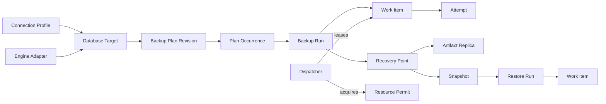

# Domain Dictionary — Connected RestorePlane (v4, 확정)

> 코드(변수/함수/타입), config 키, CLI 명령, UI, 문서는 이 규범 용어를 따른다.
> v1~v3의 보안·아티팩트 용어는 보존하고 Connected Backup Platform v2의 운영 용어를
> 별도 bounded context로 확장한다.

## Security and Artifact Context

| 규범 용어 | 정의 | 동의어/주의 |
|-----------|------|-------------|
| DEK (Data Encryption Key) | 실제 백업 데이터를 암호화하는 랜덤 32B 대칭키 | "데이터 키" |
| KEK (Key Encryption Key) | DEK를 감싸는(wrapping) 키. 마스터 비번 Argon2id 유도 | "키 암호화 키", "마스터 키"와 혼용 금지 |
| Envelope Encryption(봉투암호화) | DEK를 여러 KEK/경로로 wrapping해 저장하는 구조 | |
| Recovery Code(복구 코드) | 비번 분실 시 DEK를 여는 오프라인 고엔트로피 코드 | "recovery key"와 동일 취급 |
| Wrapping(래핑) | 키를 다른 키로 암호화하는 행위 | unwrap=풀기 |
| BackupSource | DB에서 덤프를 생성하는 trait(Postgres/MySQL) | "소스", "원본" |
| Destination(목적지) | 백업본 저장처 trait(S3/SSH/Local) | "대상"과 혼용 금지(대상=DB일 수 있음) |
| Logical Dump(논리 덤프) | pg_dump/mysqldump가 만드는 SQL 논리 백업 | 물리 백업(pg_basebackup) 아님 |
| Object Lock | S3 WORM 불변성. Governance/Compliance 모드 | "불변성", immutability |
| Append-only 자격증명 | Put만 되고 Delete/lifecycle 안 되는 목적지 신원 | write-only |
| Catalog(카탈로그) | 백업 이력/체크섬/검증상태 로컬 SQLite | "백업 이력" |
| Test-restore(복원 검증) | 백업을 임시 인스턴스에 실제 복원해 검증 | "+0", restore-test |
| Pull 토폴로지 | 백업 호스트가 DB에서 당겨오기 | push와 대비 |
| Tunnel(터널) | russh direct-tcpip로 바스티온 경유 DB 접속 | SSH 터널 |
| Job(잡) | 한 DB×목적지(들) 백업 작업 단위 | |
| Retention(보존주기) | 백업 보관 기간/회전 정책 | GFS |
| Manifest(매니페스트) | 덤프 본체와 별도로 목적지에 동봉되는 백업 메타데이터(진실 소스). Catalog는 캐시 | catalog와 구분 필수 |
| Globals 덤프 | pg_dumpall --globals-only 산출물(role/tablespace). DB 덤프와 별개, 짝 기록 | "클러스터 전역" |
| DumpArtifact | BackupSource 출력 형태: Stream(stdout) 또는 Directory(mydumper/-Fd) | |
| Spool-once fan-out(옵션 C) | 1회 덤프→암호화→로컬 스풀→목적지별 독립 업로드 | in-pipe tee(B)와 대비 |
| Commit Protocol | exit0 + finish(inner→outer) + multipart close + 매니페스트 후에만 커밋 | |
| Immutability Capability | Destination 자가보고(None/Governance/Compliance/ServerAppendOnly) | job이 assert |
| Verify Level(검증 레벨) | L1 파일무결성 / L2 포맷유효성 / L3 실제복원. "verified"는 레벨 표기 | "verified(L3)" |
| Origin Authentication | 출처 인증(비대칭 서명). 무결성(대칭 AEAD)과 구분 — DEK 보유자도 위조 가능 | integrity와 구분 |
| Restore-as-Exec | 논리 복원이 코드 실행(RCE)이 되는 성질 → 샌드박스 필수 | |
| Confidentiality-Rotation Deadlock | WORM이 재암호화를 막아 정적 DEK 유출이 영구 비가역이 되는 실패 | → 백업별 DEK |
| Unenforced-Control | 런타임 검증 없는 수동 보안 설정(IAM 템플릿 등). 있는 줄 알지만 없음 | |
| RPO/RTO | RPO=백업주기(최대 데이터 유실), RTO=복원 소요. 논리백업은 RPO=주기 | |

## Control and Operations Context

| 규범 용어 | 정의 | 코드/UI 규칙 |
|-----------|------|--------------|
| Control Plane(제어면) | 연결·대상·계획·정책·상태를 관리하고 실행을 요청하는 제품 표면 | Tauri, CLI, 향후 HTTP API가 공유. dump 직접 실행 금지 |
| Data Plane(실행면) | DB에 접근해 dump, 검증, restore, 전송을 실제 수행하는 영역 | executor와 향후 agent |
| Workspace(작업공간) | 한 운영자가 함께 관리하는 Connection Profile, Database Target, Destination, Backup Plan, Work Item, Activity, Recovery Point의 로컬 소유권 경계 | 코드·IPC는 `workspace_id`/`workspaceId`. Cargo workspace, 폴더, SaaS 조직·테넌트와 혼용 금지 |
| Connection Profile(연결 프로필) | 하나의 DB 서버 또는 SQLite 파일에 접속하기 위한 엔진·주소·인증·TLS·터널 설정 | `connection_profile`; DB 선택과 일정 포함 금지 |
| Database Target(DB 대상) | Connection Profile에서 발견되어 보호 대상으로 선택된 개별 데이터베이스 | `database_target`; 저장 목적지의 “대상”과 구분 |
| Engine Adapter(엔진 어댑터) | 엔진별 probe·discover·preflight·backup·verify·restore·validate 구현 경계 | 기존 `BackupSource`보다 넓은 계약 |
| Capability(기능 역량) | 특정 엔진·버전·도구 또는 목적지가 실제 제공한다고 검증된 기능 | 로고나 enum 존재와 구분 |
| Backup Plan(백업 계획) | DB 대상, 목적지, 일정, 보존, 검증 정책의 versioned 선언 | 기존 과적재된 `Job`의 설정 의미를 대체 |
| Backup Run(백업 실행) | Backup Plan을 특정 시점에 실행한 상태·결과 인스턴스 | `backup_run`; 계획과 혼용 금지 |
| Snapshot(스냅샷) | complete Recovery Point의 UI·검색 projection | partial artifact와 Catalog-only 상태 제외 |
| Restore Run(복원 실행) | 특정 Snapshot을 특정 DB 대상에 복원하는 상태·결과 인스턴스 | `restore_run`; test-restore도 목적을 별도 표시 |
| Dispatcher(디스패처) | persistent queue에서 실행을 lease하고 resource permit을 획득해 executor에 전달하는 단일 조정자 | UI와 Task Scheduler가 우회 실행 금지 |
| Work Item(작업 항목) | queue에 저장되는 실행 요청. Backup Run 또는 Restore Run을 가리킨다 | `work_item`; `thread`나 `task`와 혼용 금지 |
| Lease(실행 임대) | Work Item의 시한부 실행권. owner identity, Attempt, heartbeat, expiry, Fencing Token을 포함 | 시간 만료가 worker 종료를 뜻하지 않음 |
| Resource Permit(자원 허가) | 전역·호스트·CPU·목적지·복원 동시성 한도를 점유하는 토큰 | Rust OS thread와 구분 |
| Activity Event(활동 이벤트) | 상태 전이, 영향, error code, retryability, 관련 객체를 포함하는 append-only 운영 기록 | debug log와 구분. 로컬 관리자에 대한 감사 불변성은 보장하지 않음 |
| Support Contract(지원 계약) | declared·observed·certified capability의 교집합이며 데이터 범위·일관성·restore evidence까지 포함 | 일부 구현만으로 “지원” 표기 금지 |
| Restore Eligibility(복원 적격성) | complete Recovery Point, provenance, 서명·무결성, Consistency Grade, Engine Matrix, target fingerprint, 검증 freshness를 평가한 복원 gate | 최근 backup 성공과 구분 |
| Agent(에이전트) | DB 인접 호스트에서 Data Plane 작업을 수행하는 향후 원격 실행기 | Control Plane 서버나 단순 SSH 터널과 구분 |

## Queue and Runtime Context

| 규범 용어 | 정의 | 코드/UI 규칙 |
|-----------|------|--------------|
| Operational Store(운영 저장소) | Connection, Target, Plan, Work Item, Run, Activity의 권위 소스인 SQLite 영역 | Manifest rebuild 대상 Catalog projection과 구분 |
| Plan Revision(계획 리비전) | Backup Plan 변경 때 생성되는 불변 실행 설정 버전 | queued occurrence는 특정 revision 고정 |
| Plan Occurrence(계획 발생) | 특정 Plan Revision의 `scheduled_for_utc`에서 발생한 한 번의 실행 의도 | `Scheduled Occurrence`는 동의어, 규범 용어는 Plan Occurrence |
| Attempt(실행 시도) | 하나의 Work Item을 worker가 처리한 개별 시도 | occurrence당 여러 Attempt 가능 |
| Lease Heartbeat(임대 하트비트) | worker가 Lease를 유지 중임을 주기적으로 갱신하는 신호 | 진행 증거와는 별도 |
| Fencing Token(펜싱 토큰) | Lease 재발급 때 증가하며 stale Attempt의 상태·commit을 거부하는 세대 | compare-and-set 조건 필수 |
| Process Supervisor(프로세스 감독자) | native tool process tree 시작, pipe drain, timeout, 취소, wait/reap, orphan cleanup을 소유하는 경계 | Windows Job Object 사용 |
| Source Resource Identity(원본 자원 정체성) | tunnel·agent·canonical endpoint를 반영한 source permit용 안정 식별자 | 표시 hostname과 구분 |
| Spool Reservation(스풀 예약) | dump 전에 특정 볼륨의 예상 사용량을 확보하는 Resource Permit | terminal cleanup 후 해제 |
| Reconciliation(재조정) | queue, process identity, fencing, destination object, signed Manifest를 비교해 crash 후 권위 상태를 결정하는 절차 | 단순 retry와 구분 |
| Transaction Owner(트랜잭션 소유자) | Operational Store write transaction을 열고 commit/rollback할 수 있는 단일 service actor | 장기 native process 동안 transaction 유지 금지 |

## Recovery and Compliance Context

| 규범 용어 | 정의 | 코드/UI 규칙 |
|-----------|------|--------------|
| Recovery Point(복구 지점) | 한 Database Target의 동일 Plan Occurrence에 필요한 Artifact Part와 signed set Manifest를 묶은 원자적 복원 단위 | complete 이후에만 Snapshot 노출 |
| Artifact Part(아티팩트 파트) | Recovery Point를 구성하는 DB dump, globals 등 개별 payload | required/optional 명시 |
| Artifact Replica(아티팩트 복제본) | Recovery Point가 특정 Destination에 commit된 사본과 그 불변성·보존·reader 상태 | `Destination Copy`는 동의어 |
| Required Destination(필수 목적지) | Protection Compliance 충족을 위해 성공해야 하는 Plan의 Destination membership | 기본 정책 `all-required` |
| Protection Compliance(보호 준수 상태) | required Replica, RPO, 불변성, 보존, 검증 freshness가 정책을 충족하는지 계산한 상태 | Backup Run 성공과 구분 |
| Protection Status(보호 상태) | Target의 Protection Compliance와 Attention State를 사람이 판단하기 쉽게 요약한 UI 상태 | 근거 없는 “안전함” 금지 |
| Attention State(개입 필요 상태) | 실패, RPO 위반, 검증 기한 초과, drift, stale lease 등 운영자 조치가 필요한 공통 상태 | 내비게이션 배지 기준 |
| Consistency Grade(일관성 등급) | 엔진·토폴로지·옵션이 artifact에 보장하는 시점 일관성과 evidence | 모든 엔진을 같은 “백업”으로 숨기지 않음 |
| Engine Matrix(엔진 매트릭스) | 엔진·서버·native tool·OS·format·capability별 인증 상태와 evidence 만료 표 | Support Contract의 증적 단위 |
| Probe Result(점검 결과) | 연결·TLS·권한·tool 또는 목적지 기능을 관찰한 구조화 결과와 시각 | 정적 capability와 구분 |
| Discovery Drift(탐색 변경) | 재탐색 결과와 기존 Database Target 사이의 추가·누락·변경 차이 | 자동 삭제 금지 |
| Restore Drill(복원 훈련) | 정책에 따라 격리 대상에 수행하는 주기적 L3 복원 검증 | 실제 장애 Restore Run과 목적 구분 |
| Verification Policy(검증 정책) | 요구 Verify Level, 실행 직후 검증, 주기적 Restore Drill 기준 | Backup Plan 구성요소 |
| Preflight(사전 점검) | 실행 직전 엔진·목적지·공간·권한·일관성 조건을 확인하는 단계 | 저장 전 probe와 구분 |
| Support Bundle(지원 번들) | 비밀을 redaction한 설정·로그·버전·상태의 진단 산출물 | secret canary 검증 필수 |
| Orphan Artifact(고아 산출물) | complete Recovery Point에 귀속되지 않은 ciphertext, part Manifest, spool | 기본 Snapshot 목록에서 제외 |
| RPO Violation(RPO 위반) | 마지막 유효 Recovery Point가 정책 RPO를 넘긴 운영 상태 | 이후 성공으로 과거 event 삭제 금지 |

## Relationship Map

## 금지·교체 표현

| 금지 또는 모호한 표현 | 규범 표현 | 이유 |
|----------------------|-----------|------|
| `Job` 하나로 설정과 실행을 모두 지칭 | `Backup Plan`, `Backup Run` | 선언과 실행 상태 분리 |
| DB를 `Destination`이라고 지칭 | `Database Target` | 저장 목적지와 충돌 |
| 동시 실행을 `thread 수`로 표현 | `Work Item concurrency`, `Resource Permit` | 외부 process와 자원 한도가 본질 |
| 백업 파일 한 개를 무조건 `Snapshot`으로 표현 | committed `Snapshot` | commit 전 partial artifact 제외 |
| `Scheduled Occurrence` | `Plan Occurrence` | 계획 revision과 실행 의도 용어 통일 |
| `Destination Copy` | `Artifact Replica` | fan-out과 목적지별 상태 용어 통일 |
| L1만 통과한 상태를 `verified`로 표현 | `verified(L1)` | 검증 수준을 숨기지 않음 |
| enum에 추가된 엔진을 `supported`로 표현 | Support Contract 통과 | 실제 복원 가능성 보장 |

## 변경 이력

| 날짜 | 변경 | 이유 |
|------|------|------|
| 2026-07-26 | v4 확정: Queue/Runtime, Recovery/Compliance Context 병합 | 6개 전문가 리뷰와 충돌 해소 |
| 2026-07-26 | v4-draft: Control and Operations Context 추가 | 연결형 다중 DB 백업 제품으로 도메인 확장 |
| 기존 | v3: Security and Artifact Context 확정 | 기존 보안 백업 코어 |
