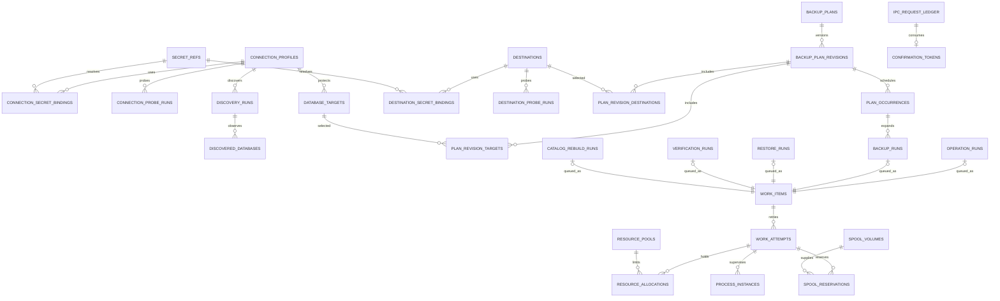
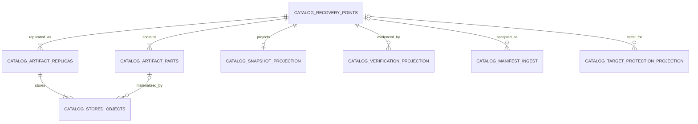

# Connected Backup Platform v2 Database Schema

> 상태: implementation-ready planning schema
> DDL: [`schema-v2.sql`](schema-v2.sql)
> 기준 시각: UTC Unix epoch milliseconds
> 테이블 수: 53

## 1. Target Database

- **DB**: SQLite 3.45+ via `rusqlite = 0.31` with the `bundled` feature
- **운영 모드**: WAL, `foreign_keys=ON`, `synchronous=FULL`, `busy_timeout=5000`
- **쓰기 소유권**: `dbbackup-service`의 단일 Transaction Owner만 read-write connection을 연다.
- **읽기**: UI와 진단 경로는 read-only connection pool을 사용한다.
- **선택 이유**:
  - 현재 제품은 Windows-first 단일 노드이며 별도 DB 서버 운영이 제품 가치보다 큰 부담이다.
  - queue claim, fencing CAS, 짧은 상태 전이를 하나의 로컬 transaction으로 묶을 수 있다.
  - signed Manifest에서 Catalog Projection을 재구성하면서도 Connection, Plan, Run 같은 제어
    상태는 같은 파일에서 원자적으로 백업할 수 있다.
- **비선택 범위**: 이 스키마는 향후 HTTP Control Plane의 분산 queue나 multi-tenant SaaS
  스키마가 아니다. Agent가 추가되어도 중앙 Operational Store는 초기에는 단일 노드다.

## 2. Authority Boundary

하나의 SQLite 파일을 사용하지만 데이터 권위는 논리적으로 두 영역으로 분리한다.

| 영역 | 테이블 | 권위와 복구 방식 |
|------|--------|------------------|
| Operational Control State | IPC ledger/confirmation, `connection_*`, `database_targets`, `destinations`, `backup_plan_*`, `plan_occurrences`, `*_runs`, `work_*`, resource/spool, Activity, Attention, notification, migration/meta | 로컬 권위 데이터. control-store backup에서만 완전 복구 가능 |
| Rebuildable Catalog Projection | `catalog_recovery_points`부터 `catalog_manifest_ingest`까지 8개 테이블 | signed Manifest와 목적지 inventory에서 삭제 후 전량 재구성 가능 |
| External Secret Store | `secret_refs`와 각 binding만 SQLite에 존재 | 실제 credential과 key payload는 Windows DPAPI 기반 Secret Store의 권위 데이터 |
| Artifact Truth | signed set Manifest, part Manifest, ciphertext object | SQLite 밖의 Destination이 권위 데이터 |

중요한 방향 규칙은 다음과 같다.

1. Control State는 `catalog_*` 테이블을 FK로 참조하지 않는다.
2. `restore_runs.recovery_point_id`, `verification_runs.recovery_point_id`,
   `backup_runs.recovery_point_id`는 의도적으로 FK가 아니다.
3. 따라서 Catalog Projection을 비우고 재구성해도 queue, 실행 이력, 복원 이력은 삭제되지 않는다.
4. `catalog_*` 내부 관계만 FK와 `ON DELETE CASCADE`를 사용한다.
5. Catalog 행은 Restore 권한의 단독 근거가 아니다. 복원 직전에 Destination의 signed Manifest를
   다시 읽고 검증한다.

## 3. Core Invariants

| ID | 불변조건 | DB 보장 |
|----|----------|---------|
| INV-01 | secret payload는 Operational Store에 저장하지 않는다. | `secret_refs`는 provider locator와 fingerprint만 보유 |
| INV-02 | Plan Revision은 publish 이후 불변이다. | revision/membership trigger |
| INV-03 | publish된 revision에는 Target과 Destination이 각각 하나 이상 있다. | publish trigger |
| INV-04 | scheduled/catch-up occurrence는 revision과 예정 시각당 하나다. | partial unique index |
| INV-05 | manual occurrence는 client idempotency key당 하나다. | partial unique index |
| INV-06 | occurrence의 Target당 Backup Run은 하나다. | `UNIQUE(plan_occurrence_id, database_target_id)` |
| INV-07 | Work Item은 정확히 하나의 Backup/Restore/Verification/Catalog Rebuild/Operation Run을 가리킨다. | `CHECK`와 partial unique indexes |
| INV-08 | stale Attempt는 heartbeat, 상태 전이, commit을 할 수 없다. | `work_items.fencing_token`을 사용하는 repository CAS |
| INV-09 | 일부 permit만 보유한 상태에서 다음 permit을 기다리지 않는다. | single-writer admission transaction과 application invariant |
| INV-10 | complete Recovery Point는 유효한 서명과 모든 required part를 가진다. | `catalog_recovery_points` `CHECK`와 commit transaction |
| INV-11 | Stored Object의 Replica와 Part는 같은 Recovery Point에 속한다. | composite FK |
| INV-12 | Catalog Projection 삭제가 Operational Control State를 cascade하지 않는다. | FK 방향과 의도적 비-FK ID |
| INV-13 | Activity payload는 유효한 JSON이고 redaction version을 가진다. | `CHECK(json_valid(...))`, `redaction_version` |
| INV-14 | 모든 시각 비교는 UTC epoch millisecond 정수로 수행한다. | `INTEGER`와 non-negative `CHECK` |
| INV-15 | mutating IPC replay는 같은 SID·command·idempotency key에서 결과를 재사용하거나 충돌로 거부한다. | `ipc_request_ledger` unique key와 payload digest |
| INV-16 | destructive confirmation은 SID·action·resource fingerprint·payload·expiry에 묶이고 한 번만 소비된다. | raw token이 아닌 digest, 상태 `CHECK`, consuming request FK |
| INV-17 | Plan Occurrence는 Target별 결과를 집계해 succeeded/partially_succeeded/failed를 구분한다. | occurrence state enum과 application aggregate transaction |
| INV-18 | Snapshot은 completeness, durability, Protection Compliance, restore eligibility를 분리한다. | 별도 projection 컬럼과 enum `CHECK` |

INV-08과 resource pool 총량은 행 하나의 정적 제약만으로 표현할 수 없다. 반드시 아래처럼
짧은 `BEGIN IMMEDIATE` transaction에서 compare-and-set으로 갱신한다.

## 4. ERD

### 4.1 Control State



### 4.2 Rebuildable Catalog Projection



## 5. Table Catalog

### 5.1 Schema Lifecycle and Recovery

| 테이블 | 관계와 역할 | 삭제 정책 |
|--------|--------------|-----------|
| `schema_migrations` | version, checksum, app version별 적용 journal | 삭제 금지 |
| `app_meta` | instance ID, cutover state, minimum reader version 같은 소형 key/value | allowlist key만 update |
| `control_store_backups` | online backup, integrity check, restore rehearsal 결과 | 운영 보존 정책 후 archive |
| `config_import_runs` | legacy TOML/v2 export의 dry-run, shadow, cutover 증거 | 삭제 금지, 오래된 성공은 archive 가능 |
| `ipc_request_ledger` | mutating/destructive local IPC의 재전송·payload 충돌·결과 재사용 ledger | expiry 뒤 batch archive, 보존 기간 중 hard delete 금지 |
| `confirmation_tokens` | raw token 없이 destructive action binding과 단회 소비 상태 저장 | consumed/expired/revoked 뒤 감사 보존 기간을 거쳐 archive |

### 5.2 Secrets, Tools, and Certifications

| 테이블 | 관계와 역할 | 삭제 정책 |
|--------|--------------|-----------|
| `secret_refs` | 외부 Secret Store locator, version, rotation chain | revoke/retire만 허용, hard delete 금지 |
| `native_tool_inventory` | 경로, 버전, hash, Authenticode 상태, 공급 출처 | soft delete |
| `engine_certifications` | engine/server/tool/OS/format 조합의 인증 증거 | 상태를 expired/suspended로 변경 |
| `engine_certification_capabilities` | certification별 probe~restore drill 결과 | parent 삭제 시 cascade, 인증 이력은 일반 삭제 금지 |

### 5.3 Connections and Discovery

| 테이블 | 관계와 역할 | 삭제 정책 |
|--------|--------------|-----------|
| `connection_profiles` | DB 서버 또는 SQLite 파일 연결 설정 | soft delete, Target 존재 시 사용 중지 우선 |
| `connection_secret_bindings` | DB auth, TLS, tunnel secret role 연결 | profile draft 삭제 시 cascade |
| `connection_probe_runs` | 네트워크, TLS, 인증, 권한, tool/certification 관찰 | 시간 기반 archive |
| `discovery_runs` | 재탐색 실행과 drift count | 시간 기반 archive |
| `discovered_databases` | 특정 discovery 시점의 관찰 row | discovery archive 시 cascade |
| `database_targets` | 보호 대상으로 선택된 안정 DB identity | retire, historical Plan/Run 때문에 hard delete 금지 |

Discovery 결과는 현재 상태 테이블이 아니라 시점별 관찰이다. 최신 성공 `discovery_runs`와
그 자식 row를 기존 `database_targets`와 비교해 drift를 계산한다.

### 5.4 Destinations

| 테이블 | 관계와 역할 | 삭제 정책 |
|--------|--------------|-----------|
| `destinations` | Local/S3/SSH 등 저장소 endpoint와 capability | soft delete |
| `destination_secret_bindings` | writer, reader, delete, host auth를 분리 | destination draft 삭제 시 cascade |
| `destination_probe_runs` | credential role별 write/read/delete/list/Object Lock 증거 | 시간 기반 archive |

### 5.5 Plans and Occurrences

| 테이블 | 관계와 역할 | 삭제 정책 |
|--------|--------------|-----------|
| `backup_plans` | 사람이 관리하는 계획 identity와 현재 revision pointer | retire/soft delete |
| `backup_plan_revisions` | schedule, RPO, retention, verification, execution policy의 불변 버전 | draft만 삭제 가능 |
| `plan_revision_targets` | revision과 Target M:N | draft revision에서만 변경 |
| `plan_revision_destinations` | revision과 Destination M:N, required/best-effort 역할 | draft revision에서만 변경 |
| `plan_occurrences` | scheduled/catch-up/manual 실행 의도와 idempotency ledger | 삭제 금지, 장기 archive |

정책 JSON은 무제한 EAV가 아니다. 엔진·목적지별로 진화하는 작은 versioned document이며
공통 query 대상인 schedule, timezone, RPO, requirement는 정규 컬럼으로 유지한다.

### 5.6 Runs and Durable Runtime

| 테이블 | 관계와 역할 | 삭제 정책 |
|--------|--------------|-----------|
| `catalog_rebuild_runs` | 목적지 Manifest scan의 제어 실행 | archive |
| `operation_runs` | probe, discovery, repair, retention, tool, notification, migration, control/support 작업의 공통 실행 envelope | 삭제 금지, Work Item과 함께 archive |
| `backup_runs` | occurrence × Target의 실행 결과 | 삭제 금지, 장기 archive |
| `restore_runs` | Snapshot에서 특정 target으로 수행한 고위험 복원 | 삭제 금지 |
| `verification_runs` | L1/L2/L3 실행과 evidence | 삭제 금지, 큰 evidence는 외부 locator 사용 |
| `work_items` | 모든 장기 operation의 durable queue 권위 row, 현재 fence와 lease 보유 | terminal archive 전까지 삭제 금지 |
| `work_attempts` | claim별 worker, boot, lease, retry 결과 | 삭제 금지, Work Item과 함께 archive |
| `resource_pools` | global/source/CPU/destination/restore/database-exclusive capacity | 참조 중 삭제 금지 |
| `resource_allocations` | Attempt가 실제 획득한 permit | release 후 history 유지 |
| `spool_volumes` | volume별 hard/soft limit과 상태 | 참조 중 삭제 금지 |
| `spool_reservations` | dump 전 byte reservation과 cleanup 상태 | release 후 history 유지 |
| `process_instances` | PID+start time+boot ID+Job Object로 orphan 판별 | 삭제 금지, Attempt와 함께 archive |

### 5.7 Activity and Attention

| 테이블 | 관계와 역할 | 삭제 정책 |
|--------|--------------|-----------|
| `activity_events` | append-only 운영 이벤트, 정렬용 monotonic `seq` 포함 | 정책에 따른 batch prune/archive |
| `attention_states` | 동일 fingerprint의 open/acknowledged/resolved incident | resolved 후 archive |
| `attention_event_links` | Attention과 원인/반복 Activity M:N | Attention archive 시 cascade |

`Activity Event`는 tamper-proof 감사 로그가 아니다. 로컬 관리자가 파일을 수정할 수 있다는
trust boundary를 유지하면서 운영 진단용 append-only repository contract를 제공한다.

### 5.8 Notifications

| 테이블 | 관계와 역할 | 삭제 정책 |
|--------|--------------|-----------|
| `notification_channels` | email/webhook 계열 endpoint 설정 | soft delete |
| `notification_channel_secret_bindings` | auth/signing secret role | draft channel 삭제 시 cascade |
| `notification_rules` | event filter, severity, cooldown | Plan 참조 중 삭제 금지 |
| `plan_notification_rules` | Plan과 rule M:N | Plan hard delete가 가능한 draft에서만 cascade |
| `notification_outbox` | transactionally 생성되고 별도 lease/fence로 claim되는 durable delivery intent | delivered/terminal 보존 후 batch prune |
| `notification_delivery_attempts` | 전송 시도와 retry 증거 | Outbox와 함께 archive |

### 5.9 Rebuildable Catalog Projection

| 테이블 | 관계와 역할 | 삭제 정책 |
|--------|--------------|-----------|
| `catalog_recovery_points` | signed set Manifest에서 투영한 원자 복구 단위 | 전체 rebuild 가능 |
| `catalog_artifact_parts` | DB dump, globals, metadata 등 required/optional part | Recovery Point 삭제 시 cascade |
| `catalog_artifact_replicas` | Destination별 commit, durability, retention, reader 상태 | Recovery Point 삭제 시 cascade |
| `catalog_stored_objects` | payload/part manifest/set manifest/evidence object | Replica/Part 삭제 시 cascade |
| `catalog_snapshot_projection` | completeness, replica durability, Protection Compliance, restore eligibility의 검색 projection | 전체 rebuild 가능 |
| `catalog_target_protection_projection` | Target별 최신 성공/실패, 3축 상태, RPO/verification 요약 | 전체 재계산 가능 |
| `catalog_verification_projection` | Manifest/evidence에서 읽은 검증 이력 | 전체 rebuild 가능 |
| `catalog_manifest_ingest` | manifest별 accepted/rejected 진단 결과 | rebuild run별 prune 가능 |

## 6. SQLite Type and Constraint Rules

### 6.1 Identifier and Time

- 모든 도메인 ID는 application이 생성한 UUID/ULID 문자열 `TEXT`다.
- `activity_events.seq`만 페이지네이션과 단조 증가 정렬을 위해
  `INTEGER PRIMARY KEY AUTOINCREMENT`를 사용한다.
- 시각은 `*_at_ms INTEGER`이며 application이 UTC epoch milliseconds로 제공한다.
- 종료 시각은 시작 시각보다 빠를 수 없도록 `CHECK`한다.
- duration은 `*_ms INTEGER`, byte 크기는 `INTEGER`이며 non-negative `CHECK`를 둔다.

### 6.2 Boolean, Enum, and JSON

- boolean은 `INTEGER CHECK(value IN (0,1))`다.
- SQLite native enum 대신 `TEXT CHECK(value IN (...))`를 사용한다.
- 유연한 adapter/policy/evidence payload만 JSON `TEXT`로 두고 `json_valid()`를 검사한다.
- queue state, engine, requirement, capability처럼 query와 제약 대상인 값은 JSON에 숨기지 않는다.
- 모든 테이블은 `STRICT`를 사용해 SQLite affinity의 암묵 변환을 막는다.

### 6.3 Foreign Keys

- 활성 설정과 실행 이력의 관계는 기본 `ON DELETE RESTRICT`다.
- draft 소유 객체의 순수 child binding은 `ON DELETE CASCADE`다.
- 진단 observation이 삭제된 inventory를 견뎌야 하면 `ON DELETE SET NULL`이다.
- Catalog Projection 내부는 rebuild 단위이므로 `ON DELETE CASCADE`다.
- FK 컬럼은 모두 join/access pattern에 맞춘 index를 갖는다.

## 7. Critical Transaction Recipes

### 7.1 Due Work Claim and Fence Issue

Transaction Owner는 다음을 하나의 짧은 `BEGIN IMMEDIATE`에서 수행한다.

```sql
-- 1. claim 후보를 하나 선택한다.
SELECT id, current_attempt_no, fencing_token
FROM work_items
WHERE state IN ('queued', 'delayed')
  AND available_at_ms <= :now_ms
ORDER BY priority DESC, available_at_ms, created_at_ms
LIMIT 1;

-- 2. 현재 관찰값이 유지된 경우에만 새 fence와 lease를 발급한다.
UPDATE work_items
SET state = 'leased',
    current_attempt_no = current_attempt_no + 1,
    fencing_token = fencing_token + 1,
    lease_owner = :worker_id,
    lease_boot_id = :boot_id,
    heartbeat_at_ms = :now_ms,
    lease_expires_at_ms = :expires_ms,
    updated_at_ms = :now_ms
WHERE id = :work_item_id
  AND state IN ('queued', 'delayed')
  AND current_attempt_no = :observed_attempt_no
  AND fencing_token = :observed_fencing_token;
```

update count가 1일 때만 같은 transaction에서 `work_attempts`를 insert한다. child process를
시작하기 전에 commit하며 native process 실행 중 SQLite transaction을 열어 두지 않는다.

### 7.2 Fenced Heartbeat and State Transition

```sql
UPDATE work_items
SET heartbeat_at_ms = :now_ms,
    lease_expires_at_ms = :expires_ms,
    updated_at_ms = :now_ms
WHERE id = :work_item_id
  AND current_attempt_no = :attempt_no
  AND fencing_token = :fencing_token
  AND lease_owner = :worker_id
  AND state IN ('leased', 'starting', 'running', 'committing', 'cancel_requested');
```

heartbeat, checkpoint, terminal transition, Recovery Point commit 모두 같은 fence predicate를
사용한다. update count 0은 stale Attempt이며 작업을 즉시 중단하고 Reconciliation 대상으로
보낸다.

### 7.3 Resource Admission

1. 필요한 모든 resource key를 canonical 순서로 계산한다.
2. `resource_pools`의 active allocation 합계를 하나의 transaction에서 읽는다.
3. 하나라도 capacity가 부족하면 아무 allocation도 만들지 않고 `wait_reason`만 갱신한다.
4. 모두 가능할 때에만 모든 `resource_allocations`와 `spool_reservations`를 insert한다.
5. allocation expiry는 Attempt lease보다 길 수 없도록 repository가 검사한다.

SQLite `CHECK`는 여러 행의 `SUM(units)`를 안전하게 제한할 수 없으므로 capacity 검사는
Transaction Owner의 단일 admission operation에 집중한다. 다른 write connection을 금지하는
이유다.

### 7.4 Recovery Point Commit

1. required Artifact Part와 Replica object upload 결과를 확인한다.
2. signed set Manifest를 Destination에 publish한다.
3. 현재 fence를 다시 확인한다.
4. 같은 transaction에서 `backup_runs.recovery_point_id`와 terminal state를 갱신하고,
   이미 읽은 signed Manifest를 `catalog_*`에 upsert한다.
5. Manifest publish 뒤 SQLite commit 전에 crash한 경우 Reconciliation이 Destination의
   Manifest와 fence를 비교해 같은 ID로 재투영한다.

Catalog insert 실패는 artifact truth를 없애지 않는다. 성공한 signed Manifest는 다음 rebuild에서
같은 Recovery Point ID로 복원된다.

### 7.5 IPC Idempotency and Confirmation Consumption

mutating/destructive command는 하나의 `BEGIN IMMEDIATE`에서 다음 순서를 지킨다.

1. canonical payload의 BLAKE3 digest와 client SID hash를 계산한다.
2. `ipc_request_ledger`에 `(SID, command, idempotency key)`를 insert한다.
3. unique 충돌에서 payload digest가 같으면 기존 Work Item/결과를 반환하고, 다르면
   `IPC_IDEMPOTENCY_CONFLICT`로 거부한다.
4. destructive command면 raw token digest로 `confirmation_tokens`를 찾고 SID, action,
   resource fingerprint, payload digest, expiry, `state='issued'`를 모두 비교한다.
5. token을 `consumed`로 CAS 갱신하면서 consuming request, Run, Work Item을 같은 transaction에
   만든다.
6. update count가 0이면 만료, replay 또는 binding mismatch로 거부한다.

raw confirmation token과 원문 SID는 저장하지 않는다. service restart 뒤에도 consumed token과
완료된 idempotent 결과는 재사용되지 않는다. consumed/revoked/expired token은 trigger로
terminal immutable 상태가 된다.

### 7.6 Notification Delivery Claim

Outbox delivery는 일반 Work Item과 독립된 짧은 claim loop를 사용하지만 같은 fenced delivery
원칙을 따른다.

1. `state='pending' AND available_at_ms <= now`인 row를 선택한다.
2. 기존 fence 관찰값과 일치할 때만 `delivering`, 새 `fencing_token`, owner, boot ID, lease로
   CAS 갱신한다.
3. network 전송 중 SQLite transaction을 열지 않는다.
4. 성공·실패·heartbeat는 현재 fence와 owner가 같은 경우에만 기록한다.
5. 만료 lease는 sweep이 새 fence로 reclaim하고 이전 delivery 결과는 deduplication key와
   provider response에 따라 수렴시킨다.

## 8. Access Patterns and Index Strategy

| 화면/operation | 핵심 query | 사용 index |
|----------------|-----------|------------|
| Overview attention | unresolved Attention을 severity/최근순 조회 | `idx_attention_states_open` |
| 최근 실패와 성공 분리 | Activity severity/time, Target protection latest success/failure | `idx_activity_events_error_time`, protection PK |
| Connections 목록 | active engine/state filter | `idx_connection_profiles_engine_state` |
| Connection 상세 | 최근 probe/discovery | `idx_connection_probe_profile_time`, `idx_discovery_runs_profile_time` |
| Discovery 선택 | connection의 normalized DB name | `idx_discovered_databases_profile_name` |
| Plans 목록 | active state, current revision | `idx_backup_plans_state`, PK lookup |
| 일정 tick | revision의 occurrence insert-or-ignore | scheduled/manual partial unique indexes |
| IPC replay/idempotency | SID, command, idempotency key lookup과 expiry prune | `sqlite_autoindex_ipc_request_ledger_*`, `idx_ipc_request_ledger_expiry` |
| Destructive confirmation | SID/action/expiry의 issued token lookup | `idx_confirmation_tokens_subject_expiry` |
| Dispatcher claim | due state, priority, available time | `idx_work_items_claim` |
| Lease sweep | active work의 expiry | `idx_work_items_active_lease`, `idx_work_attempts_active_lease` |
| Permit 진단 | pool별 active allocation | `idx_resource_allocations_active_pool` |
| Spool pressure | volume별 active reservation 합계 | `idx_spool_reservations_active_volume` |
| Activity pagination | `(occurred_at_ms, seq)` cursor | `idx_activity_events_time` |
| 객체별 Activity | entity type/id와 시간 | `idx_activity_events_entity_time` |
| Snapshot 목록 | Target/engine/restore eligibility와 commit time | 세 `idx_catalog_snapshots_*` index |
| Recovery Point 상세 | parts, replicas, objects | 각 child FK index |
| Restore source 선택 | recovery point의 committed/eligible Replica | `idx_catalog_replicas_recovery_state` |
| 검증 freshness | recovery point별 level/시간 | `idx_catalog_verification_recovery_level` |
| Notification delivery | pending + available time, expired delivery lease | `idx_notification_outbox_delivery`, `idx_notification_outbox_active_lease` |

100,000 Activity Event 기준 기본 탐색은 keyset pagination을 사용한다. `OFFSET` 기반 무제한
페이지네이션과 `%term%` 전체 scan은 금지한다. 전문검색 수요가 확인되면 Operational Store
schema와 분리된 rebuildable FTS5 index를 추가한다.

## 9. WAL and Single-writer Operations

### Connection Policy

- write connection: service process 내부 1개, writer actor만 소유
- read connections: `mode=ro`, bounded pool, query timeout 적용
- 모든 connection: `foreign_keys=ON`, `busy_timeout=5000`
- write connection: WAL, `synchronous=FULL`
- transaction 안에서 network, native process, file upload를 기다리지 않는다.
- heartbeat/lease/control transition은 high-priority writer lane을 사용한다.
- Activity는 bounded batch로 낮은 우선순위 lane에서 append한다.

### Checkpoint and Vacuum

- 기본 checkpoint는 `wal_autocheckpoint`에만 맡기지 않고 service idle 또는 WAL size threshold에서
  `PRAGMA wal_checkpoint(PASSIVE)`를 수행한다.
- shutdown/drain과 control backup 전에는 reader 상태를 확인한 뒤 `TRUNCATE` checkpoint를
  시도하되 장시간 reader를 강제 종료하지 않는다.
- Activity/outbox archive는 작은 batch delete 후 `PRAGMA incremental_vacuum`으로 회수한다.
- `VACUUM`은 service maintenance mode에서만 실행한다.

### Control-store Backup

- live write 중 파일 복사나 WAL 파일 생략을 금지한다.
- rusqlite가 노출하는 SQLite online backup API를 사용하거나 명시적 service quiesce를 사용한다.
- backup 완료 뒤 별도 in-memory/file connection에서 `integrity_check`, `foreign_key_check`,
  schema version, 핵심 Plan 관계를 검증한다.
- `control_store_backups`의 성공은 backup 생성과 integrity check가 모두 성공해야 한다.
- restore rehearsal은 production DB를 덮지 않고 별도 경로에서 수행한다.

## 10. Delete and Retention Strategy

| 데이터 종류 | 전략 | 이유 |
|-------------|------|------|
| Connection, Destination, Plan, Tool, Channel | `deleted_at_ms` soft delete 또는 retired/disabled | historical Run과 evidence 보존 |
| Secret Ref | revoke/retire | 과거 revision과 signing/rotation 추적 |
| Published Plan Revision, Occurrence, Run | 일반 삭제 금지 | 재현성과 idempotency ledger |
| Work Item/Attempt/Process/Allocation | terminal 단위 archive | crash Reconciliation과 incident evidence |
| Probe/Discovery observation | 기간별 archive, discovery child cascade | 증가량이 크고 현재 설정의 권위 데이터가 아님 |
| Activity Event | 정책 기반 keyset batch archive/delete | append volume 제어 |
| Attention | resolved 후 archive | open fingerprint uniqueness 유지 |
| Notification Outbox | delivered/terminal 후 보존 기간을 거쳐 archive | delivery 증거 |
| Catalog Projection | 전체 delete/rebuild 가능 | signed Manifest가 권위 |
| 실제 backup object | 이 스키마의 cascade로 삭제 금지 | 별도 retention dry-run→tombstone→delete protocol |

DB 행 삭제가 Destination object 삭제를 암시하지 않는다. 실제 object retention은 Object Lock,
required Replica, verification evidence, tombstone grace period를 확인하는 별도 destructive
Work Item이어야 한다.

## 11. Migration and Cutover

### 11.1 Migration Runner

- `schema_migrations`는 version, name, migration file checksum, app version을 기록한다.
- 각 step은 가능한 한 하나의 transaction이며 재실행 가능한 명확한 precondition을 갖는다.
- checksum이 이미 적용된 version과 다르면 service는 write mode로 시작하지 않는다.
- `PRAGMA user_version`은 빠른 guard지만 `schema_migrations`가 상세 권위 journal이다.
- destructive table rebuild는 `new table → copy/validate → rename → old table archive` 순서다.

### 11.2 v1 to v2 Data Mapping

| v1 source | v2 destination | 규칙 |
|-----------|----------------|------|
| TOML database/server fields | `connection_profiles`, `connection_secret_bindings`, `database_targets` | server connection과 개별 DB를 분리하고 stable ID 발급 |
| TOML job | `backup_plans`, revision, Target/Destination membership | revision 1을 draft로 만들고 validation 뒤 publish |
| Task Scheduler XML | `plan_occurrences`의 향후 schedule seed가 아니라 recovery bundle evidence | old task는 cutover 때 freeze |
| `backups` | `catalog_recovery_points`, `catalog_artifact_parts` | signed Manifest가 검증된 row만 complete로 import |
| `artifacts` | `catalog_artifact_replicas`, `catalog_stored_objects` | 목적지 Manifest/object와 대조 |
| `verifications` | `verification_runs` history와 `catalog_verification_projection` | level/evidence가 실제 존재하는 범위만 승격 |
| `runs` | migration Activity와 필요한 historical `backup_runs` | `job` 문자열만으로 권위 Plan을 추론하지 않음 |
| `meta` | allowlist된 `app_meta` | 알려지지 않은 key는 import report에 남기고 무시 |

서명되지 않았거나 object와 대조하지 못한 v1 backup은 complete Snapshot으로 승격하지 않고
`incomplete` 또는 `quarantined` projection으로 가져온다.

### 11.3 Safe Cutover

1. TOML, keystore, 기존 Catalog, Scheduler XML과 enabled 상태를 recovery bundle로 저장한다.
2. production file과 다른 경로에 v2 schema를 생성한다.
3. `config_import_runs(mode='shadow')`로 import하고 stable ID, relation, secret binding을 검증한다.
4. source와 shadow의 Plan/Target/Destination diff를 운영자에게 제시한다.
5. old Scheduler task를 freeze하고 새 실행이 시작되지 않음을 확인한다.
6. SQLite online backup을 다시 생성하고 shadow import의 최종 delta를 반영한다.
7. durable queue, fencing, Process Supervisor, Reconciliation gate가 통과한 build만
   `cutover_marker`와 minimum reader version을 기록한다.
8. service execute authority를 활성화하고 old direct-run binary를 guard한다.
9. 첫 scheduled/manual occurrence를 dry-run 및 실제 작은 fixture로 검증한다.

### 11.4 Rollback Boundary

- cutover marker 전: shadow DB를 폐기하고 기존 Scheduler 상태를 복원할 수 있다.
- marker 뒤 새 queue/run 데이터 전: rehearsal된 recovery bundle로 원자 복귀할 수 있다.
- 새 queue/run 데이터가 생긴 뒤: 구 binary로 돌아가지 않고 forward fix 또는 v2 control-store
  backup 복원을 사용한다.
- Catalog Projection만 손상된 경우 control DB 전체를 되돌리지 않고 `catalog_*`만 rebuild한다.

## 12. Repository Boundaries

권장 repository는 물리 SQLite 파일이 아니라 권위 경계대로 나눈다.

| Repository | 소유 table |
|------------|------------|
| `ConfigurationRepository` | Connection, Target, Destination, Plan, Secret Ref binding |
| `RuntimeRepository` | Occurrence, Run, Work Item, Attempt, Resource, Spool, Process |
| `ActivityRepository` | Activity, Attention |
| `CertificationRepository` | Tool inventory, Engine Certification |
| `NotificationRepository` | Channel, Rule, Outbox, Delivery Attempt |
| `CatalogProjectionRepository` | 모든 `catalog_*` |
| `MigrationRepository` | migration/meta/import/control backup |

외부 API나 UI가 SQL을 직접 실행하지 않는다. 특히 claim, fence, publish, reconciliation은
`RuntimeRepository`의 원자 operation으로만 노출한다.

## 13. DDL Validation

`schema-v2.sql`을 production DB와 무관한 rusqlite in-memory connection에 실행해 검증했다.

| 검증 | 결과 |
|------|------|
| SQLite bundled DDL 전체 실행 | 통과 |
| 예상 table count | 53 |
| `STRICT`, partial index, trigger syntax | 통과 |
| `PRAGMA integrity_check` | `ok` |
| required destination, token immutability, generic Work Item, overwrite/L3, 3축 Snapshot smoke test | 통과 |
| production DB 변경 | 없음 |

구현 시 이 검증을 `dbbackup-catalog` migration test로 영구 편입하고 다음 fixture를 추가한다.

- published Plan Revision과 membership 수정 거부
- Target/Destination 없는 revision publish 거부
- scheduled/manual occurrence 중복 거부
- Plan Occurrence의 succeeded/partially_succeeded/failed 집계
- Work Item의 다중 subject 거부
- 일반 Operation Run이 Work Item에 단일 subject로 연결되는지 검증
- stale fence update count 0
- resource capacity와 all-or-nothing admission
- 같은 IPC idempotency key의 동일 payload 결과 재사용과 다른 payload 충돌
- confirmation token의 SID/action/resource/payload/expiry binding과 단회 소비
- notification delivery의 stale fence와 만료 lease reclaim
- cross-Recovery-Point Part/Replica object 연결 거부
- complete Recovery Point의 invalid signature/required part 부족 거부
- Snapshot projection의 completeness/durability/compliance/eligibility 독립 조합
- Catalog Projection 전체 삭제 후 signed Manifest rebuild
- live online backup의 `foreign_key_check`와 restore rehearsal

`#tags: sqlite, database-schema, operational-store, persistent-queue, catalog-projection, migration`
