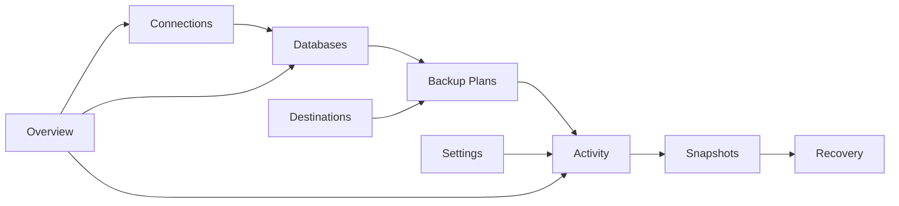

# Connected Backup Platform v2 Operation Scenarios

## 1. 목적과 범위

이 문서는 실제 사용자가 제품을 운영하는 순서를 정의하며 `qa-scenarios.md`의 근거가 된다.
초기 v2는 로컬 Windows desktop과 service를 대상으로 한다. 아래 역할은 제품 내 원격 RBAC
계정이 아니라 local IPC 명령의 권한 수준과 운영 책임을 설명하는 추상 역할이다.

## 2. 역할 정의

| 역할 ID | 역할 | 주요 권한 | 초기 v2 매핑 |
|---|---|---|---|
| R-OWNER | 로컬 소유자/관리자 | 연결·secret·계획·복원·retention·cutover·설정 | 설치 owner/admin Windows SID |
| R-OPERATOR | 백업 운영자 | 조회, run-now, cancel/retry, repair, 비파괴 복원 | 허용된 local SID의 read/operate |
| R-AUDITOR | 감사·지원 담당 | Snapshot, verification evidence, Activity, support bundle 조회 | read-only local principal |
| R-SERVICE | Windows service | queue claim, native process, artifact commit, notification delivery | service identity, UI 로그인 불가 |

원격 Agent와 HTTP/RBAC가 도입되기 전까지 역할 관리 화면을 만들지 않는다. 승인되지 않은
SID는 pipe 연결 단계 또는 명령 authorization 단계에서 거부한다.

## 3. 공통 운영 규칙

- 긴 작업은 UI 요청 안에서 실행하지 않고 Work Item ID를 즉시 반환한다.
- UI는 Work Item 상태를 구독하거나 cursor 기반으로 갱신한다.
- 성공 표시는 complete Recovery Point, Replica 상태, verification evidence를 구분한다.
- queue 대기는 오류가 아니며 어떤 permit 때문에 기다리는지 표시한다.
- secret 원문은 UI, Operational Store, Activity, support bundle에 저장하지 않는다.
- destructive 작업은 action, target identity, SID, expiry가 묶인 confirmation token을 요구한다.
- 지원 DB라는 표시는 Engine Matrix의 backup과 restore fixture가 모두 통과했을 때만 사용한다.

## 4. 메뉴별 시나리오

### OP-M01 Overview

- **접근 역할**: R-OWNER, R-OPERATOR, R-AUDITOR
- **화면 구성**: 보호 상태 요약, Attention 목록, running/queued 상태, DB별 보호 현황,
  service/queue health
- **정상 흐름**:
  1. 사용자가 앱을 연다.
  2. UI가 `service.status`와 요약 projection을 조회한다.
  3. 최근 성공, 최근 실패, RPO 위반, verification overdue를 서로 다른 상태로 본다.
  4. Attention 항목을 선택해 관련 Database, Work Item, Snapshot으로 이동한다.
- **예외 흐름**:
  - service가 중지되면 과거 데이터는 읽기 전용으로 표시하고 “정상”으로 추정하지 않는다.
  - projection이 오래됐으면 마지막 갱신 시각과 stale 상태를 표시한다.
  - 데이터가 없으면 첫 연결 등록 동작을 제시한다.

### OP-M02 Connections

- **접근 역할**: 조회 R-AUDITOR 이상, 생성·수정 R-OWNER
- **화면 구성**: Connection inventory, 필터, inspector, 단계형 등록 workspace, probe 결과
- **정상 흐름**:
  1. R-OWNER가 engine과 서버 주소, 인증 방식을 입력한다.
  2. secret은 Secret Store에 저장되고 Connection에는 Secret Ref만 남는다.
  3. 비파괴 probe가 도구, 네트워크, 인증, 권한, server identity를 검사한다.
  4. 성공 시 database discovery를 실행하고 Target 후보를 보여준다.
  5. 사용자가 보호할 Target을 선택한다.
- **예외 흐름**:
  - 인증 실패 시 secret을 화면에 되돌려 보내지 않고 분류된 원인과 재시도를 표시한다.
  - 같은 server identity를 중복 등록하면 기존 Connection과 병합·별도 등록 선택을 요구한다.
  - discovery가 일부만 성공하면 발견된 Target과 누락 원인을 함께 보존한다.
  - 기존 Target이 사라지거나 이름이 바뀌면 자동 삭제하지 않고 Discovery Drift로 표시한다.

### OP-M03 Databases

- **접근 역할**: R-OWNER, R-OPERATOR, R-AUDITOR
- **화면 구성**: Connection별 Target inventory, protection 상태, RPO, last backup/L3,
  capability, inspector
- **정상 흐름**:
  1. 사용자가 unprotected 필터로 아직 Plan이 없는 Target을 찾는다.
  2. Target inspector에서 engine capability와 최근 probe를 확인한다.
  3. “보호 계획 만들기”로 해당 Target이 미리 선택된 plan wizard를 연다.
- **예외 흐름**:
  - Connection은 살아 있지만 Target 접근 권한이 없으면 별도 권한 오류로 표시한다.
  - capability가 조건부이면 제한과 필요한 tool/version을 표시하고 기본 선택을 막는다.
  - discovery 결과가 stale이면 보호 상태와 섞지 않고 재탐색을 제안한다.

### OP-M04 Destinations

- **접근 역할**: 조회 R-AUDITOR 이상, 생성·secret 변경 R-OWNER
- **화면 구성**: 목적지 inventory, required/best-effort 사용 현황, writer/reader probe,
  공간·immutability·encryption capability
- **정상 흐름**:
  1. R-OWNER가 Local, NAS 또는 지원 destination을 등록한다.
  2. writer probe가 임시 객체를 쓰고 reader probe가 동일 객체를 검증한다.
  3. capability와 최근 probe evidence를 저장한다.
  4. plan에서 required 또는 best-effort 목적지로 선택한다.
- **예외 흐름**:
  - 쓰기는 되지만 읽기 검증이 실패하면 backup destination으로 활성화하지 않는다.
  - 공간 부족과 quota는 probe 결과와 Attention에 표시한다.
  - 사용 중인 목적지 삭제는 차단하고 replacement/migration 경로를 제시한다.

### OP-M05 Backup Plans

- **접근 역할**: 조회 R-AUDITOR 이상, 생성·수정 R-OWNER, run-now R-OPERATOR 이상
- **화면 구성**: Plan inventory, revision inspector, 단계형 wizard, due/RPO/retention/
  verification/preflight 요약
- **정상 흐름**:
  1. 사용자가 하나 이상의 Target을 선택한다.
  2. required와 best-effort Destination을 선택한다.
  3. schedule, timezone/DST 정책, RPO, retention, verification policy를 정한다.
  4. preflight가 engine capability, tool, 공간, 권한, destination을 검사한다.
  5. 활성화하면 불변 Plan Revision이 만들어지고 다음 due를 표시한다.
- **예외 흐름**:
  - required Destination이 하나도 없으면 기본 정책에서 활성화를 거부한다.
  - engine capability가 선택 옵션을 지원하지 않으면 필드 수준 오류를 보여준다.
  - plan 수정은 기존 revision을 덮어쓰지 않고 새 revision을 만든다.
  - run-now 중복 클릭은 같은 manual idempotency key로 Plan Occurrence 하나만 만든다.

### OP-M06 Activity

- **접근 역할**: 조회 R-AUDITOR 이상, cancel/retry R-OPERATOR 이상
- **화면 구성**: cursor/virtualized 목록, 상태·유형 필터, 단계 timeline, 구조화 로그,
  관련 리소스 링크
- **정상 흐름**:
  1. 사용자가 queued Work Item을 선택한다.
  2. 대기 permit, next eligible time, Plan/Target/Destination을 확인한다.
  3. running 상태에서는 process 단계와 heartbeat freshness를 본다.
  4. 실패 시 retryability, safe retry 동작, 관련 support evidence를 확인한다.
- **예외 흐름**:
  - cancel 요청 시 아직 시작 전이면 즉시 취소하고, native process 실행 중이면 supervisor가
    단계적으로 종료한 후 artifact를 격리한다.
  - stale heartbeat는 자동 성공·실패로 단정하지 않고 Reconciliation 상태로 전환한다.
  - notification delivery 실패도 독립 Activity와 Attention으로 표시한다.
  - 100,000건 이상에서도 전체 DOM 렌더링 없이 탐색 가능해야 한다.

### OP-M07 Snapshots

- **접근 역할**: R-OWNER, R-OPERATOR, R-AUDITOR
- **화면 구성**: complete Snapshot inventory, completeness/durability/compliance/
  verification 필터, Part·Replica·Manifest inspector
- **정상 흐름**:
  1. 사용자가 Target과 시점으로 Snapshot을 검색한다.
  2. signed Manifest, Part hash/size, Replica eligibility, L1/L2/L3 evidence를 검사한다.
  3. 적격 Snapshot에서 verify, repair 또는 restore 동작을 선택한다.
- **예외 흐름**:
  - incomplete Recovery Point와 Orphan Artifact는 기본 목록에서 숨기고 진단 필터에서만 본다.
  - complete이나 required Replica가 부족하면 `degraded`로 표시하고 `protected`를 금지한다.
  - catalog projection이 손실됐으면 목적지 Manifest inventory에서 재구축할 수 있다.

### OP-M08 Recovery

- **접근 역할**: 비파괴 restore R-OPERATOR 이상, overwrite R-OWNER
- **화면 구성**: Snapshot 진입 정보, 복원 모드, target mapping, preflight 결과,
  confirmation, Restore Run timeline/evidence
- **정상 흐름**:
  1. Snapshot에서 Recovery workspace를 연다.
  2. 기본값인 새 데이터베이스 또는 별도 파일 대상으로 mapping한다.
  3. preflight가 도구, 공간, 권한, 연결, 버전 호환성을 검사한다.
  4. Restore Work Item을 시작하고 완료 후 engine-specific 검증을 실행한다.
  5. 검증 evidence와 최종 Restore Run을 보존한다.
- **예외 흐름**:
  - 적격 Replica가 없으면 시작을 차단하고 repair를 제시한다.
  - overwrite는 대상 identity 재입력과 만료 confirmation token 없이는 시작하지 않는다.
  - 복원 프로세스 성공 후 검증 실패는 성공으로 표시하지 않는다.
  - 취소·실패 후 생성된 대상은 자동 파괴하지 않고 안전한 정리 지침을 제공한다.

### OP-M09 Settings

- **접근 역할**: 조회 R-AUDITOR 이상, 변경 R-OWNER
- **화면 구성**: concurrency permit, notifications, native tool inventory, Operational Store
  backup/export, service/update, migration 상태
- **정상 흐름**:
  1. R-OWNER가 global/host/CPU/destination/restore permit을 확인한다.
  2. 변경 시 범위와 최솟값·최댓값을 검증하고 새 작업부터 적용한다.
  3. notification channel을 저장하고 test delivery 결과를 확인한다.
  4. control backup을 실행해 SQLite online backup과 Secret Ref metadata bundle을 만든다.
- **예외 흐름**:
  - permit을 0 또는 안전 상한 초과로 지정하면 저장하지 않는다.
  - notification test 실패가 backup 결과를 바꾸지는 않지만 Attention으로 남는다.
  - live SQLite 파일을 단순 복사하지 않고 online backup API 실패를 명확히 보고한다.
  - cutover marker 이후 legacy binary 실행은 설정과 무관하게 거부한다.

## 5. End-to-End 업무 시나리오

### OP-E01 첫 연결에서 첫 보호된 백업까지

- **역할**: R-OWNER
- **선행 조건**: service healthy, 지원 PostgreSQL fixture와 적격 Local Destination
- **흐름**:
  1. Connection을 등록하고 probe한다.
  2. 발견된 여러 Target 중 하나를 선택한다.
  3. required Destination을 등록·검증한다.
  4. schedule/RPO/retention/verification을 가진 Plan을 활성화한다.
  5. run-now를 실행한다.
  6. Activity에서 queue, native process, verify, replica commit을 추적한다.
  7. Snapshots에서 `complete + protected`와 evidence를 확인한다.
- **예외**: probe 실패, capability mismatch, destination reader 실패, dump 실패, verification 실패
- **완료 조건**: complete Recovery Point 하나, required Replica 성공, Protection Compliance 통과

### OP-E02 같은 시각에 여러 DB가 due인 경우

- **역할**: R-OPERATOR
- **선행 조건**: 동일 host의 16개 Target, global=2, host=1
- **흐름**:
  1. scheduler가 각 revision의 Plan Occurrence를 멱등 생성한다.
  2. dispatcher가 permit을 만족하는 작업만 claim한다.
  3. 나머지는 host/global 대기 이유와 next eligible time을 표시한다.
  4. 작업 종료마다 permit을 반환하고 다음 작업을 시작한다.
- **예외**: scheduler 중복 tick, run-now 동시 요청, service restart
- **완료 조건**: host 동시 실행 1 이하, global 2 이하, 중복 Recovery Point 0, 누락 사유 설명 가능

### OP-E03 required 목적지 일부 실패와 Replica repair

- **역할**: R-OPERATOR
- **선행 조건**: required Local과 required NAS, Local 성공, NAS 일시 단절
- **흐름**:
  1. Part와 Manifest를 만들고 Local Replica를 commit한다.
  2. NAS 전송 실패를 기록한다.
  3. Recovery Point는 complete이고 Snapshot은 검색 가능하지만 `degraded`다.
  4. Protection Compliance 실패와 repair Work Item을 표시한다.
  5. NAS 복구 후 적격 Local Replica에서 NAS Replica를 repair한다.
- **완료 조건**: 두 required Replica가 모두 commit되고 상태가 `protected`로 전환

### OP-E04 service crash 이후 자동 Reconciliation

- **역할**: R-SERVICE, 관찰 R-OPERATOR
- **선행 조건**: native dump 또는 upload가 running
- **흐름**:
  1. service를 강제 종료한다.
  2. 재시작 시 만료 lease, process identity, staging, Manifest, destination 객체를 조사한다.
  3. 이전 Attempt를 fence한다.
  4. 이미 commit된 작업은 projection을 복구하고, 안전한 작업은 새 Attempt로 requeue한다.
  5. partial artifact는 격리·repair·cleanup 중 하나로 수렴한다.
- **완료 조건**: stale commit 0, terminal 또는 queued로 설명 가능한 상태, permit 누수 0

### OP-E05 새 데이터베이스로 안전한 복원

- **역할**: R-OPERATOR
- **선행 조건**: complete Snapshot과 적격 Replica
- **흐름**:
  1. Snapshot을 선택하고 새 DB 이름을 입력한다.
  2. preflight를 통과한다.
  3. Restore Work Item이 native restore를 실행한다.
  4. 구조·표본 데이터·engine-specific 검증을 수행한다.
- **완료 조건**: 검증된 Restore Run과 evidence가 원 Snapshot에 연결됨

### OP-E06 기존 데이터베이스 overwrite 복원

- **역할**: R-OWNER
- **선행 조건**: complete Snapshot, overwrite 허용 정책
- **흐름**:
  1. 실제 target identity를 다시 입력한다.
  2. SID, action, target, expiry가 묶인 confirmation token을 발급한다.
  3. restore.start가 같은 identity와 token을 검증한다.
  4. preflight와 복원을 수행하고 감사 Activity를 남긴다.
- **예외**: token 만료, 다른 target, 다른 SID, replay, source와 destination 혼동
- **완료 조건**: 일치한 단일 요청만 실행되고 모든 거부가 안정된 오류 코드로 기록됨

### OP-E07 Discovery Drift 대응

- **역할**: R-OWNER
- **선행 조건**: 보호 중인 Target의 rename/drop 또는 새 Target 생성
- **흐름**:
  1. 주기적 discovery가 이전 source resource identity와 비교한다.
  2. drift를 자동 삭제나 자동 plan 변경 없이 Attention으로 기록한다.
  3. R-OWNER가 새 identity mapping, 보호 해제 또는 새 Plan 생성을 선택한다.
- **완료 조건**: 기존 이력의 Target 참조는 보존되고 승인된 변경만 새 revision에 반영됨

### OP-E08 RPO 위반과 notification 실패

- **역할**: R-OPERATOR
- **선행 조건**: 마지막 compliant Snapshot이 RPO를 초과, notification channel 오류
- **흐름**:
  1. compliance evaluator가 RPO violation Attention을 만든다.
  2. durable outbox가 알림을 전송하고 실패를 재시도한다.
  3. 알림 실패 자체도 별도 Activity/Attention으로 표시한다.
- **완료 조건**: 원 RPO 위반이 알림 실패로 가려지지 않고 두 상태가 독립적으로 해소됨

### OP-E09 legacy TOML에서 안전한 v2 cutover

- **역할**: R-OWNER
- **선행 조건**: recovery bundle, shadow import diff, Durable Core G1 통과
- **흐름**:
  1. TOML과 scheduler 상태를 shadow Operational Store로 import한다.
  2. stable ID, 관계, Secret Ref, 다음 due를 diff한다.
  3. legacy scheduler를 freeze하고 service/queue health를 검사한다.
  4. marker를 원자 기록하고 old path guard를 켠다.
  5. 새 데이터 생성 전 장애면 rehearsal한 bundle로 되돌린다.
  6. 새 데이터 생성 후 장애면 service execution authority를 유지하고 forward-fix한다.
- **완료 조건**: dual-run 0, plan 누락 0, old binary guard 통과

### OP-E10 live Operational Store backup과 복구 연습

- **역할**: R-OWNER
- **선행 조건**: WAL mode에서 service가 읽기·쓰기를 수행 중
- **흐름**:
  1. SQLite online backup API로 일관된 control backup을 만든다.
  2. schema version, checksum, cutover state, Secret Ref metadata를 기록한다.
  3. 격리된 test location에서 복원하고 migration/read 검사를 실행한다.
- **완료 조건**: running 작업을 깨뜨리지 않고 복원 가능한 control backup evidence 생성

### OP-E11 SQL Server BACPAC 후보 검증

- **역할**: R-OWNER
- **선행 조건**: 검증된 `sqlpackage`, 지원되는 fixture
- **흐름**:
  1. Engine Matrix에서 BACPAC capability와 제한을 확인한다.
  2. export, artifact commit, 새 DB import, 데이터 검증을 수행한다.
  3. unsupported object/login/agent/encryption 제한을 evidence에 남긴다.
- **완료 조건**: 통과 fixture 범위에서만 `supported`이며 DACPAC을 데이터 백업으로 표시하지 않음

### OP-E12 SQLite online backup과 overwrite 복원

- **역할**: R-OWNER
- **선행 조건**: WAL과 장기 reader/writer가 있는 SQLite fixture
- **흐름**:
  1. online backup API 또는 검증된 `.backup` 경로로 일관된 artifact를 만든다.
  2. 별도 파일로 복원해 integrity와 데이터 검증을 통과한다.
  3. overwrite는 원본 path identity 확인 후 atomic replace를 수행한다.
- **완료 조건**: WAL/lock 상황에서도 손상 없는 복구, 실패 시 원본 파일 보존

### OP-E13 Retention 삭제

- **역할**: R-OWNER 또는 승인된 R-SERVICE 정책
- **선행 조건**: retention 후보와 최소 복구 지점 정책
- **흐름**:
  1. dry-run이 삭제 후보, 유지 사유, compliance 영향을 계산한다.
  2. pinned/hold/마지막 compliant Recovery Point를 제외한다.
  3. tombstone과 deletion Work Item을 기록한 뒤 Replica를 삭제한다.
  4. 성공한 객체만 catalog projection에 반영하고 실패는 재시도한다.
- **완료 조건**: 복구 가능성 하락이 정책 없이 발생하지 않고 부분 삭제가 감사 가능

### OP-E14 Unauthorized local IPC

- **역할**: 승인되지 않은 local process
- **선행 조건**: service pipe 접근 시도
- **흐름**:
  1. server가 client SID와 process context를 확인한다.
  2. 권한이 없으면 payload 처리 전 또는 command authorization에서 거부한다.
  3. secret이나 존재 여부를 과도하게 노출하지 않는 감사 이벤트를 남긴다.
- **완료 조건**: command 실행과 상태 변경 0, 안정된 `AUTH_` 오류, secret 노출 0

## 6. 화면 이동 흐름

모든 세부 화면은 관련 리소스로 왕복 탐색할 수 있어야 한다. 예를 들어 Work Item에서 Plan,
Target, Snapshot으로 이동하고 뒤로 갔을 때 필터·cursor·선택 상태를 복원한다.

## 7. Research 대비 후속 후보

다음 기능은 경쟁 제품에서 보이지만 초기 v2 핵심 흐름에 포함하지 않는다.

| 후보 | 상태 | 승격 조건 |
|---|---|---|
| Remote Agent | 후속 | 로컬 service 안정화, 인증·upgrade·offline queue 위협 모델 |
| Public HTTP API/RBAC | 후속 | local IPC contract 안정화와 별도 versioning 정책 |
| S3/Object Lock 계열 추가 목적지 | expansion | writer/reader/delete/immutability fixture |
| Redis/Valkey export | experimental | restore runbook과 실제 복원 testbed |
| 백업 내용 브라우징 | 보류 | 엔진별 보안·대용량·민감 데이터 노출 모델 |
