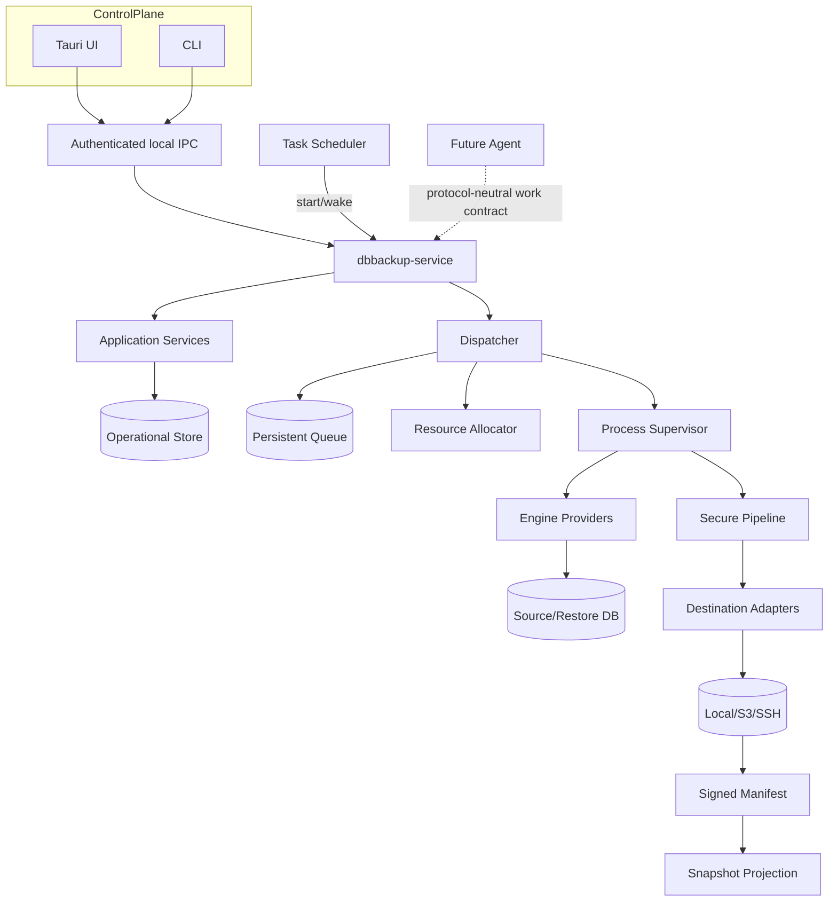

# Connected Backup Platform v2 Implementation Plan

> 전략: Desktop-first Modular Strangler
> 기준: Databasement 수준의 제품 운영 흐름 + 기존 Rust 보안 코어
> 구현 원칙: correctness gate를 통과하기 전 신규 엔진과 외형 중심 UI를 앞당기지 않는다.

## 1. Outcome

최종 제품은 Tauri를 주 제어면으로 유지하되, UI와 독립된 Windows service가 모든 backup,
verification, retention, restore 실행을 소유한다. 사용자는 Connection을 등록하고 발견된 DB를
선택해 Plan을 만들며, Activity와 Snapshot에서 상태를 판단하고 Snapshot에서 Restore를 시작한다.

Databasement의 제품 모델과 정보구조는 적극 흡수하지만 PHP/Laravel 코드는 포크하지 않는다.
기존 Rust 코어의 encryption, signed Manifest, Destination fan-out, Object Lock, remote reader,
Catalog rebuild, verification 모듈은 새 application boundary 뒤에서 재사용한다.

## 2. Target Architecture

## 3. Code Organization

### New crates

| Crate | Responsibility | Must not own |
|-------|----------------|--------------|
| `dbbackup-domain` | IDs, Plan Revision, Plan Occurrence, Run, Work Item, Attempt, capability, state machine DTO | SQLite, Tauri, native process |
| `dbbackup-application` | connection/plan/snapshot/restore use cases와 내부 Rust command/result | raw DB connection, UI types, public remote protocol |
| `dbbackup-runtime` | dispatcher, Resource Permit, Process Supervisor, spool, Reconciliation | React/Tauri, engine-specific UI |
| `dbbackup-service` | Windows service host, singleton, authenticated local IPC, lifecycle/update/drain | domain logic duplication |

### Existing crates

| Crate | v2 role |
|-------|---------|
| `dbbackup-core` | 기존 `BackupSource`, `Destination`, pipeline primitives 유지; provider contracts의 저수준 타입 |
| `dbbackup-config` | legacy TOML schema, versioned import/export, validation, cutover marker |
| `dbbackup-catalog` | 한 SQLite 파일의 Operational Store repository와 rebuildable projection을 논리 분리해 소유 |
| `dbbackup-pipeline` | encode, encryption, spool, Artifact Part/Replica commit |
| `dbbackup-source-pg` | PostgreSQL Connection/Backup/Restore/Tool provider |
| `dbbackup-source-mysql` | MySQL과 MariaDB provider, 별도 Engine Matrix |
| `dbbackup-dest-*` | Destination Adapter와 capability/preflight/reader |
| `dbbackup-verify` | Verification Policy, L1/L2/L3, Restore Drill evidence |
| `dbbackup-scheduler` | service install/wake와 occurrence 계산 보조 |
| `dbbackup-cli` | application command client, 진단 및 migration entrypoint |
| `apps/console` | Tauri Control Plane, direct sidecar 실행 제거 |

`dbbackup-catalog`라는 crate 이름은 호환성을 위해 유지하되 공개 도메인에서는 `Operational
Store`와 `Catalog Projection`을 구분한다. SQLite write connection은 service의 단일
Transaction Owner만 연다.

## 4. Delivery Phases

## Phase 0: Truth, Safety Baseline, and ADR Gate

### Purpose

현재 구현이 실제로 보장하는 것과 UI가 주장하는 것을 일치시킨다. 이 단계에서 신규 엔진
adapter를 만들지 않는다.

### Work

1. 현재 direct execution 경로를 inventory한다.
   - `apps/console/src-tauri/src/run.rs`
   - `crates/dbbackup-cli/src/commands/run.rs`
   - `crates/dbbackup-cli/src/commands/schedule.rs`
   - `crates/dbbackup-scheduler/src/xml.rs`
2. verify cadence, retention/prune, 실제 target restore, connection probe, management stub,
   result persistence의 미배선을 실패 테스트로 고정한다.
3. ignored live test를 CI pass 집계와 분리하고 managed testbed 결과 형식을 정의한다.
4. Dashboard의 최신 성공이 최근 실패를 가리는 query를 회귀 테스트로 재현한다.
5. log redaction, bundled/native tool identity, release Tauri build의 현재 gap을 기록한다.
6. ADR-001~007을 구현 gate로 승인하고 CI에서 필수 문서 존재를 확인한다.
7. v2 변경을 기존 dirty worktree와 섞지 않도록 기준 commit 또는 명확한 patch boundary를 만든다.

### Tests

- `cargo test --workspace`
- frontend build/typecheck
- ignored test inventory가 “미실행”으로 보고되는지 확인
- 현재 false-green scenario가 의도적으로 실패하는지 확인

### Exit Gate G0-A

- production claim과 실제 test evidence가 일치한다.
- direct run 경로, stub, 미배선 policy 목록에 소유자와 후속 phase가 있다.
- 신규 엔진 코드는 아직 시작되지 않았다.

## Phase 1: Domain Model, Operational Store, and Cutover Preparation

### Purpose

Connection과 Target, Plan과 Run을 분리하고 모든 제어 상태의 권위 소스를 만든다.

### Work

1. `dbbackup-domain`을 생성한다.
   - stable typed ID
   - `ConnectionProfile`, `DatabaseTarget`, `DestinationProfile`
   - `BackupPlan`, `PlanRevision`, `PlanOccurrence`
   - `BackupRun`, `RestoreRun`, `VerificationRun`, `OperationRun`, `WorkItem`, `Attempt`
   - `RecoveryPoint`, `ArtifactPart`, `ArtifactReplica`
   - allowed state transition table
2. `dbbackup-catalog`에 versioned migration runner와 schema journal을 추가한다.
3. control tables와 rebuildable projection tables를 분리한다.
4. FK, scheduled/manual unique occurrence, 부분 성공 aggregate, fencing CAS, tombstone,
   revision immutability, required Destination, destructive confirmation 불변성을 DB constraint와
   repository transaction으로 강제한다.
5. `dbbackup-config`에 v1 TOML shadow importer와 v2 export/import를 구현한다.
6. migration recovery bundle을 만든다.
   - TOML
   - keystore
   - 기존 Catalog
   - Task Scheduler XML 및 enabled 상태
7. shadow import, diff, dry-run, scheduler freeze, cutover marker, old-binary guard 기능을
   구현하되 실제 production marker는 Phase 3 G1 cutover까지 기록하지 않는다.
8. Operational Store encrypted export/integrity check/restore command를 제공한다.
9. mutating IPC replay ledger와 raw token을 저장하지 않는 confirmation digest ledger를
   schema에 포함하되 실제 named-pipe command 연결은 Phase 2에서 수행한다.
10. probe, discovery, repair, retention, notification, migration, control/support 작업을
    `OperationRun -> WorkItem`으로 연결해 backup 전용 queue가 되지 않게 한다.

### Key Files

- 신규: `crates/dbbackup-domain/`
- 신규/수정: `crates/dbbackup-catalog/src/migrations/`
- 수정: `crates/dbbackup-config/src/migrate.rs`
- 수정: `crates/dbbackup-config/src/schema.rs`
- 수정: `crates/dbbackup-cli/src/commands/`

### Tests

- v1 TOML→v2 schema golden migration
- stable ID와 Secret Ref 충돌
- migration step별 전원 차단 simulation과 멱등 재개
- rehearsal marker에서 old binary/direct run 거부
- rollback 시 scheduler 상태 복원
- export/import round trip
- 모든 FK/unique/check/state transition

### Exit Gate G0-B

- ConnectionProfile과 DatabaseTarget이 별도 저장된다.
- Plan Revision과 Plan Occurrence가 불변 참조를 가진다.
- Manifest rebuild가 control table을 건드릴 수 없다.
- production 실행권은 아직 기존 경로에 있고, cutover rehearsal과 rollback rehearsal만 통과한다.

## Phase 2: Windows Service Shell and Application Boundary

### Purpose

실행권을 넘기기 전에 service host, application use case, IPC와 Secret Store 경계를 만든다.
이 phase의 service는 production backup/restore를 claim하지 않는다.

### Work

1. `dbbackup-application` use case를 정의한다.
   - connection create/probe/discover
   - target select/drift
   - destination create/probe
   - plan create/revise/pause
   - manual run enqueue
   - snapshot query/rebuild
   - restore prepare/confirm/enqueue
2. `dbbackup-service`를 Windows service singleton shell로 구현한다.
3. ADR-007에 따라 named-pipe DACL, client SID impersonation, command authorization,
   version/size/timeout과 durable replay/idempotency ledger를 구현한다. 같은 key의 다른
   canonical payload는 거부한다.
4. ADR-006에 따라 service-owned Secret Store, owner/service SID ACL, secret create/rotate
   command와 zeroization을 구현한다.
5. Tauri와 CLI의 configuration/read/diagnostic command를 application client로 전환한다.
6. production backup/restore command는 아직 old path를 유지하되 cutover 대상임을 명시하고
   service 쪽 execute command는 feature-disabled 상태로 둔다.
7. minimal diagnostic surface에서 service health, schema version, cutover state, queue 준비
   여부를 확인할 수 있게 한다.
8. update/shutdown shell과 SCM preshutdown contract를 구현하되 Work Item claim은 하지 않는다.

### Key Files

- 신규: `crates/dbbackup-application/`
- 신규: `crates/dbbackup-service/`
- 수정: `apps/console/src-tauri/src/lib.rs`
- 수정: `apps/console/src-tauri/src/run.rs`
- 수정: `crates/dbbackup-cli/src/main.rs`
- 수정: `crates/dbbackup-scheduler/`
- 신규/수정: installer와 Windows service scripts

### Tests

- Tauri 종료 후 service shell이 계속 실행
- 두 service instance 중 하나만 authority 획득
- unauthorized/cross-user/replayed/oversized IPC 거부
- command 등급별 owner/admin SID authorization
- confirmation token의 Snapshot/target/policy binding
- confirmation token의 SID/action/resource/payload/expiry binding, raw token 비저장, 단회 CAS 소비
- service 계정이 필요한 secret/tool만 읽는지 ACL test
- canary secret이 store/log/IPC trace에 남지 않는지 확인

### Exit Gate G0-C

- service shell, IPC, Secret Store, application read/config command가 준비된다.
- production 실행권은 아직 전환하지 않는다.
- service가 durable runtime 없이 backup/restore를 claim할 수 없다.

## Phase 3: Durable Dispatcher, Process Supervisor, and Recovery Point Commit

### Purpose

여러 DB를 Rust가 “많이 실행”하는 것이 아니라 시스템 자원 범위 안에서 안전하게 조정하게
한다.

### Work

1. `dbbackup-runtime`에 persistent dispatcher를 구현한다.
2. claim은 `BEGIN IMMEDIATE`의 짧은 SQLite transaction에서 due, attempt limit, current
   state를 검사하고 writer actor의 high-priority control lane을 사용한다.
3. Attempt마다 Lease, Lease Heartbeat, Fencing Token, worker/service boot identity를 기록한다.
4. Resource Allocator를 구현한다.
   - global job
   - Source Resource Identity
   - CPU encode
   - Destination
   - restore/database exclusive
   - spool volume reservation
5. 일부 permit을 보유한 채 다른 permit을 기다리지 않도록 admission을 설계한다.
6. Process Supervisor를 Windows Job Object로 구현한다.
   - `KILL_ON_JOB_CLOSE`
   - shell을 사용하지 않는 명시적 argv와 최소 환경
   - ACL이 제한된 임시 credential file/pipe와 즉시 삭제
   - bounded async stdout/stderr drain과 Activity batching
   - breakaway 금지 정책과 descendant process enumeration
   - graceful cancel, timeout, hard kill, wait/reap
   - process start time/tool identity 기록
   - SCM stop/preshutdown grace와 forced-kill evidence
7. 단계 checkpoint를 구현한다.
   - preflight
   - dumping
   - encoded
   - replicating
   - verifying
   - committing
8. required Artifact Part와 signed set Manifest로 Recovery Point를 commit한다.
9. Artifact Replica별 retry/repair와 `all-required` Protection Compliance를 구현한다.
10. `committing` crash, lease expiry, orphan process/artifact를 Reconciliation한다.
11. retry에 full jitter, circuit breaker, budget, deadline을 적용한다.
12. occurrence identity를 origin별로 구현한다.
    - scheduled: Plan Revision + scheduled UTC
    - manual: client request idempotency key + requested UTC
    - retry: 동일 occurrence, 새 Attempt
    - catch-up: 원래 scheduled UTC와 catch-up policy 유지
13. occurrence ledger에 timezone, DST, sleep/resume, bounded latest-one catch-up을 구현한다.
14. SQLite 운영 규칙을 적용한다.
    - WAL, `foreign_keys=ON`, `busy_timeout`
    - service-owned write connection 1개와 read-only pool
    - max transaction duration budget과 WAL checkpoint policy
    - Activity bounded batch, retention, incremental vacuum
    - SQLite online backup API로 일관된 Operational Store export
15. 세 상태 축을 별도로 계산한다.
    - Artifact Completeness: required part와 set Manifest가 complete인가
    - Replica Durability: eligible Replica 수와 required destination 상태
    - Protection Compliance: RPO·불변성·보존·검증 freshness까지 충족하는가
16. complete Recovery Point와 적격 Replica가 하나 이상이면 degraded Snapshot으로 검색·복원할
    수 있으나, required destination 미충족 시 `보호됨` 또는 성공 배지를 금지한다.
17. durable runtime의 fault-injection gate를 통과한 뒤에만 실제 cutover를 수행한다.
    - old Scheduler freeze
    - service execute feature enable
    - cutover marker
    - Tauri/CLI/Scheduler direct execution 제거
    - transitional drain mode도 동일 queue/fencing 사용

### Key Files

- 신규: `crates/dbbackup-runtime/src/{queue,dispatcher,lease,permits,supervisor,reconcile}.rs`
- 수정: `crates/dbbackup-pipeline/src/{fanout,manifest,dest}.rs`
- 수정: `crates/dbbackup-cli/src/commands/run.rs`
- 수정: `crates/dbbackup-catalog/src/`
- 수정: `crates/dbbackup-scheduler/src/`

### Initial Limits

| Resource | Default |
|----------|---------|
| global jobs | 2 |
| dumps per Source Resource Identity | 1 |
| CPU encode stages | 1, 최대 2 권장 |
| uploads per Destination | 2 |
| restore | 1 |
| same database backup vs restore | exclusive |

### Failure-injection Tests

- stale Fencing Token의 heartbeat/commit 거부
- SQLite busy와 heartbeat 경쟁
- stderr/Activity 폭주 중 heartbeat 만료 0건
- dispatcher crash at every checkpoint
- ciphertext upload 후 Manifest publish 실패
- signed Manifest publish 후 SQLite projection 전 crash
- dump child와 grandchild hang/kill
- stderr flood와 pipe deadlock
- spool 및 WAL disk full
- required destination 실패/best-effort 성공
- PG globals 성공 후 DB dump 실패
- DST forward/backward, 24시간 sleep, clock rollback
- retry storm와 circuit breaker
- manual request replay와 scheduled/manual occurrence collision

### Exit Gate G1

- occurrence당 complete Recovery Point가 최대 하나다.
- stale Attempt는 어떠한 terminal commit도 할 수 없다.
- cancel/timeout/crash 뒤 orphan process 0건, partial Snapshot 0건이다.
- permit 상한은 2/4/8/16 동시 due load test에서도 깨지지 않는다.
- required destination 실패가 성공 또는 보호됨으로 표시되지 않는다.
- 모든 수동·예약 backup/restore 요청이 service와 durable queue를 거친다.
- UI를 닫아도 예약 실행이 지속되고 old scheduler/direct run은 거부된다.
- Operational Store online backup은 live write 중에도 integrity check와 restore rehearsal을 통과한다.

## Phase 4: Existing Engine Support Contract and Real Recovery

### Purpose

PostgreSQL, MySQL, MariaDB를 “코드가 있다”에서 “실제 복원까지 인증됨”으로 올린다.

### Work

1. 거대 `EngineAdapter` 하나 대신 provider를 분리한다.
   - `ConnectionProvider`
   - `BackupProvider`
   - `RestoreProvider`
   - `ToolProvider`
2. 기존 `BackupSource::plan/spawn`을 `BackupProvider` 뒤에서 재사용한다.
3. 공통 probe/discover/preflight 결과와 declared/observed/certified capability를 구현한다.
4. PostgreSQL:
   - DB discovery/exclusion
   - tool/server matrix
   - globals pairing과 complete Recovery Point
   - 실제 `pg_restore`/plain SQL restore
5. MySQL/MariaDB:
   - 서로 다른 tool matrix
   - engine/charset/routine/event/trigger/definer inventory
   - transactional/non-transactional Consistency Grade
   - 실제 restore와 validation
6. 자동 Verification Policy와 Restore Drill cadence를 dispatcher에 연결한다.
7. retention/prune를 실제 시행하고 Object Lock 충돌을 Protection Compliance에 반영한다.
8. L3는 digest-pinned disposable target, network isolation, CPU/memory/disk limit을 사용한다.
9. smoke query를 넘어서 sentinel data, object inventory, table count, sampled content hash,
   sequence/constraint 검증을 수행한다.
10. Engine Matrix evidence를 release artifact로 저장하고 만료를 관리한다.
11. 엔진별 Restore Safety Policy를 application service에서 강제한다.
    - 새 DB/namespace 기본
    - 최소권한 restore credential
    - server-scope object 기본 차단
    - routine/trigger/definer/extension inventory review
    - target fingerprint 재확인
    - disposable target의 outbound network 차단
12. retention을 독립 destructive subphase로 구현한다.
    - dry-run과 reachability check
    - tombstone→grace period→delete의 2단계
    - delete 전용 credential
    - Object Lock/legal hold/clock skew 처리
    - required Replica와 evidence 조기 삭제 방지
    - 삭제 실패와 orphan cost를 Protection Compliance에 반영
13. notification을 operational event로 구현한다.
    - channel과 routing rule
    - outbox/delivery Attempt
    - retry/backoff와 redaction
    - 전송 실패 Activity와 Attention State
    - test notification
14. 엔진별 fixture matrix를 관리한다.
    - PostgreSQL: globals, large object, extension, collation, sequence, role
    - MySQL/MariaDB: routine, event, trigger, definer, GTID, binary data,
      transactional/non-transactional table
    - 각 행에 dump/restore flag, unsupported object, Consistency Grade, content oracle,
      evidence artifact를 명시

### Tests

- 엔진별 probe/discover 권한 오류 분류
- server/tool version mismatch와 tool hash 변조
- backup→L1→L2→L3→restore→content oracle
- signed Manifest/key rotation/rebuild
- reader-only remote restore
- retention actual delete와 locked object behavior
- unsupported/expired certification의 UI/API 강등
- dangerous restore fixture의 정책 차단
- retention dry-run/tombstone/Object Lock/delete credential
- notification outbox crash와 canary redaction

### Exit Gate G2

- 세 엔진의 관리 testbed 전 행이 통과한다.
- 실제 target restore가 decrypt-only 경로를 대체한다.
- verify/retention/notification은 저장뿐 아니라 실제 시행 상태를 기록한다.
- 엔진별 fixture matrix와 Restore Safety Policy가 release artifact에 포함된다.
- ignored live test는 여전히 pass로 계산되지 않는다.

## Phase 5: Databasement-level Product UI

### Purpose

보안 설정 화면이 아니라 연결형 백업 관리 제품으로 보이게 한다.

### Delivery Order

1. **UI foundation**
   - `DESIGN.md` token 유지
   - accessible form, status badge, capability matrix, inventory table, inspector, activity timeline
   - 100,000 event pagination/virtualization
2. **First-value onboarding**
   - setup 완료→Connection Profile→probe→DB discovery→Target 선택
3. **Destinations and Plans**
   - writer/reader probe
   - 단계형 Target→Destination→schedule/RPO→retention/verification→preflight summary
4. **Activity**
   - persistent state, queue wait reason, cancel/retry, related object navigation
5. **Snapshots**
   - 검색/filter, complete/incomplete, Replica, verification, Protection Compliance
   - destination에서 inventory rebuild
6. **Recovery**
   - Snapshot에서 진입
   - eligibility, registered target, new DB default, overwrite high-risk confirmation
   - Restore Run timeline와 evidence
7. **Overview**
   - 최근 성공과 실패 분리
   - Attention State, RPO, L3 freshness, service/queue health
8. **Settings**
   - concurrency, notifications, tool inventory, control backup/export

### Key Files

- 수정: `apps/console/src/App.tsx`
- 신규/대체: `apps/console/src/screens/{Connections,Databases,BackupPlans,Activity,Snapshots,Recovery}.tsx`
- 수정: `apps/console/src/lib/api.ts`
- 수정/신규: `apps/console/src/components/`
- 수정: `apps/console/src-tauri/src/commands.rs`

기존 `Jobs.tsx`, 수동 ID 기반 `Restore.tsx`, 휘발성 run panel은 새 application flow가
통과한 뒤 제거한다.

### Accessibility and Visual Tests

- 모든 input/select/checkbox의 label/name/description/error
- keyboard-only 5대 journey
- focus trap/return, live region, table header/sort/selection
- dark/light container, text, select option, placeholder, autofill
- 1024/1280/1600px, 200% zoom
- 실제 Pretendard/Space Grotesk/JetBrains Mono face load
- 실패, empty, loading, 100k activity, 긴 DB 이름/오류

### Exit Gate G3

- 연결에서 첫 성공 backup까지 중앙값 5분 이하
- Snapshot ID/connection string 수동 입력 없이 restore 가능
- queued 이유와 active permit을 설명 가능
- 최근 성공이 실패나 RPO 위반을 숨기지 않음
- 핵심 여정 accessibility tree와 browser E2E 통과

## Phase 6: New Engine Wave 1

### SQL Server

1. BACPAC export/import를 데이터 포함 논리 백업 후보로 prototype한다.
2. DACPAC은 schema-only capability로 분리한다.
3. 대용량, unsupported object, login/user/permission, SQL Agent, encrypted object를
   Engine Matrix에 기록한다.
4. `.bak`은 Agent와 server-side permission 모델 전에는 구현하지 않는다.

### SQLite

1. SQLite file Connection Profile과 path ACL을 구현한다.
2. online Backup API 또는 `.backup`을 사용한다.
3. WAL, lock, long transaction, atomic replace를 검증한다.
4. restore target overwrite는 별도 고위험 승인으로 둔다.

### Exit Gate G4

SQL Server와 SQLite는 서로 독립적으로 출시한다. 각 엔진이 Support Contract 전 행과 실제
restore content validation을 통과해야만 지원 matrix에 추가한다.

## Phase 7: Expansion Waves

### Wave 2

- MongoDB와 Firebird provider
- Azure Blob, SMB 또는 rclone Destination Adapter 중 수요 우선순위

### Wave 3

- Redis/Valkey는 restore runbook과 managed testbed 전까지 experimental export
- service-stop/data-directory control이 필요하면 Agent wave와 결합

### Wave 4

- remote Agent identity, approval/revoke, heartbeat, protocol version, signed result
- Agent-local Resource Permit와 central assignment Lease 분리
- DB secret와 평문 artifact는 가능하면 Agent 밖으로 내보내지 않음

### Wave 5

- HTTP Control Plane, 조직, RBAC, SSO, REST API, MCP
- single-node application contract를 재사용
- multi-node/distributed queue는 실제 요구가 확인될 때 별도 ADR

## 5. Cross-cutting Security Gates

- Secret Ref만 Operational Store에 저장하고 secret payload는 Secret Store에 둔다.
- service account, store, spool, key, tool directory ACL을 installer가 검증한다.
- native tool은 origin, license, version, architecture, hash/Authenticode evidence를 가진다.
- support bundle redaction은 canary secret으로 회귀 테스트한다.
- signing key ID와 과거 verifying key trust history를 유지한다.
- Restore Eligibility와 confirmation은 UI가 아니라 application service가 강제한다.
- logical restore의 executable object inventory와 least-privilege credential을 적용한다.
- 향후 Agent는 별도 trust-boundary ADR 전에는 원격 실행 권한을 받지 않는다.

## 6. Rollback Strategy

| 전환 | 롤백 |
|------|------|
| shadow import 전 | 원본 변경 없음, import DB 폐기 후 재실행 |
| scheduler freeze 후 marker 전 | recovery bundle의 scheduler enabled 상태 복원 |
| service 설치 후 marker 전 | service 제거/비활성화 후 기존 scheduler 복원 |
| cutover marker 후 첫 새 데이터 전 | marker와 service를 원자적으로 되돌리고 rehearsal한 bundle 복원 |
| 첫 새 데이터·queue event 후 | old binary 금지 유지, 새 service forward fix 또는 새 export/import |
| secret migration 불일치 | service execute disable, Secret Store recovery bundle 복원, canary 검증 후 재개 |
| Operational Store 손상 | service claim 중지, online backup 복원, integrity check와 Reconciliation |
| service upgrade 실패 | SCM rollback package 또는 이전 service binary가 같은 schema를 지원할 때만 복귀 |
| queue schema migration | schema별 down이 안전한 변경만 rollback, 데이터 생성 후에는 forward fix |
| Tauri 화면 전환 | application service는 유지하고 화면 route만 이전 view로 feature flag 전환 |
| engine 신규 출시 | certification 해제 후 기존 engine matrix에서 숨김, 기존 Snapshot은 읽기 유지 |
| destination adapter | 신규 Plan 선택 차단, 기존 Replica read/repair 경로 유지 |

cutover marker 이후 새 Operational Store 데이터가 생겼다면 구 binary 실행은 롤백 수단이 아니다.
각 행은 recovery command, 예상 service/Scheduler 상태, 검증 query와 책임자를 runbook으로
작성하고 전원 차단 simulation에서 연습한다.

## 7. Verification Pyramid

| Layer | Scope |
|-------|-------|
| Unit | state machine, schedule, capability, redaction, idempotency key |
| Deterministic integration | SQLite claim/CAS/fencing, resource admission, migration |
| Fault injection | crash checkpoint, disk full, pipe flood, stale Attempt, partial destination |
| Adapter conformance | provider and Destination Adapter contract |
| Managed live E2E | actual DB backup/restore/content oracle, S3/SSH |
| Desktop E2E | Tauri journey, service reconnect, accessibility |
| Load/soak | 2/4/8/16 due, 100 Plans, 100k Activity, 24h service restart/sleep |

검증 결과는 `mock pass`, `live pass`, `not run`, `expired evidence`를 구분한다.

### Benchmark Profiles

| Profile | Environment | Dataset | Pass criteria |
|---------|-------------|---------|---------------|
| Control | 4 core/8 GB/SSD Windows | 100 Plan, 100k Activity | 주요 목록 p95 300ms 이하, enqueue p95 100ms 이하 |
| Small DB | 동일 host PostgreSQL/MySQL | DB당 1 GB, 동시 due 16 | global/host permit 위반 0, 중복 Recovery Point 0 |
| Medium DB | 8 core/16 GB/SSD Windows | DB당 50 GB, S3 100 Mbps | spool hard limit 위반 0, heartbeat expiry 0 |
| Restore | 격리된 managed testbed | engine fixture 전체 | content oracle 100%, orphan process 0 |

시간과 처리량 목표는 hardware, DB size, network, tool/server version을 evidence에 함께 기록한다.
orphan process는 Windows process enumeration과 Job Object membership으로 측정한다.

## 8. Product Milestones

| Milestone | User-visible outcome | Hard gate |
|-----------|----------------------|-----------|
| M0 Safe foundation | 기존 기능의 거짓 성공 제거 | G0 |
| M1 Durable engine | UI가 닫혀도 다중 DB가 제한된 병렬도로 실행 | G1 |
| M2 Proven recovery | 기존 세 엔진의 실제 복원 evidence | G2 |
| M3 Connected product | Databasement 수준의 연결·계획·활동·스냅샷·복원 UX | G3 |
| M4 Engine expansion | SQL Server 후보와 SQLite 독립 출시 | G4 |
| M5 Remote/team | Agent와 선택적 웹·조직 기능 | G5 |

## 9. Definition of Done

v2 core는 다음이 모두 참일 때만 완료다.

- Tauri, CLI, Scheduler가 native backup/restore를 직접 실행하지 않는다.
- UI 종료와 Windows 재시작 뒤에도 queue 상태를 결정적으로 복구한다.
- stale Attempt가 commit할 수 없고 occurrence당 complete Recovery Point가 하나다.
- required Destination 실패가 Protection Compliance 성공으로 표시되지 않는다.
- PostgreSQL, MySQL, MariaDB의 managed live restore와 content validation이 통과한다.
- Connection→Discovery→Plan→Activity→Snapshot→Recovery 여정이 수동 ID 없이 동작한다.
- control backup과 artifact rebuild의 복구 범위를 사용자가 구분할 수 있다.
- 지원 표시는 유효한 certified Engine Matrix에만 나온다.
- 모든 핵심 접근성·failure-injection·migration·load gate가 통과한다.
