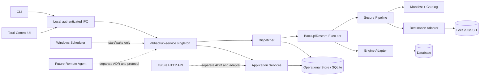
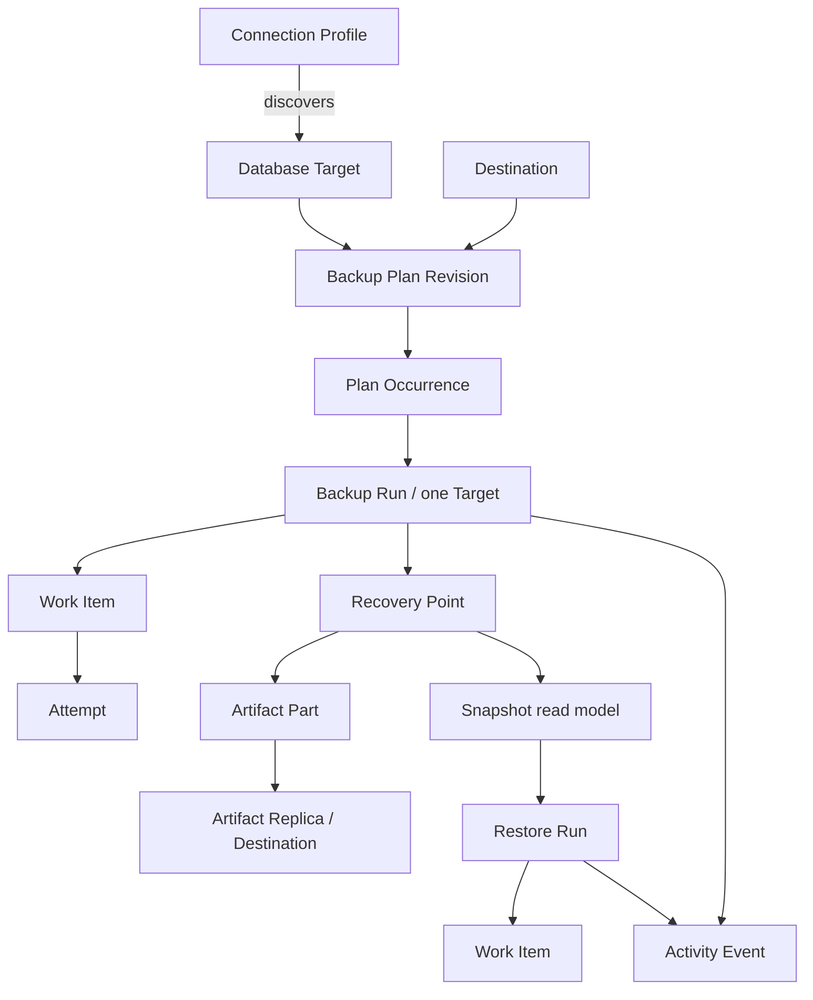

# Connected Backup Platform v2 Specification

> 상태: Draft for implementation planning
> 작성일: 2026-07-26
> 제품 기준선: Databasement 수준의 운영 경험 + 기존 Rust 보안 코어

## 1. Product Definition

여러 종류의 데이터베이스를 연결하고 예약 백업하며, 특정 스냅샷의 실제 복원 가능성까지
증명하는 Windows-first 백업 관리자다.

현재 `dbbackupsystem`을 버리지 않는다. Rust 기반 dump/restore, 암호화, 서명 매니페스트,
다중 목적지, 불변성, 원격 reader, catalog rebuild를 실행 코어로 유지하고 그 위에 연결,
탐색, 계획, 활동, 스냅샷, 복원 중심의 제품 모델을 구축한다.

## 2. Problem Statement

현재 제품은 안전한 백업 파일을 만드는 기능은 강하지만, 사용자가 실제로 관리하는 대상은
파일이 아니라 여러 DB 연결이다. 연결과 DB 대상을 쉽게 등록·탐색할 수 없고, 실행 이력과
스냅샷, 복원 가능성을 한 흐름에서 판단하기 어렵다. 여러 스케줄 프로세스의 전역 부하도
통제되지 않는다.

이 상태에서 엔진 로고만 늘리면 “지원은 많지만 운영할 수 없는 제품”이 된다. 먼저
Databasement 수준의 공통 운영 흐름과 실행 제어를 완성한 뒤 동일한 지원 계약으로 엔진을
추가해야 한다.

## 3. Goals

- DB 서버 연결 등록부터 DB 탐색, 계획 생성까지 5분 안에 완료한다.
- 여러 DB의 예약 실행을 중앙 queue가 안전한 병렬도로 조절한다.
- 백업 성공, 검증 성공, 복원 검증 성공, RPO 위반을 구분해 보여준다.
- 스냅샷을 검색하고 선택한 대상에 안전하게 복원한다.
- 기존 세 엔진을 운영 수준으로 완성한 뒤 검증된 순서로 엔진을 확장한다.
- 향후 remote agent와 웹 제어면이 같은 application service 계약을 재사용할 수 있게 한다.
- 기존 보안 보장을 제품 기본값으로 유지한다.

## 4. Non-goals for Initial v2

- Databasement의 PHP/Laravel 코드를 포크하거나 런타임에 결합하지 않는다.
- 첫 릴리스에 조직, RBAC, SSO, multi-tenant SaaS를 넣지 않는다.
- 첫 릴리스에 REST API, MCP, 브라우저 제어면을 공개하지 않는다.
- 모든 엔진을 동일 기능으로 보이게 만들지 않는다.
- PostgreSQL 물리 백업/PITR, SQL Server `.bak` 등 별도 인프라가 필요한 고급 모드는
  기본 논리 백업과 같은 범위로 약속하지 않는다.
- 검증되지 않은 엔진·버전·도구 조합을 지원으로 표시하지 않는다.

## 5. Primary Users

- 여러 PostgreSQL/MySQL/MariaDB 인스턴스를 관리하는 Windows 운영자
- SQL Server, SQLite 등 이종 DB가 섞인 소규모 팀 관리자
- 장애 시 스냅샷을 찾아 복원하고 증적을 남겨야 하는 복구 담당자
- 향후 중앙 제어면에서 원격 지점의 agent를 관리하는 플랫폼 운영자

## 6. Context Map

경계 원칙:

- UI는 native tool을 직접 실행하지 않는다.
- UI가 닫혀도 `dbbackup-service`는 최소권한 계정으로 계속 실행된다.
- `dbbackup-service` 안의 dispatcher만 backup/restore 시작 권한을 가진다.
- CLI와 Windows Scheduler는 직접 실행하지 않고 command 제출 또는 service wake만 한다.
- Engine Adapter는 연결·탐색·백업·검증·복원 capability를 명시한다.
- Destination Adapter는 저장, 읽기, 삭제, 불변성 capability를 명시한다.
- Operational Store는 연결·계획·queue·Run·Activity의 권위 소스다.
- signed Manifest는 Recovery Point와 artifact의 권위 소스이고 Catalog projection은
  Manifest에서 rebuild할 수 있다. Plan과 queue는 Manifest에서 복구할 수 없다.
- dotted future boundary는 초기 v2 wire protocol을 뜻하지 않는다. Agent identity/offline queue/
  split-brain과 HTTP/RBAC versioning은 local 제품 안정화 뒤 별도 ADR에서 정의한다.
- Secret Store는 credential과 key material의 권위 소스다.

### Architecture Decisions

| 항목 | 결정 |
|------|------|
| Execution authority | UI와 독립된 Windows service singleton |
| Delivery semantics | at-least-once Attempt + idempotent Plan Occurrence + fenced commit |
| Operational persistence | SQLite WAL, service-owned single writer, 짧은 transaction |
| Backup atomic unit | 한 DB의 required Artifact Part를 묶은 complete Recovery Point |
| Multi-destination | Artifact Replica, required/best-effort 역할, 기본 all-required |
| Child process | Windows Job Object 기반 Process Supervisor |
| Configuration cutover | SQLite one-way cutover, TOML export/import, old-binary guard |
| Initial topology | single-node local service, distributed queue 없음 |

## 7. Core Domain Model

- `ConnectionProfile`: 호스트·포트·인증·터널 등 서버 접속 정보
- `DatabaseTarget`: 연결에서 발견되어 백업 대상으로 선택된 개별 DB
- `BackupPlanRevision`: 대상, 목적지, 일정, 보존, 검증 정책의 불변 버전
- `PlanOccurrence`: 특정 revision과 예정 시각에서 발생한 한 번의 실행 의도
- `BackupRun`: 계획을 특정 시점에 실행한 인스턴스
- `WorkItem`: queue의 실행 요청이며 여러 Attempt를 가질 수 있음
- `Attempt`: worker가 Work Item을 처리한 개별 시도
- `RecoveryPoint`: 한 DB의 동일 occurrence에 필요한 artifact part와 set Manifest의 원자 단위
- `ArtifactReplica`: 특정 목적지에 commit된 Recovery Point 사본
- `Snapshot`: complete Recovery Point의 UI·검색 projection
- `RestoreRun`: 스냅샷을 특정 대상에 복원한 실행 인스턴스
- `ActivityEvent`: 상태 전이와 사용자 판단에 필요한 구조화 로그

기존 `Job`은 과적재된 이름이므로 새 모델에서는 `BackupPlan` 또는 `BackupRun`으로
분리한다.

## 8. Functional Requirements

### FR-CON: Connections

- `FR-CON-01` 사용자는 엔진 종류, 이름, 호스트, 포트, 인증, TLS, 선택적 SSH 터널을
  입력해 Connection Profile을 저장할 수 있어야 한다.
- `FR-CON-02` 저장 전 실제 접속, 서버 버전, 권한, native tool 버전을 probe해야 한다.
- `FR-CON-03` 자격증명은 운영 DB에 평문으로 저장하지 않고 기존 secret store를 사용한다.
- `FR-CON-04` 연결 실패는 DNS, 네트워크, TLS, 인증, 권한, tool 누락을 구분해 보여준다.
- `FR-CON-05` 연결 삭제 전 연관 Target·Plan 수와 영향을 보여주고 안전하게 차단한다.

### FR-DIS: Database Discovery

- `FR-DIS-01` 연결 성공 후 백업 가능한 DB 목록을 탐색한다.
- `FR-DIS-02` system DB, template DB, offline DB 등 제외 사유를 엔진별로 표시한다.
- `FR-DIS-03` 하나 이상의 DB를 선택해 Database Target으로 등록한다.
- `FR-DIS-04` 재탐색 시 추가·삭제·이름 변경을 diff로 보여주고 자동 삭제하지 않는다.
- `FR-DIS-05` SQLite는 서버 탐색 대신 파일 선택과 잠금/WAL 사전 점검을 제공한다.

### FR-DST: Destinations

- `FR-DST-01` Local, S3, SSH/SFTP 목적지를 등록·probe할 수 있어야 한다.
- `FR-DST-02` 목적지는 write, read, delete, list, object lock capability를 보고한다.
- `FR-DST-03` backup writer와 restore reader 자격증명을 분리할 수 있어야 한다.
- `FR-DST-04` 저장 공간, 쓰기 권한, 불변성 설정을 plan 실행 전에 preflight한다.
- `FR-DST-05` 신규 목적지는 공통 adapter contract로 추가할 수 있어야 한다.
- `FR-DST-06` Plan의 목적지 membership은 `required` 또는 `best-effort` 역할을 가진다.
- `FR-DST-07` 기본 내구성 정책은 모든 required 목적지 성공인 `all-required`다.
- `FR-DST-08` 일부 Replica 실패는 repair queue로 보내고 기존 encoded artifact를 재사용한다.

### FR-PLN: Backup Plans

- `FR-PLN-01` 하나 이상의 Target, 하나 이상의 Destination, 일정, 보존 정책을 묶어
  Backup Plan을 만든다.
- `FR-PLN-02` 계획 생성 전에 각 Target의 예상 지원 capability와 제한을 보여준다.
- `FR-PLN-03` 수동 실행과 예약 실행이 동일한 queue 경로를 사용한다.
- `FR-PLN-04` 일정 충돌 시 중복 실행 정책은 기본 `coalesce-one`으로 한다.
- `FR-PLN-05` GFS 또는 단순 기간/개수 정책을 목적지별로 검증한다.
- `FR-PLN-06` 일정 지연이 RPO 예산을 넘으면 실행 성공 여부와 별도로 위반 상태를 남긴다.
- `FR-PLN-07` 수정은 새 Plan Revision을 만들며 queued Plan Occurrence는 enqueue 시점의
  immutable execution spec과 versioned Secret Ref를 사용한다.
- `FR-PLN-08` 일정은 timezone과 UTC occurrence ledger를 가지며 DST·절전 복귀 시 기본
  `bounded latest-one` 정책으로 처리하고 missed occurrence를 기록한다.

### FR-DSP: Queue and Dispatcher

- `FR-DSP-01` queue는 SQLite에 persist되어 앱 재시작 후 복구돼야 한다.
- `FR-DSP-02` 상태는 최소 `queued`, `delayed`, `leased`, `starting`, `running`,
  `committing`, `cancel_requested`, `succeeded`, `partially_succeeded`,
  `failed_terminal`, `cancelled`를 포함한다.
- `FR-DSP-03` dispatcher는 전역, 호스트별, CPU 단계별, 목적지별, restore별 permit을
  획득한 뒤 작업을 실행한다.
- `FR-DSP-04` lease heartbeat가 끊긴 작업은 orphan child process를 확인한 후 재개 또는
  실패 처리한다.
- `FR-DSP-05` 취소는 child process tree까지 전달하고 partial artifact는 commit하지 않는다.
- `FR-DSP-06` retry는 지수 backoff와 최대 횟수를 사용하며 backlog를 무한 증폭시키지 않는다.
- `FR-DSP-07` Windows Scheduler는 개별 backup을 직접 실행하지 않고 dispatcher를 깨우거나
  서비스 상태를 보장하는 역할만 한다.
- `FR-DSP-08` claim마다 Fencing Token을 발급하고 현재 token과 일치하는 Attempt만
  heartbeat, 상태 전이, 결과 commit을 할 수 있다.
- `FR-DSP-09` Plan Occurrence는 `plan_id + plan_revision + scheduled_for_utc`로 멱등화하고
  Backup Run은 occurrence 내 Target당 하나만 존재한다.
- `FR-DSP-09A` 수동 실행은 client request idempotency key와 requested UTC로 식별하며 retry는
  동일 occurrence의 새 Attempt다.
- `FR-DSP-10` lease 만료는 terminal 성공/실패가 아니다. Reconciliation이 process identity,
  목적지 Manifest, current fencing token을 비교한 뒤 requeue 또는 terminal 상태를 결정한다.
- `FR-DSP-11` Resource Permit은 부분 획득 상태로 대기하지 않고 원자 admission하거나
  고정 순서로 예약해 deadlock과 head-of-line blocking을 막는다.
- `FR-DSP-12` retry는 full jitter, circuit breaker, retry budget, deadline을 포함한다.
- `FR-DSP-13` backup, restore, verification뿐 아니라 probe, discovery, Replica repair,
  retention, tool scan, notification, migration, control backup 같은 장기 operation도
  전용 Run 또는 Operation Run을 통해 동일한 durable Work Item/Attempt 계약을 사용한다.
- `FR-DSP-14` Plan Occurrence는 Target별 Run 결과를 집계해 `succeeded`,
  `partially_succeeded`, `failed`를 구분하며 단일 “completed” 상태로 성공 의미를 숨기지 않는다.

### FR-SVC: Service and Local IPC

- `FR-SVC-01` `dbbackup-service`만 production Work Item을 claim하고 native process를 시작한다.
- `FR-SVC-02` service shell을 먼저 설치하되 durable queue, fencing, Process Supervisor,
  Reconciliation gate 전에는 production execute command를 활성화하지 않는다.
- `FR-SVC-03` named pipe는 service SID, 설치 owner SID, 승인된 administrator만 허용한다.
- `FR-SVC-04` service는 client token의 SID/session을 확인하고 read, operate,
  destructive/admin command를 별도로 인가한다.
- `FR-SVC-05` IPC request는 version, request ID, idempotency key, issued/expiry, size limit을
  가지며 replay, oversize, unknown version을 거부한다.
- `FR-SVC-06` destructive restore/delete/secret/migration command는 대상에 결합된 짧은
  confirmation token을 요구한다.
- `FR-SVC-07` mutating IPC의 SID, command, idempotency key, canonical payload digest와
  redacted 결과 참조를 durable ledger에 저장한다. 같은 key의 다른 payload는 거부한다.
- `FR-SVC-08` confirmation token은 SID, action, resource fingerprint, payload digest,
  expiry에 결합하고 raw token을 저장하지 않으며 Run/Work Item 생성과 같은 transaction에서
  한 번만 소비한다.

### FR-RUN: Backup Execution

- `FR-RUN-01` 한 Target의 dump는 한 번만 만들고 다중 Destination으로 fan-out한다.
- `FR-RUN-02` dump process의 stdout/stderr를 고갈 없이 소비하고 민감정보를 redaction한다.
- `FR-RUN-03` 압축, 암호화, 업로드, 매니페스트 commit 순서를 원자적으로 보장한다.
- `FR-RUN-04` required Artifact Part 전체와 signed set Manifest가 commit된 뒤에만 complete
  Recovery Point와 Snapshot을 만든다.
- `FR-RUN-05` 각 실행은 engine/tool/version/options, source identity, bytes, duration을 기록한다.
- `FR-RUN-06` Process Supervisor는 Windows Job Object로 native tool process tree의 시작,
  timeout, 취소, pipe drain, wait/reap, orphan cleanup을 소유한다.
- `FR-RUN-07` dump 전 spool volume의 Spool Reservation을 획득하며 soft throttle과 hard stop을
  구분한다.
- `FR-RUN-08` 실행 단계는 최소 preflight, dumping, encoded, replicating, verifying,
  committing checkpoint를 갖고 Replica retry가 dump를 반복하지 않게 한다.
- `FR-RUN-09` 엔진별 Consistency Grade와 evidence를 Manifest와 Activity에 기록한다.

### FR-SNP: Snapshots and Activity

- `FR-SNP-01` Snapshot을 DB, plan, engine, 기간, 검증 레벨, 목적지, 상태로 검색한다.
- `FR-SNP-02` local catalog 손실 시 목적지의 서명 매니페스트로 inventory를 재구축한다.
- `FR-SNP-03` 실행 상세에 단계별 시간, 구조화 오류, retry, 검증 결과를 보여준다.
- `FR-SNP-04` 대시보드는 최근 성공과 최근 실패를 각각 보여주며 실패를 숨기지 않는다.
- `FR-SNP-05` 미검증, 검증 기한 초과, RPO 위반을 별도 attention 상태로 보여준다.
- `FR-SNP-06` 실행 성공과 required Replica, 불변성, 보존, RPO, 검증 freshness를 결합한
  Protection Compliance를 별도로 계산한다.
- `FR-SNP-07` incomplete Recovery Point와 Orphan Artifact는 기본 복원 목록에서 숨기고
  진단·repair 대상으로만 표시한다.
- `FR-SNP-08` complete Recovery Point와 적격 Replica가 하나 이상이면 Snapshot은 검색
  가능하고 조건부 복원 가능하다. required Destination이 부족하면 상태는 `degraded`이며
  Protection Compliance는 실패이고 “보호됨” 표기를 금지한다.

### FR-VRF: Verification

- `FR-VRF-01` L1은 암호화 artifact와 매니페스트의 무결성·서명을 검증한다.
- `FR-VRF-02` L2는 엔진별 native tool로 포맷과 구조를 검증한다.
- `FR-VRF-03` L3는 격리된 disposable target에 실제 복원하고 smoke query를 수행한다.
- `FR-VRF-04` 검증 정책은 실행 직후와 주기적 restore drill을 구분한다.
- `FR-VRF-05` 검증 결과는 catalog와 UI에 level, timestamp, evidence로 저장한다.

### FR-RST: Restore

- `FR-RST-01` 사용자는 Snapshot에서 복원을 시작한다.
- `FR-RST-02` restore reader만 artifact를 읽을 수 있고 writer 자격증명을 요구하지 않는다.
- `FR-RST-03` 대상 연결, 새 DB 이름, 기존 DB 충돌 정책, destructive warning을 명시한다.
- `FR-RST-04` 서명·무결성 gate를 통과하지 못한 artifact는 기본적으로 실행하지 않는다.
- `FR-RST-05` 복원은 기본 동시성 1이며 backup과 별도 resource permit을 사용한다.
- `FR-RST-06` restore-as-exec 위험이 있는 논리 덤프는 격리 또는 명시적 승인 경계를 가진다.
- `FR-RST-07` 완료 후 엔진별 smoke query와 결과 evidence를 남긴다.
- `FR-RST-08` application service는 Snapshot, target fingerprint, overwrite policy,
  eligibility 결과에 결합된 짧은 confirmation token을 검증한다.
- `FR-RST-09` globals, routine, trigger, definer, external object처럼 실행성·서버 범위 객체를
  inventory하고 정책에 따라 차단하거나 별도 승인한다.
- `FR-RST-10` 엔진별 Restore Safety Policy는 새 DB 기본, 최소권한 credential, server-scope
  object 기본 차단, target fingerprint 재확인, 격리 대상의 network egress 차단을 포함한다.

### FR-NOT: Notifications

- `FR-NOT-01` channel과 event routing rule을 등록하고 test notification을 보낼 수 있어야 한다.
- `FR-NOT-02` 알림은 transactional outbox 또는 동등한 durable delivery record를 사용한다.
- `FR-NOT-03` delivery retry는 bounded backoff를 사용하고 payload와 오류를 redaction한다.
- `FR-NOT-04` notification 실패 자체를 Activity Event와 Attention State로 표시한다.
- `FR-NOT-05` Backup Plan에는 적용되는 notification rule을 명시한다.

### FR-MIG: Configuration and Cutover

- `FR-MIG-01` 기존 TOML, keystore, Catalog, Scheduler XML을 recovery bundle로 백업한다.
- `FR-MIG-02` TOML을 shadow Operational Store로 import하고 stable ID, Secret Ref, 관계,
  schedule diff를 검증한다.
- `FR-MIG-03` cutover 전에 기존 scheduler task를 일시 중지하고 새 service health를 확인한다.
- `FR-MIG-03A` durable queue, fencing, supervisor, reconciliation이 통과하기 전에는 actual
  cutover marker를 기록하지 않는다.
- `FR-MIG-04` cutover marker 이후 구 binary와 직접 `run_job` 경로는 실행을 거부한다.
- `FR-MIG-05` migration은 schema version별 transaction과 checksum을 가지며 중단 후 멱등
  재개할 수 있어야 한다.
- `FR-MIG-06` rollback은 DB 파일뿐 아니라 scheduler enablement와 service 상태를 복원한다.
- `FR-MIG-07` TOML은 secret 제외를 기본으로 하는 versioned export/import 표면으로 유지한다.

### FR-ENG: Engine Expansion

- `FR-ENG-01` 모든 엔진은 동일한 support contract를 구현한다.
- `FR-ENG-02` capability가 없는 기능은 숨기거나 “지원 안 함”으로 명확히 표시한다.
- `FR-ENG-03` 엔진·서버·native tool 버전의 검증 matrix를 유지한다.
- `FR-ENG-04` 실제 restore E2E가 CI 또는 관리된 testbed에서 통과해야 지원 상태가 된다.
- `FR-ENG-05` Redis/Valkey처럼 restore 의미가 제한된 경우 backup-only로 표시한다.
- `FR-ENG-06` capability는 declared, observed, certified로 나누며 사용자가 보는 지원 상태는
  세 조건의 교집합이다.
- `FR-ENG-07` Engine Matrix에는 server/tool/OS/format/consistency/evidence 시각과 만료를
  기록한다.

## 9. Engine Roadmap

| Wave | 엔진 | 1차 방식 | 출시 조건 |
|------|------|----------|-----------|
| 0 | PostgreSQL | `pg_dump`/`pg_restore` | 기존 기능 production gap 해소, L3 |
| 0 | MySQL | `mysqldump` 계열 | 실제 restore와 결과 기록 |
| 0 | MariaDB | `mariadb-dump` 계열 | MySQL과 별도 tool/version matrix |
| 1 | SQL Server | BACPAC export/import 후보 | 실제 데이터 범위·크기 제한·restore E2E 검증 후 확정 |
| 1 | SQLite | SQLite online `.backup` | WAL/lock/atomic copy 검증 |
| 2 | MongoDB | `mongodump`/`mongorestore` | namespace/consistency 검증 |
| 2 | Firebird | `gbak` | dialect/version matrix |
| 3 | Redis | RDB 중심 backup-only | 복원 의미와 서비스 중단 조건 명시 |
| 3 | Valkey | RDB 중심 backup-only | Redis와 별도 호환 matrix |
| 4 | SQL Server | native `.bak` | DB 인접 agent와 권한 모델 확정 |

SQL Server DACPAC은 schema-only capability로만 분류하고 데이터 백업 성공에 포함하지 않는다.
Redis/Valkey는 복원 runbook과 managed testbed가 준비되기 전까지 “지원”이 아니라
experimental export로 표시한다.

## 10. Non-functional Requirements

### Reliability

- 앱·호스트 재시작 후 queue와 실행 상태를 결정적으로 복구한다.
- partial upload와 commit 전 artifact는 Snapshot으로 노출하지 않는다.
- 동일 Plan Occurrence는 중복 Attempt를 허용하되 complete Recovery Point는 하나만 commit한다.
- stale Fencing Token의 상태 전이와 commit은 항상 거부한다.
- catalog rebuild 결과와 기존 매니페스트가 일치해야 한다.
- committing 중 crash 후 Reconciliation 결과가 결정적이어야 한다.
- Operational Store의 암호화 export, integrity check, 복원 rehearsal을 제공한다.
- Operational Store export는 SQLite online backup API 또는 명시적 service quiesce를 사용해
  live write 중에도 일관된 snapshot을 만든다.

### Performance and Backpressure

- 기본 permit: global jobs 2, per source host 1, CPU stages 1~2, per destination 2,
  restore 1.
- permit 값은 설정 가능하지만 안전 범위를 벗어날 때 경고한다.
- Spool Reservation 없이 dump를 시작하지 않는다.
- SQLite는 WAL, `foreign_keys=ON`, `busy_timeout`, service-owned single writer, read-only pool,
  bounded transaction duration과 checkpoint policy를 사용한다.
- queue/heartbeat control write는 Activity/debug log batch보다 우선한다.
- UI 이벤트는 로그 전체를 메모리에 적재하지 않고 pagination/streaming한다.
- 100개 plan과 100,000개 activity event에서 기본 검색이 실사용 가능한 수준이어야 한다.

### Security

- 기존 backup별 DEK, KEK wrapping, origin signature, object lock 보장을 유지한다.
- process argument와 로그에 비밀을 노출하지 않는다.
- native tool 바이너리의 출처, 버전, hash 또는 서명 검증 정책을 둔다.
- writer, reader, admin 권한을 가능한 범위에서 분리한다.
- 복원은 백업보다 높은 위험 동작으로 분류하고 명시적 대상 확인을 요구한다.
- signing key ID와 과거 verifying key의 신뢰 이력을 보존한다.
- Activity Event는 운영 기록이며 로컬 관리자에 대한 tamper-evident 감사 로그로 과대
  해석하지 않는다.
- Secret Store는 service-owned machine DPAPI와 설치별 entropy/ACL을 사용하고 Operational
  Store에는 versioned Secret Ref만 저장한다.
- IPC, process environment/argv, Activity, support bundle에서 canary secret 노출 0건을
  release gate로 둔다.

### Accessibility and UX

- 모든 form control은 programmatic label, name/id, 설명과 오류 연결을 가진다.
- 키보드만으로 연결 생성, plan 생성, 스냅샷 검색, 복원 확인이 가능해야 한다.
- 기존 `DESIGN.md`의 색·타이포·테마 토큰을 정본으로 사용한다.
- 다크 테마의 container, text, select option, placeholder, autofill을 함께 검증한다.
- 상태는 색만으로 전달하지 않는다.

### Operability

- structured log와 사용자용 activity 메시지를 분리한다.
- error code는 engine, phase, retryability를 포함한다.
- 최근 실패, queue depth, 오래된 lease, RPO 위반, 마지막 L3 시각을 진단 화면에서 본다.
- support bundle은 비밀을 redaction한 설정·로그·버전·상태만 내보낸다.
- queue control transaction이 Activity/debug log 폭주에 굶지 않도록 우선순위를 분리한다.
- current Protection Compliance와 과거 실행 성공을 각각 표시한다.

## 11. UI Information Architecture

1. **Overview**: 보호 상태, 최근 실패, RPO 위반, restore drill 상태
2. **Connections**: 서버 연결, probe, DB discovery
3. **Databases**: 선택된 Database Target과 보호 여부
4. **Destinations**: 저장소 capability와 상태
5. **Backup Plans**: 대상·목적지·일정·보존·검증 정책
6. **Activity**: queued/running/succeeded/failed 실행과 단계별 로그
7. **Snapshots**: 검색, 검증 상태, 복원 시작
8. **Recovery**: 진행 중/과거 Restore Run과 evidence
9. **Settings**: concurrency, notifications, tools, secrets, export/import

보안 기능은 독립된 설정실에 숨기지 않는다. plan 생성, snapshot 상세, restore gate의 기본
흐름 안에 드러나야 한다.

## 12. Acceptance Scenarios

### AS-01 New connection to protected backup

사용자가 PostgreSQL 연결을 등록하고 실제 probe를 통과하면 DB 목록이 표시된다. 두 DB를
선택하고 S3 목적지와 야간 일정을 묶어 plan을 만든다. 수동 실행 후 두 Snapshot이 committed
상태로 보이고 L1/L2 결과와 다음 실행 시각이 표시된다.

### AS-02 Multiple DB load control

10개 plan이 동시에 due가 돼도 global 2, 같은 host 1 제한을 넘지 않는다. 나머지는 queued
상태와 예상 대기 이유를 보여준다. 앱을 재시작해도 실행 중 lease와 대기열이 유실되지 않는다.

### AS-03 Failed dump is not a snapshot

native dump process가 비정상 종료하면 fan-out destination 어느 곳에도 committed
매니페스트가 생기지 않는다. 실패 phase와 redacted stderr가 Activity에 보이고 정책에 따라
retry된다.

### AS-04 Snapshot-based restore

사용자가 검증된 Snapshot을 선택하고 별도 reader 자격증명과 새 DB 이름으로 복원한다.
서명·무결성 gate, 실제 restore, smoke query가 통과하면 Restore Run이 succeeded가 되고
evidence가 남는다.

### AS-05 Restore gate failure

매니페스트 서명이 유효하지 않으면 restore가 시작되지 않는다. UI는 실패 원인과 안전한
다음 조치를 보여주며 우회는 일반 설정에 제공하지 않는다.

### AS-06 Discovery drift

서버에서 DB가 추가·삭제된 뒤 재탐색하면 diff를 보여준다. 삭제된 DB의 기존 Snapshot과
Plan은 자동 삭제되지 않고 attention 상태로 전환된다.

### AS-07 RPO violation

목적지 장애로 retry가 누적돼 마지막 성공이 RPO를 넘으면, 이후 한 번 성공하더라도 위반
event와 실패 이력이 사라지지 않는다.

### AS-08 Engine capability mismatch

backup-only 엔진에서 restore를 선택하면 실행 버튼을 실패시키는 대신 지원 범위와 이유를
사전에 보여준다.

### AS-09 Stale worker fencing

Attempt A의 lease가 만료돼 Attempt B가 시작된 뒤 A가 늦게 돌아와도 A의 heartbeat, 상태 전이,
Manifest publish, Snapshot projection은 거부된다. Reconciliation 후 occurrence에는 complete
Recovery Point가 하나만 남는다.

### AS-10 Required destination failure

Local과 S3가 required인 Plan에서 Local만 성공하면 encoded artifact는 repair에 재사용되지만
complete Recovery Point와 적격 Local Replica가 있으면 Snapshot은 `degraded`로 검색·복원
가능하다. Protection Compliance는 실패이며 UI는 “백업 실행 일부 완료”와 “보호 요건
미충족”을 구분하고 “보호됨”을 표시하지 않는다.

### AS-11 Safe configuration cutover

TOML shadow import 도중 전원이 끊겨도 구 scheduler와 새 service가 동시에 실행되지 않는다.
재시작 시 migration을 안전하게 재개하거나 recovery bundle로 돌아가며 cutover marker 이후
구 binary는 실행을 거부한다.

### AS-12 Incomplete multi-part backup

PostgreSQL globals는 성공하고 DB dump가 실패하면 signed set Manifest가 게시되지 않는다.
해당 artifact는 Orphan/Incomplete 진단에만 보이고 Snapshot과 Restore 후보에는 나타나지 않는다.

### AS-13 Unauthorized local IPC

다른 local user가 service pipe에 연결하거나 이전 confirmation token을 다른 target restore에
재사용하면 command는 실행 전에 거부된다. 거부 Activity에는 SID와 command class가 기록되지만
secret과 payload 원문은 남지 않는다.

### AS-14 Live Operational Store backup

queue heartbeat와 Activity write가 진행 중일 때 control backup을 실행해도 일관된 SQLite
snapshot이 생성된다. 복원 rehearsal에서 integrity check, schema version, Plan 관계를 확인하고
production service는 backup 때문에 lease를 잃지 않는다.

## 13. Release Gates

- `G0 Truth and Cutover`: production gap을 실패 테스트로 재현하고 execution authority ADR,
  Operational Store ownership, TOML migration/rollback, old scheduler 차단을 검증한다.
- `G1 Durable Core`: idempotent occurrence, fencing, Process Supervisor, Spool Reservation,
  complete Recovery Point, required Destination, crash Reconciliation을 검증한다.
- `G2 Existing Engine Recovery`: PostgreSQL, MySQL, MariaDB의 연결→탐색→계획→백업→
  L1/L2/L3→실제 복원→content validation과 retention 시행을 통과한다.
- `G3 Product`: Connections, Targets, Plans, Activity, Snapshots, Recovery UI, service reconnect,
  부분 성공/Compliance 표현과 접근성 회귀를 통과한다.
- `G4 New Engine`: SQL Server BACPAC 후보와 SQLite를 각각 독립 Support Contract로 검증한다.
- `G5 Expansion`: Agent/API 도입 전 identity, secret custody, protocol version,
  central/local lease 경계를 검증한다.

## 14. Success Metrics

- 연결 등록 후 첫 성공 백업까지 중앙값 5분 이하
- due 대비 설명되지 않은 실행 누락 0건, occurrence당 complete Recovery Point 1개
- stale Fencing Token commit 허용 0건
- cancel/timeout/crash 후 orphan child process 0건
- committed Snapshot 중 L1 증적 보유율 100%
- 정책 대상 Snapshot의 L3 기한 준수율 95% 이상
- 실패 원인 분류 불가 비율 5% 미만
- 지원 표시된 engine matrix의 관리 testbed restore 통과율 100%

## 15. Open Decisions That Do Not Block Planning

- 첫 외부 목적지 확장은 Azure Blob, SMB, rclone adapter 중 사용 수요로 결정한다.
- SQL Server 고객이 `.bak`을 필수로 요구하면 agent wave를 앞당긴다.
- 웹·팀 기능 수요가 확인되면 HTTP control plane을 데스크톱 이후 별도 제품 표면으로 연다.
- 실제 부하 데이터에 따라 기본 permit을 조정하되 중앙 dispatcher 구조는 바꾸지 않는다.
