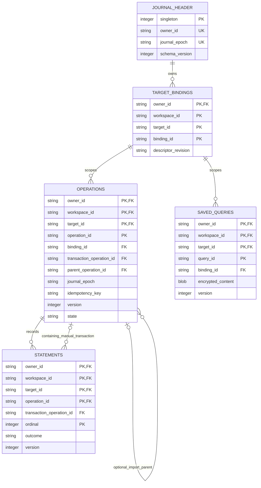

# Database Schema — Workbench Client State v1

## Target Database and ownership

- **DB:** new current-user SQLite `client-state.sqlite3`, schema version 1; existing service Operational Store stays v4.
- **Authority:** plan.md selected user-owned Workbench; spec.md consistency invariants; feature dictionary v3. One OS-user process lock and one journal writer actor own this file.
- **Boundary:** no target rows, SQL, parameters, original/draft values, passwords or complete endpoint descriptors in the journal. Live sessions/cursors/results/authorization leases remain memory-only.
- **Encryption:** saved-query name/body are one CurrentUser-DPAPI blob encrypted before any SQLite bind. Credentials are separate CurrentUser-DPAPI files; only an opaque validated reference is in bindings. Extend the existing secrets provider with explicit scope; machine/service defaults stay unchanged.
- **Prerequisites:** refuse elevated Workbench before opening paths. Verify user ACL, SQLite >=3.37 with STRICT/FK support, WAL and FULL synchronous durability. Failure/unsupported runtime starts write-disabled diagnostics, never weaker settings.

## ERD



ERD PK markers are components of the scoped composite keys, not globally unique columns. Operation idempotency uniqueness is (owner,workspace,target,kind,key). Parent relationship is optional and only import batches require it. The executable DDL below is canonical. [Standalone ERD](flow-diagrams/client-state-er.mmd).

## DDL (single executable SQLite initialization transaction)

```sql
PRAGMA foreign_keys = ON;
PRAGMA trusted_schema = OFF;
PRAGMA journal_mode = WAL;
PRAGMA synchronous = FULL;
BEGIN IMMEDIATE;
CREATE TABLE journal_header (
 singleton INTEGER PRIMARY KEY CHECK(singleton=1), schema_version INTEGER NOT NULL CHECK(schema_version=1),
 owner_id TEXT NOT NULL UNIQUE CHECK(length(owner_id)=64), journal_epoch TEXT NOT NULL UNIQUE CHECK(length(journal_epoch)=36),
 storage_revision INTEGER NOT NULL DEFAULT 0 CHECK(storage_revision>=0),
 created_at_ms INTEGER NOT NULL CHECK(created_at_ms>=0), updated_at_ms INTEGER NOT NULL CHECK(updated_at_ms>=created_at_ms)
) STRICT;
CREATE TABLE target_bindings (
 owner_id TEXT NOT NULL REFERENCES journal_header(owner_id) ON DELETE RESTRICT,
 workspace_id TEXT NOT NULL CHECK(length(workspace_id) BETWEEN 1 AND 128), target_id TEXT NOT NULL CHECK(length(target_id) BETWEEN 1 AND 128),
 binding_id TEXT NOT NULL CHECK(length(binding_id)=36), connection_profile_id TEXT NOT NULL CHECK(length(connection_profile_id) BETWEEN 1 AND 128),
 descriptor_revision TEXT NOT NULL CHECK(length(descriptor_revision)=64), authority_epoch TEXT NOT NULL CHECK(length(authority_epoch) BETWEEN 1 AND 128),
 source_identity_digest TEXT NOT NULL CHECK(length(source_identity_digest)=64), engine TEXT NOT NULL CHECK(engine IN('postgresql','mysql','mariadb','sqlite')),
 credential_ref TEXT CHECK(credential_ref IS NULL OR length(credential_ref)=36), state TEXT NOT NULL CHECK(state IN('active','retired')),
 created_at_ms INTEGER NOT NULL CHECK(created_at_ms>=0), updated_at_ms INTEGER NOT NULL CHECK(updated_at_ms>=created_at_ms),
 PRIMARY KEY(owner_id,workspace_id,target_id,binding_id), UNIQUE(owner_id,workspace_id,target_id,descriptor_revision,authority_epoch)
) STRICT;
CREATE TABLE operations (
 owner_id TEXT NOT NULL, workspace_id TEXT NOT NULL, target_id TEXT NOT NULL, binding_id TEXT NOT NULL,
 operation_id TEXT NOT NULL CHECK(length(operation_id)=36), kind TEXT NOT NULL CHECK(kind IN('query','manual_transaction','verified_apply','import_job','import_batch','export_job','protection_link')),
 idempotency_key TEXT NOT NULL CHECK(length(idempotency_key) BETWEEN 1 AND 256), payload_digest TEXT NOT NULL CHECK(length(payload_digest)=64),
 journal_epoch TEXT NOT NULL CHECK(length(journal_epoch)=36),
 process_boot_epoch TEXT NOT NULL CHECK(length(process_boot_epoch)=36), window_instance_id TEXT NOT NULL CHECK(length(window_instance_id)=36),
 session_id TEXT CHECK(session_id IS NULL OR length(session_id)=36), connection_generation INTEGER NOT NULL DEFAULT 0 CHECK(connection_generation>=0), execution_epoch INTEGER NOT NULL DEFAULT 0 CHECK(execution_epoch>=0),
 transaction_operation_id TEXT CHECK(transaction_operation_id IS NULL OR length(transaction_operation_id)=36), transaction_kind TEXT CHECK(transaction_kind IS NULL OR transaction_kind='manual_transaction'),
 parent_operation_id TEXT, parent_kind TEXT CHECK(parent_kind IS NULL OR parent_kind='import_job'), batch_index INTEGER,
 source_digest TEXT CHECK(source_digest IS NULL OR length(source_digest)=64), batch_digest TEXT CHECK(batch_digest IS NULL OR length(batch_digest)=64),
 source_byte_start INTEGER, source_byte_end INTEGER, source_row_start INTEGER, source_row_end INTEGER,
 state TEXT NOT NULL CHECK(state IN('accepted','dispatching','running','commit_requested','committed','rolled_back','failed','outcome_unknown','completed','cancelled','interrupted','partial')),
 transaction_outcome TEXT NOT NULL DEFAULT 'none' CHECK(transaction_outcome IN('none','open','commit_requested','committed','rolled_back','outcome_unknown')),
 result_completeness TEXT NOT NULL DEFAULT 'none' CHECK(result_completeness IN('none','complete','capped','cancelled','interrupted','partial')),
 version INTEGER NOT NULL DEFAULT 1 CHECK(version>=1), dispatch_count INTEGER NOT NULL DEFAULT 0 CHECK(dispatch_count IN(0,1)),
 failure_code TEXT CHECK(failure_code IS NULL OR length(failure_code) BETWEEN 1 AND 64),
 movement_metadata_json TEXT CHECK(movement_metadata_json IS NULL OR (kind IN('import_job','export_job') AND json_valid(movement_metadata_json) AND length(CAST(movement_metadata_json AS BLOB))<=65536)),
 operator_acknowledged_at_ms INTEGER CHECK(operator_acknowledged_at_ms IS NULL OR operator_acknowledged_at_ms>=0),
 token_expires_at_ms INTEGER NOT NULL, dedup_retain_until_ms INTEGER NOT NULL,
 terminal_at_ms INTEGER, tombstoned_at_ms INTEGER,
 created_at_ms INTEGER NOT NULL CHECK(created_at_ms>=0), updated_at_ms INTEGER NOT NULL CHECK(updated_at_ms>=created_at_ms),
 PRIMARY KEY(owner_id,workspace_id,target_id,operation_id), UNIQUE(owner_id,workspace_id,target_id,operation_id,kind),
 UNIQUE(owner_id,workspace_id,target_id,kind,idempotency_key),
 FOREIGN KEY(owner_id,workspace_id,target_id,binding_id) REFERENCES target_bindings(owner_id,workspace_id,target_id,binding_id) ON DELETE RESTRICT,
 FOREIGN KEY(owner_id,workspace_id,target_id,parent_operation_id,parent_kind) REFERENCES operations(owner_id,workspace_id,target_id,operation_id,kind) ON DELETE RESTRICT,
 FOREIGN KEY(owner_id,workspace_id,target_id,transaction_operation_id,transaction_kind) REFERENCES operations(owner_id,workspace_id,target_id,operation_id,kind) ON DELETE RESTRICT,
 CHECK((transaction_operation_id IS NULL AND transaction_kind IS NULL) OR (transaction_operation_id IS NOT NULL AND transaction_kind IS NOT NULL AND transaction_kind='manual_transaction')),
 CHECK(transaction_operation_id IS NULL OR (kind='query' AND transaction_operation_id<>operation_id)),
 UNIQUE(owner_id,workspace_id,target_id,parent_operation_id,batch_index),
 CHECK(token_expires_at_ms>created_at_ms AND token_expires_at_ms-created_at_ms<=86400000 AND dedup_retain_until_ms>=token_expires_at_ms),
 CHECK(terminal_at_ms IS NULL OR terminal_at_ms>=created_at_ms), CHECK(tombstoned_at_ms IS NULL OR (terminal_at_ms IS NOT NULL AND tombstoned_at_ms>=terminal_at_ms)),
 CHECK((kind='import_batch' AND parent_operation_id IS NOT NULL AND parent_kind IS NOT NULL AND parent_kind='import_job' AND parent_operation_id<>operation_id AND batch_index IS NOT NULL AND batch_index>=0 AND source_digest IS NOT NULL AND batch_digest IS NOT NULL AND source_byte_start IS NOT NULL AND source_byte_end IS NOT NULL AND source_row_start IS NOT NULL AND source_row_end IS NOT NULL AND source_byte_start>=0 AND source_byte_end>source_byte_start AND source_row_start>=0 AND source_row_end>source_row_start) OR (kind<>'import_batch' AND parent_operation_id IS NULL AND parent_kind IS NULL AND batch_index IS NULL AND source_digest IS NULL AND batch_digest IS NULL AND source_byte_start IS NULL AND source_byte_end IS NULL AND source_row_start IS NULL AND source_row_end IS NULL)),
 CHECK((state IN('accepted','dispatching','running','commit_requested') AND terminal_at_ms IS NULL) OR (state IN('committed','rolled_back','failed','outcome_unknown','completed','cancelled','interrupted','partial') AND terminal_at_ms IS NOT NULL)),
 CHECK(state<>'committed' OR transaction_outcome='committed'), CHECK(state<>'rolled_back' OR transaction_outcome='rolled_back')
) STRICT;
CREATE TABLE statements (
 owner_id TEXT NOT NULL, workspace_id TEXT NOT NULL, target_id TEXT NOT NULL, operation_id TEXT NOT NULL,
 ordinal INTEGER NOT NULL CHECK(ordinal>=0 AND ordinal<10000), statement_digest TEXT NOT NULL CHECK(length(statement_digest)=64),
 effect_class TEXT NOT NULL CHECK(effect_class IN('read','write','ddl','transaction','unknown')),
 outcome TEXT NOT NULL CHECK(outcome IN('not_sent','sent','succeeded','failed','cancelled','outcome_unknown')),
 effect_evidence TEXT NOT NULL DEFAULT 'none' CHECK(effect_evidence IN('none','read_only','pending_transaction','committed','rolled_back','outcome_unknown')),
 transaction_operation_id TEXT CHECK(transaction_operation_id IS NULL OR length(transaction_operation_id)=36), transaction_kind TEXT CHECK(transaction_kind IS NULL OR transaction_kind='manual_transaction'),
 matched_rows TEXT CHECK(matched_rows IS NULL OR (length(matched_rows) BETWEEN 1 AND 20 AND matched_rows NOT GLOB '*[^0-9]*')),
 changed_rows TEXT CHECK(changed_rows IS NULL OR (length(changed_rows) BETWEEN 1 AND 20 AND changed_rows NOT GLOB '*[^0-9]*')),
 version INTEGER NOT NULL DEFAULT 1 CHECK(version>=1), failure_code TEXT CHECK(failure_code IS NULL OR length(failure_code) BETWEEN 1 AND 64),
 created_at_ms INTEGER NOT NULL CHECK(created_at_ms>=0), updated_at_ms INTEGER NOT NULL CHECK(updated_at_ms>=created_at_ms),
 CHECK((transaction_operation_id IS NULL AND transaction_kind IS NULL) OR (transaction_operation_id IS NOT NULL AND transaction_kind IS NOT NULL AND transaction_kind='manual_transaction')),
 PRIMARY KEY(owner_id,workspace_id,target_id,operation_id,ordinal),
 FOREIGN KEY(owner_id,workspace_id,target_id,transaction_operation_id,transaction_kind) REFERENCES operations(owner_id,workspace_id,target_id,operation_id,kind) ON DELETE RESTRICT,
 FOREIGN KEY(owner_id,workspace_id,target_id,operation_id) REFERENCES operations(owner_id,workspace_id,target_id,operation_id) ON DELETE RESTRICT
) STRICT;
CREATE TABLE saved_queries (
 owner_id TEXT NOT NULL, workspace_id TEXT NOT NULL, target_id TEXT NOT NULL, binding_id TEXT NOT NULL,
 query_id TEXT NOT NULL CHECK(length(query_id)=36), encryption_format TEXT NOT NULL CHECK(encryption_format='current-user-dpapi-v1'),
 encrypted_content BLOB NOT NULL CHECK(length(encrypted_content) BETWEEN 1 AND 262144),
 version INTEGER NOT NULL DEFAULT 1 CHECK(version>=1), created_at_ms INTEGER NOT NULL CHECK(created_at_ms>=0), updated_at_ms INTEGER NOT NULL CHECK(updated_at_ms>=created_at_ms),
 PRIMARY KEY(owner_id,workspace_id,target_id,query_id),
 FOREIGN KEY(owner_id,workspace_id,target_id,binding_id) REFERENCES target_bindings(owner_id,workspace_id,target_id,binding_id) ON DELETE RESTRICT
) STRICT;
CREATE INDEX bindings_scope_state ON target_bindings(owner_id,workspace_id,target_id,state,updated_at_ms,binding_id);
CREATE INDEX operations_transaction ON operations(owner_id,workspace_id,target_id,transaction_operation_id,transaction_kind);
CREATE INDEX statements_transaction_effect ON statements(owner_id,workspace_id,target_id,transaction_operation_id,transaction_kind,effect_evidence,ordinal);
CREATE INDEX operations_binding ON operations(owner_id,workspace_id,target_id,binding_id);
CREATE INDEX operations_scope_updated ON operations(owner_id,workspace_id,target_id,updated_at_ms,operation_id);
CREATE INDEX operations_scope_state ON operations(owner_id,workspace_id,target_id,state,updated_at_ms,operation_id);
CREATE INDEX operations_retention ON operations(dedup_retain_until_ms,terminal_at_ms) WHERE terminal_at_ms IS NOT NULL;
CREATE INDEX saved_queries_binding ON saved_queries(owner_id,workspace_id,target_id,binding_id);
CREATE INDEX saved_queries_scope_updated ON saved_queries(owner_id,workspace_id,target_id,updated_at_ms,query_id);
PRAGMA user_version = 1;
COMMIT;
```

## State, transaction and idempotency protocol

1. Initialize header with native-derived owner hash and a random Journal Epoch in the creation transaction; never accept either from JS. Verify header/user_version/owner before enabling operations. Process Boot Epoch and window instance IDs are native-random and not resumable handles.
2. Native validates UUIDs, digest encodings, canonical decimal counts and allowed failure-code enums. SQLite CHECKs bound storage; they are not permission checks. Canonical payload digest includes exact typed tags/values, never formatted values; no raw payload is stored. Digests themselves are sensitive metadata and are not exported in diagnostics by default.
3. `BEGIN IMMEDIATE`: validate owner/scope/epochs/token expiry/quota; insert accepted operation. Existing scoped kind+key with same digest returns its operation; differing digest conflicts. Expired/foreign-epoch tokens never admit a new operation even after pruning. Existing historical status remains readable. The current header epoch gates new admission in Rust; historical operation epochs are immutable records, deliberately not FKs to the rotatable singleton header. Rotation preserves old unknown rows and their original epochs.
4. Before target send, fresh binding authorization plus guarded `UPDATE ... WHERE full_scope AND operation_id=? AND version=? AND state='accepted' AND dispatch_count=0`; set dispatching, dispatch_count=1, version+1 and commit locally before wire. Only the exact successful transition owns dispatch; a second actor must not send.
5. All updates include full owner/Workspace/target identity and expected version/state. Immutable admission identity, digest, scope, parent/range and dispatch_count never revert. Permitted state edges live in the Rust domain transition function; arbitrary SQL updates are not a public API.
6. `commit_requested` persists before COMMIT. Server evidence decides committed/rolled_back; process/socket/cancel uncertainty decides outcome_unknown. Read-only completion uses completed/interrupted/cancelled, not fictional committed/rolled_back. Import parent may be partial; child batch states retain actual commit evidence. Remote and local transactions are never atomic together.
7. Statement success is separate from committed effects: a successful UPDATE inside an open manual transaction has pending_transaction evidence. Commit/rollback confirmation atomically updates parent transaction outcome and affected statement evidence locally; implicit-commit scripts retain per-statement evidence. A failed later statement cannot erase earlier confirmed commits.
8. Recovery invalidates all sessions and marks dispatching/running/commit_requested write-capable work unknown unless decisive evidence exists; proven read-only runs become interrupted. Cancelled is allowed only for proven no-send/no-effect cases, never uncertain writes. Accepted old-boot work is terminal cancelled/not-sent, never automatically dispatched. Unknown child stops later import batches; unique parent+batchIndex and source/range digests prevent duplicate child admission.
9. Operator acknowledgment records awareness without changing unknown to success/rollback. Reconciliation adds conclusive evidence through the same guarded transition, never inferred from matching final row values. Tombstone preserves key/digest/state/version/identity after optional child-detail cleanup.
10. UI notifications are hints only. Repeated versions are ignored; gaps/reconnect pull `operation.get/list`. No Workbench UI outbox/inbox tables. Existing service notification outbox is unaffected.

## Rationale and access/index paths

| Table | Relationship / purpose | Main access and index |
|---|---|---|
| journal_header | One user/journal identity and monotonic storage_revision paired with private external anchor; no active session authority | singleton and unique owner/epoch |
| target_bindings | Historical immutable descriptor revision/authority epoch; no persisted connect descriptor or lease | scope/state page and unique canonical revision+epoch |
| operations | Scoped deduplication, per-import child evidence, versioned outcome; optional bounded movement metadata for import/export parents | PK get, scoped key uniqueness, scope/state+updated keyset, parent/batch unique, retention partial index |
| statements | Ordered digest/class/outcome/effect evidence; no statement content | operation prefix of composite PK serves FK and ordinal scan |
| saved_queries | Explicit encrypted saved content; no default automatic history | scope/updated keyset; binding FK index; names searched only after bounded decryption |

Bindings are history, not authority: the service derives descriptorRevision from all declared connect/ownership fields in one existing read transaction; authorityEpoch is service boot identity. Cached rows cannot authorize SQL. A revised descriptor creates a new binding and retires old session authority. Saved queries may move to a new binding only through explicit validated scoped update.
SQLite FKs cover only local records; Workspace/target existence/active state and remote server identity require the existing service bridge and live driver. No cross-file FK to Operational Store and no mutation of service schema v4.

## Retention, quotas, migrations and capability gates

- Proposed unmeasured admission quotas: 100,000 operations total, 10,000 statements/operation, 1,000 saved queries and 128MiB combined journal+WAL allowance. The writer accounts file/WAL and reserved growth before admission; SQLite `max_page_count` alone does not bound WAL. Stop new admissions rather than delete active/unknown evidence. Apply existing in-memory result/draft/queue budgets separately.
- Native attempt tokens expire within 24h. Retain terminal metadata/tombstones at least 30 days and at least token expiry; unknown/unacknowledged operations have no automatic expiry. Acknowledgment does not by itself permit deletion of unknown identity. Terminal pruning requires an explicit bounded retention policy, no dependent unresolved children and old-token rejection verified after deletion.
- Delete child statements and confirmed child batches before an eligible parent; use explicit transactions and RESTRICT FKs. Bindings prune only after all retained references disappear. Saved content remains until explicit user deletion; no bulk Workspace archive callback silently erases uncertainty.
- Credential blobs live below the verified current-user root under generated UUID file names, private ACL and CurrentUser DPAPI; no caller path, plaintext fallback or blob auto-migration from service. Rotation/revocation invalidates in-memory credential/session generations. Orphan encrypted files require reconciliation, never guessing from a missing DB row.
- v1 is a new local initialization migration, not a service v4 migration. Only initialize an absent verified file. Existing unknown/newer schema, malformed header, corruption, owner mismatch or failed WAL/FULL/FK settings refuse writes. Never recreate over an unreadable journal. Backup/restore or replacement is not an automatic state transition: open write-disabled, explicitly reconcile, then issue a new Journal Epoch; never reactivate old attempts or rewrite unknown as success.
- Private `client-state.anchor` carries a bounded metadata-only anchor `{owner,journalEpoch,revision,phase:"clean"|"dirty"}`; `client-state.lock` remains the separate process lock. This is not a new database table or message broker. Native mutating access writes dirty+sync before executing its closure, durably advances header storage_revision, then writes clean+sync. A completed business refusal can clean normally; storage/anchor errors or crashes leave dirty/mismatch and refuse new writes. Read-only access does not run a write cycle. Missing DB with an existing anchor, valid DB rollback/replacement with a different revision, malformed/missing anchor for an existing DB and revision overflow all fail closed; never automatically recreate the anchor or journal. Explicit reconciliation preserves uncertainty and retires old attempts. Simultaneous rollback of the entire DB+anchor root or a malicious same-owner rewrite is outside this local detection guarantee.
- Import/export parents alone may store movement_metadata_json (valid JSON<=64KiB) for exact source/mapping/catalog IDs and digests, format/counters and native-selected artifact paths/file identity/completeness. It never contains SQL, source rows or credentials and is not a durable UI broker. Initialize metadata durably before child/file dispatch and atomically update final artifact evidence with its operation version/outcome. Metadata projection is exposed only through scoped movement.status; ordinary operation polling need not expose paths. Restart loses execution/file handles, never auto-resumes/finalizes; incomplete/unconfirmed artifacts remain visible with explicit identity-checked cleanup only.
- Future numbered migrations run under the single writer after draining sessions, validate schema/FKs/invariants and preserve encrypted payloads and unknown/tombstone identities; transaction failure leaves the prior schema authoritative. Do not downgrade by dropping feature tables.
- Driver/server/settings capability evidence stays in the Workbench Capability Matrix artifact/runtime registry, keyed by exact versions and freshness; this journal does not invent certification. Missing typed keys, transactional storage, cancel settlement or matched-row proof keeps that capability disabled. Unsupported target types are not coerced to editable strings.
- DDL validation must execute this fence on the selected SQLite runtime and test cross-owner/scope FK rejection, duplicate-key conflicts, invalid ranges/states, state-CAS concurrency, crash recovery and quotas. No product implementation or live target behavior is claimed by this document.
- **Executed validation:** Python 3.14.7 / SQLite 3.50.4 in-memory extraction passed initialization, five-table/FK checks, valid import parent+batch, cross-scope FK/state/NULL-range/terminal-time/duplicate-key rejection and stale-version CAS rejection. This smoke check is separate from the application's selected runtime and does not verify Windows ACL/DPAPI, crash durability or performance.

## Pre-release v1 completion: containing transaction identity

During implementation boundary review, explicit manual-transaction linkage was missing. Nullable transaction_operation_id+transaction_kind fields on operations/statements reference only a scoped manual_transaction operation through the existing composite UNIQUE. Import parent remains separate. Native admission additionally verifies identical session/generation and eligible observed transaction state; FKs alone are not authority.
Operation.transactionId is its own ID for manual_transaction, the single containing transaction ID when applicable, otherwise null for mixed scopes. StatementOutcome.transactionId retains per-statement provenance across implicit commit/mixed scripts. Commit/rollback evidence updates only linked pending statements together with the transaction state in one local writer transaction/CAS. Earlier independent commits are never overwritten.
This completes the new unreleased client v1 schema; service v4 is untouched and no AC definition changes. A previously created experimental v1 file with the older column signature must fail write-disabled, never be silently recreated or erase unknown evidence. Validate the column signature at open; the user_version integer alone is insufficient.
