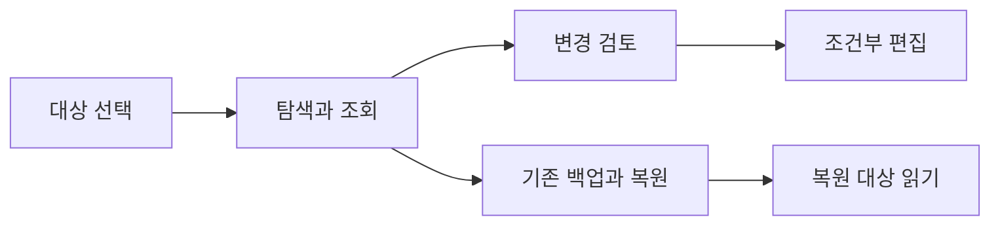

# Personas and Journeys

두 persona는 실제 인터뷰 인물이 아닌 과업 기반 추론이다. 신규 인증 역할을 추가하지 않는다.

## Persona 1 — DB 개발자
목표: schema 탐색→SQL 확인→필요 행만 안전하게 수정. 기술: SQL 가능. 빈도: inferred daily. 불만: 대상 혼동, 큰 결과 정지, 정밀도 손실.
| 단계 | 행동 | 감정/필요 | 터치포인트 | 기회 |
|---|---|---|---|---|
| 진입 | Workspace/Target/credential 선택 | 환경 확신 | header | identity/mode 상시 표시 |
| 탐색 | schema/table/FK | 빠른 탐색 | explorer/grid | lazy pages/unknown count |
| 조회 | SQL/Explain/transaction | 진행·취소 확인 | editor/results | bounded batches |
| 수정 | draft review/apply | 충돌 불안 | review panel | typed original comparison |
| 확인 | 재조회·보호 확인 | 결과 신뢰 | result/protection | unknown 별도 대조 |

## Persona 2 — 복구 운영자
목표: 보호 범위 설정, 복구된 실제 DB 확인. 기술: 운영 경험. 빈도: inferred scheduled/incident. 불만: 성공과 실제 검증 혼동.
| 단계 | 행동 | 감정/필요 | 터치포인트 | 기회 |
|---|---|---|---|---|
| 탐색 | DB/table identity | 범위 확신 | explorer | exact identity→Scope |
| 보호 | 기존 plan/run | 진행 근거 | Backup Plans | 별도 lifecycle |
| 복구 | 기존 preflight/restore | 원본 보호 | Recovery | confirmation 유지 |
| 검증 | restored target 읽기 | 대상 검증 | Workbench | new readonly session/fallback 금지 |

