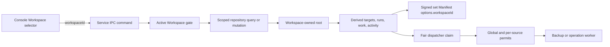

# Workspace v1 Implementation Blueprint

## Decision

Workspace is a local operational ownership boundary, not a SaaS tenant. The service remains one
Windows service with one Operational Store and one global resource governor. Operators select one
Workspace at a time in the console; all configuration, execution, activity, snapshot, and recovery
commands carry its `workspaceId`.

Existing installations upgrade in place. Every existing resource is assigned to the immutable
`Default Workspace`; no connection, plan, run, or snapshot is dropped or rewritten.

The console starts at an installation-wide Workspace dashboard. Operators compare configuration
and active-work evidence there, then enter one Workspace for protection, activity, and recovery
details. The rail selector remains a fast switcher inside the selected Workspace.

## Alternatives considered

| Alternative | Benefit | Rejected because |
|-------------|---------|------------------|
| Add `workspace_id` to all v2 tables | Simple reads | SQLite parent-table rebuilds put 53-table FK history at unnecessary migration risk |
| Separate SQLite file per Workspace | Strong file isolation | Duplicates global runtime state, complicates service-wide permits and cross-workspace fairness |
| Ownership tables over the v2 schema | Additive, reversible, FK-backed migration | Selected; derived objects inherit ownership from their root |

## Ownership boundary

Workspace-owned roots:

- Connection Profile; Database Target inherits through its Connection Profile.
- Destination.
- Backup Plan; revision, occurrence, and Backup Run inherit through the plan.
- Work Item; ownership is materialized for fast fair claiming.
- Activity Event; ownership is materialized for a stable per-Workspace feed.
- Recovery Point; Snapshot and verification evidence inherit through the Recovery Point.

Global resources:

- Service health and execution authority.
- Native tool inventory and Engine Matrix certifications.
- Resource pools, spool volumes, global worker ceiling, and control-store backups.

## Schema v3

`workspaces` plus seven FK-backed ownership/state tables are appended to schema v2. Insert triggers
assign derived work and activity automatically. Existing roots are backfilled to
`00000000-0000-4000-8000-000000000001` (`Default Workspace`). Plan membership triggers reject a
Database Target or Destination owned by another Workspace.

Names are unique inside a Workspace. Cross-Workspace duplicate connection, destination, and plan
display names are allowed.

## Command flow

## Fair scheduling

The global worker ceiling remains four. Claim selection first chooses the Workspace with the oldest
`last_claimed_at_ms`, then uses the existing priority and due-time order inside that Workspace. A
single active Workspace may use all idle workers; once another Workspace has queued work, subsequent
claims rotate to it. Existing source and destination permits remain authoritative.

## Console information architecture

The default `#/workspaces` route is a dense Data Instrument rather than a card directory:

1. Global Workspace, managed-target, active-work, and incomplete-setup counts.
2. Search and evidence-aware sorting, with incomplete setup ahead of active work and configured
   Workspaces.
3. A comparison table for database targets, plans, destinations, active work, and latest activity.
4. Workspace creation and row entry into the existing `#/overview` detail route.

The fleet page deliberately labels a fully wired Workspace as `configured`, not `healthy`.
Backup success, RPO compliance, verification freshness, and replica durability remain evidence
axes on the selected Workspace overview until the service exposes those axes in the global query.

## Compatibility

- Schema v2 databases migrate v2 to v3 in one additive transaction.
- Signed set Manifest schema stays at v2. `workspaceId` is stored in its signed `options` map, so old
  readers remain compatible and old manifests resolve to `Default Workspace`.
- All existing internal repository methods keep Default Workspace behavior while service-facing
  methods require explicit scope.

## Verification gates

1. Fresh schema v3 and populated v2 upgrade tests.
2. Cross-Workspace plan-membership rejection and same-name isolation tests.
3. IPC tests proving list/create/mutation scope.
4. Fair claim tests with two Workspaces and idle-capacity tests.
5. Console unit tests for persisted selection and request propagation.
6. Full Rust and console test/lint/build gates.
7. Installed development-service migration and rendered UI inspection.

## Verification record (2026-08-13)

- `cargo test --workspace -j 2`, `cargo fmt --all -- --check`, and
  `cargo clippy --workspace --all-targets -- -D warnings` passed. Tests that require managed
  PostgreSQL, MinIO/SFTP, or Windows Task Scheduler fixtures remain explicitly ignored.
- Console Vitest passed 31 tests across 13 files; Playwright passed 33 tests at 1024, 1280, and
  1600 pixel desktop widths, including Workspace creation, persisted selection, request scoping,
  fleet filtering and entry, accessibility, fonts, and responsive navigation.
- The installed development service migrated in place to schema v3 with 61 application tables.
  A production-pipe read-only integration test returned `Default Workspace` from that service.
- The release Tauri console opened against the installed service and rendered the Workspace
  dashboard, selector, actual `Default Workspace` counts, and `rehearsal_ready` execution status.
  Production work claiming remains intentionally disabled until the G1 cutover gate is approved.
